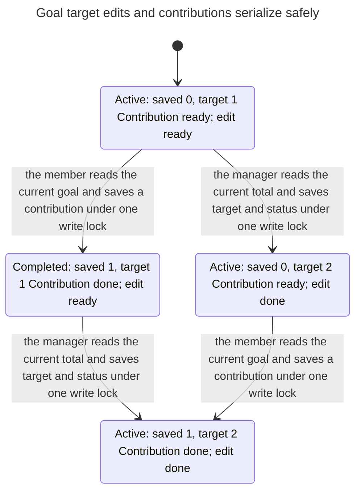
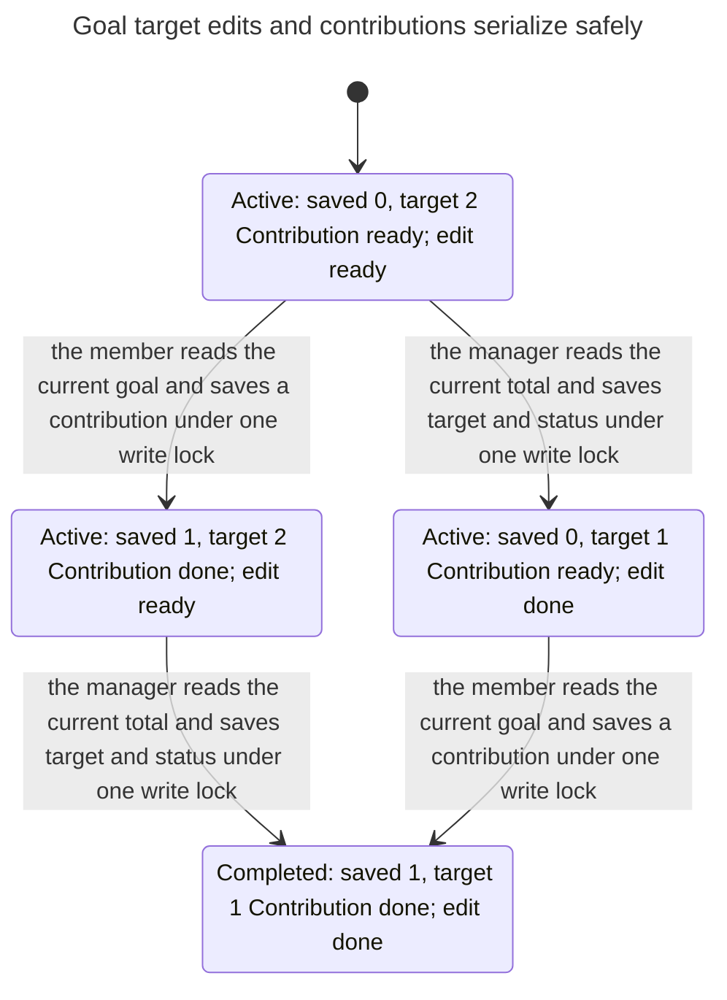

# Goal completion race fixes: verification passes

Verified on 2026-11-12 against fix commit `72d55f369ab9b5bf040a150c8661ec99bb4f0e3e` (based on `93e565f833c5fa3ae49006f5ed596db5e4ce3999`). Fixed `src/lib/store.ts` SHA-256: `dc59002eef8c73dcde28b8318ade5fa2d068f9c76a23f1b0be981ce4b81def16`.

## Fix and actual atomic boundaries

Both completion invariants are unchanged:

- **CompletionSound:** a completed goal's persisted total must meet its persisted target.
- **CompletionRecognized:** a goal whose persisted total meets its persisted target must be completed.

`addContribution` previously cached the target before taking its write lock. `updateGoal` previously read the total outside a write transaction. Both now acquire SQLite's write lock before those reads, keeping status calculation and persistence together. The lifecycle rule and conditional status-update semantics are unchanged.

| Model action | Code | Atomic boundary |
| --- | --- | --- |
| CommitContribution | [addContribution](../../../src/lib/store.ts:1145) | One BEGIN IMMEDIATE transaction includes membership/goal SELECT, validation, username SELECT, INSERT, SUM, conditional status UPDATE and returned ID. |
| RejectCompletedContribution | [completed guard](../../../src/lib/store.ts:1148) | Rejection inside the same transaction; no persisted changes. |
| CommitEditor | [updateGoal](../../../src/lib/store.ts:1111) | One BEGIN IMMEDIATE transaction includes goal SELECT, manager check, validation, SUM, and UPDATE of target/status. |
| Done | Return from both requests | Terminal stutter. |

The model combines the reads/writes only because the implementation now wraps them in transactions. It does not assume an application-level mutex or weaken an invariant while a request is pending. Other writers serialize through SQLite, including across processes. Failed or waiting lock attempts have no persisted effects in this safety model.

## TLC and statechart results

TLA+ models the permitted order of the two transactions. Both configurations were rerun through TLC and **/statechart**:

| Configuration | Bounds | Reachable states / steps | Rules |
| --- | --- | --- | --- |
| Raise | Initial target 1, edited target 2, one contribution of 1 unit | 4 / 5 | CompletionSound, CompletionRecognized, TypeOK, NoDeadlock all hold. |
| Lower | Initial target 2, edited target 1, one contribution of 1 unit | 4 / 5 | CompletionSound, CompletionRecognized, TypeOK, NoDeadlock all hold. |

One unit is 100 minor units. One initially active goal, zero initial contributions, one accepted member's contribution, one authorized manager's target edit. Both operation orders are explored. No symmetry, VIEW reduction, fairness assumptions, state/action constraints, or waived invariants are used. **No configured rule was left unchecked.**

The charts hide only the terminal self-loop. Each shows four states and four visible transitions. No state violates a configured invariant.

- Raise: [report](evidence/raise/report.md), [TLC](evidence/raise/tlc.out), [SVG](evidence/raise/chart.svg), [Mermaid](evidence/raise/chart.mmd).
- Lower: [report](evidence/lower/report.md), [TLC](evidence/lower/tlc.out), [SVG](evidence/lower/chart.svg), [Mermaid](evidence/lower/chart.mmd).

## Real SQLite replay

[replay.mjs](replay.mjs) uses the actual store implementation and a disposable WAL file with two connections. It attempts the formerly failing insertion points: a target edit after the contributor's goal read, and a contribution after the editor's SUM read. Both now encounter a real SQLite write lock. The probe connection uses timeout=0 so these attempts immediately return SQLITE_BUSY; it retries after the first transaction finishes. Production's timeout configuration is unchanged. No query result, lock result or store operation is mocked.

| Target edit | Operation order | Final target / raised / status | Next contribution |
| --- | --- | --- | --- |
| Raise | Contribution, then edit | 200 / 100 / active | Accepted |
| Raise | Edit, then contribution | 200 / 100 / active | Accepted |
| Lower | Contribution, then edit | 100 / 100 / completed | Rejected |
| Lower | Edit, then contribution | 100 / 100 / completed | Rejected |

Sequential equality also passes. [Normal verification output](evidence/baseline.out) records exit-0 results. The probes are a deterministic store-boundary replay, not a measurement of deployed worker topology or a production timeout/retry test.

## Deliberate scratch breaks

The self-test copies real source outside the repo and separately:

1. Moves the contribution's goal/status read outside its write transaction: the competing target edit succeeds, and **CompletionSound** fails.
2. Removes the target edit's transaction: the competing contribution succeeds, and **CompletionRecognized** fails.
3. Changes lifecycle equality `>=` to `>`: a fully funded goal remains active, violating **CompletionRecognized**.
4. Completes unconditionally: an underfunded goal becomes completed, violating **CompletionSound**.

Each mutation was caught for that reason. Scratch copies/databases were deleted; all five original replay cases and their lock probes passed again afterward. [Self-test output](evidence/self-test.out) contains the actual rows and outcomes.

The original shortest five-step counterexamples and red charts are retained as [historical evidence](evidence/before/REPORT.md). They describe the pre-fix code, not the current model.

## Validation and scope

Passed: normal checker, detector self-test, statechart for both configurations, all 335 tests (including 47 store tests), TypeScript typecheck, full ESLint, 7 browser tests, production build on retry, and diff whitespace check. The first build completed compilation but stopped on the installed Next.js dependency advisory gate; the retry exited 0. Dependency upgrades remain outside this change.

The model still excludes arbitrary amounts/overflow, additional contributions/edits/goals, archived goals and succession, membership revocation, other goal operations, authorization, idempotency/retries, crash/rollback recovery, busy-timeout behavior, liveness/fairness, assistant debts and actual deployment topology. This is a bounded safety result for the two fixed operations, not a whole-repository proof.

## Rerun

```sh
node .agents/skills/verify-goal-concurrency/check.mjs
node .agents/skills/verify-goal-concurrency/check.mjs --self-test
```

Both now exit 0. Read [SKILL.md](SKILL.md) for tool setup, source-sync checks, assumptions and /statechart interpretation. For fresh charts, invoke /statechart and follow its currently installed instructions on the spec/config/view copied to the checker's printed scratch directory, using new output directories.

## Full statecharts as Mermaid

### raise target



### lower target


