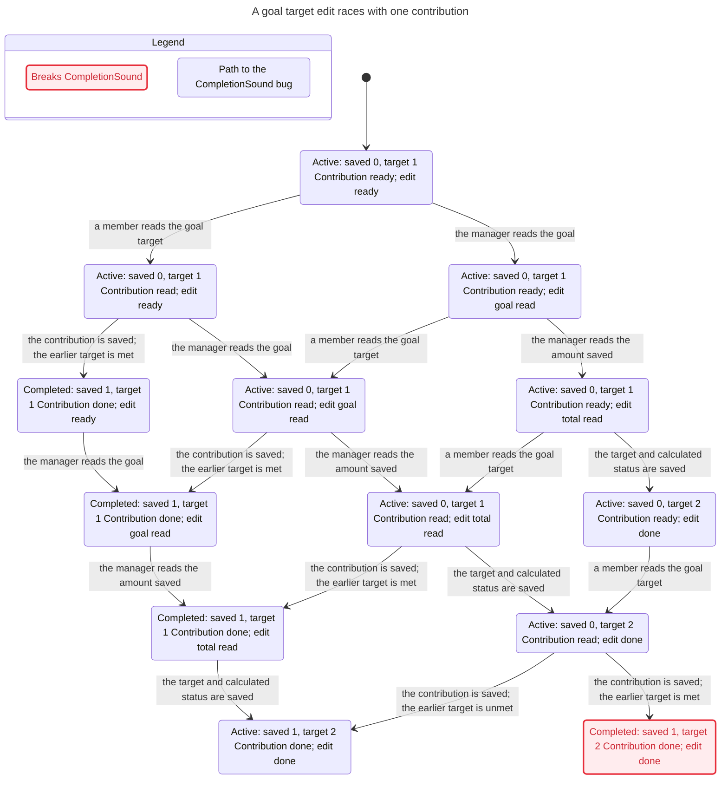
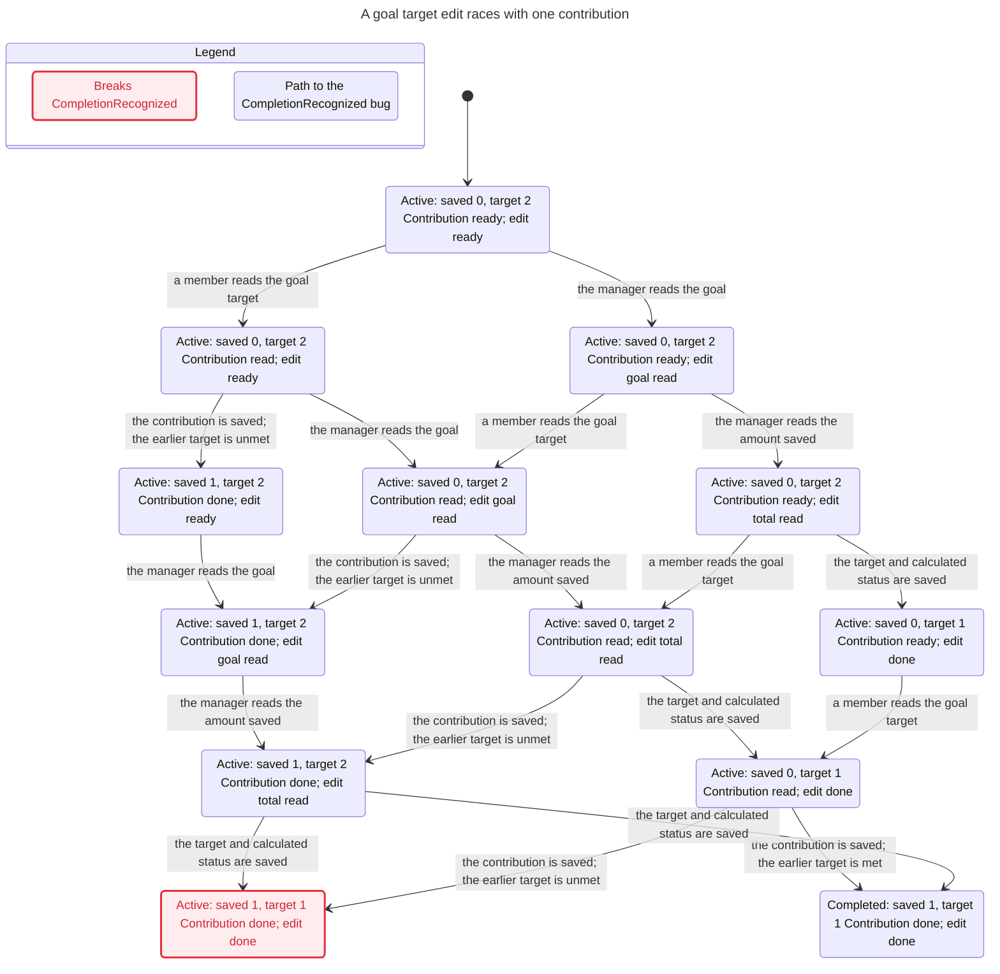

> Historical evidence before the fix. The current report is [here](../../REPORT.md).

# Confirmed goal completion races

Verified at `c006c65d648a8c8e43a3871fb527d2d2eb82ca9a` on 2026-11-12. Product source is unchanged. TLA+ fits this question because the defect depends on the ordering of database operations; SQLite tests confirm that the model describes the actual implementation.

## Contract and impact

For an unarchived goal, status must be completed exactly when its persisted contribution total meets its persisted target. [nextGoalStatus](../../../../../src/lib/lifecycle.ts) states this rule. Existing `tests/store.test.ts` covers sequential completion and reopening; it does not schedule two SQLite connections between reads and writes.

Two workers sharing the SQLite file are required. [db.ts](../../../../../src/lib/db.ts) opens a WAL database and caches a connection per process. This work does not establish whether the hosted deployment currently has multiple workers. The same synchronous functions in one Node worker do not interleave.

## Action-to-code map

| Model action | Real code | Actual atomic boundary |
| --- | --- | --- |
| ReadContributionGoal | `store.ts:1144`, `requireGoalMember` at `1084` | One autocommit SELECT outside the transaction; target and status are cached. |
| RejectCompletedContribution | `store.ts:1145` | Local guard after that SELECT; no writes. |
| CommitContribution | `store.ts:1150` through `.immediate()` at `1155` | One BEGIN IMMEDIATE transaction: INSERT, SUM, conditional status UPDATE. No interleaving inside it. |
| ReadEditorGoal | `store.ts:1112`, `requireGoalMember` | Separate autocommit SELECT. Cached active/completed status has the same lifecycle calculation in this scope. |
| ReadEditorTotal | `store.ts:1123`, `safeGoalTotal` at `398` | Separate autocommit SUM SELECT. |
| CommitEditor | `store.ts:1125` | One autocommit UPDATE changes target and status together using the earlier SUM. |
| Done | Return from both requests | Terminal stutter; prevents false deadlocks. |

Entry points: [target edit](../../../../../src/app/api/goals/[id]/route.ts) and [contribution](../../../../../src/app/api/goals/[id]/contributions/route.ts). Validations and the username SELECT are omitted as stuttering steps: inputs, identities and membership are held fixed. ReadEditorGoal remains a distinct action despite not changing financial values. No actual transaction is split or expanded to cover earlier reads.

## 1. CompletionSound breaks: a completed goal must have met its target

Shortest path: **5 actions**, statechart report steps **0–5**. Start with no contributions and target ₱1.

1. A member reads the target as ₱1 (`addContribution`, line 1144).
2. The manager reads the goal (`updateGoal`, line 1112).
3. The manager reads the contribution total as zero (line 1123).
4. The manager raises the target to ₱2 and saves active status (line 1125).
5. The member saves ₱1 and marks the goal completed using the cached ₱1 target (lines 1150–1155).

**Real-code result:** `target=200`, `raised=100`, `status=completed` (minor units). A subsequent contribution throws `This goal is complete. Its manager must raise the target before continuing.` This blocks needed contributions.

Evidence: [TLC output](raise/tlc.out), [statechart shortest path](raise/report.md), [Mermaid](raise/chart.mmd), [rendered SVG](raise/chart.svg).

## 2. CompletionRecognized breaks: a goal at target must be completed

Shortest path: **5 actions**, statechart report steps **0–5**. Start with no contributions and target ₱2.

1. A member reads the target as ₱2.
2. The manager reads the goal.
3. The manager reads the contribution total as zero.
4. The member saves ₱1; the cached ₱2 target keeps status active.
5. The manager lowers the target to ₱1 but saves active status calculated from the earlier zero total.

**Real-code result:** `target=100`, `raised=100`, `status=active`. A subsequent contribution is accepted even though the target is already met.

Evidence: [TLC output](lower/tlc.out), [statechart shortest path](lower/report.md), [Mermaid](lower/chart.mmd), [rendered SVG](lower/chart.svg).

## Real implementation replay and deliberate breaks

The historical replay (superseded by the current replay.mjs) calls real `createStore`, `addContribution`, `updateGoal` and SQLite statements against a disposable file using two connections. A scheduler wraps SQLite operations to place the second operation at the exact boundaries from the shortest path. It never supplies fake query results or writes its own goal/contribution records. Each contribution transaction runs wholly before or wholly after the manager's UPDATE. The scheduler is deterministic, not a stress test and not proof of the production worker topology.

The persisted row and follow-on contribution result are the oracle. The replay asserts the exact five-action order in self-test mode. It also checks the sequential equality control, which passes on current code.

Two independent scratch copies demonstrate sensitivity:

- Changing `nextGoalStatus` from `>=` to `>` leaves a fully funded sequential goal active: CompletionRecognized fails and another contribution is accepted.
- Replacing that predicate with `true` marks an underfunded sequential goal completed: CompletionSound fails and another contribution is rejected.

Both breaks were caught for their intended reason. The scratch copies/databases were deleted in `finally`; all three original cases were replayed afterward, returning to just the two known races. [Self-test output](self-test.out) records the observations. [Normal checker output](baseline.out) records the expected nonzero baseline check.

## Bounds, results, and unchecked rules

Each configuration explores one goal, one contribution of one model unit (100 minor units), and one target edit. Initially raised=0, status=active. Targets are 1 and 2 units. `raise.cfg` uses 1→2; `lower.cfg` uses 2→1. Stable authorized manager and accepted member, valid inputs, successful SQLite operations. Transactions serialize; autocommit statements may interleave. No symmetry, VIEW reduction, fairness assumptions, or state/action constraints are used.

Statechart's continued exploration reached **17 states / 23 steps** for raise and **16 states / 22 steps** for lower. Its visual labels merge a few states: both charts show 13 visual states. It omits only steps whose visible label stays unchanged (4 raise / 3 lower), including terminal stutter; no bug-path step is hidden.

| Configuration | Violated | Other checked rules |
| --- | --- | --- |
| Raise | CompletionSound | TypeOK, CompletionRecognized, NoDeadlock hold within this model. |
| Lower | CompletionRecognized | TypeOK, CompletionSound, NoDeadlock hold within this model. |

**Rules not checked by statechart: none of the configured rules.** The raw first TLC run stops on a violation, so its counts (16/15 distinct states) differ from the continued statechart exploration above. The statechart counts describe the continued exploration, not a larger input bound.

Unmodeled contracts: archived terminality/succession, authorization revocation, other goal operations, multiple contributions/edits/goals, retries/idempotency, crash/rollback recovery, SQLITE_BUSY/timeouts, arbitrary amounts/overflow, liveness, assistant transactions, and actual deployment topology. These results establish neither a repository-wide proof nor safety for larger bounds.

## Rerun

Run `node .agents/skills/verify-goal-concurrency/check.mjs` from the repo root; exit 1 is expected until repaired. For detector validation, add `--self-test`; expected exit 0 acknowledges existing findings rather than suppressing them. The checksum-pinned tool and scratch directory setup are in the checker.

For fresh shortest paths and charts, invoke **/statechart**, follow its current installed instructions, and give it the copied `GoalConcurrency.tla`, each copied config and `view.mjs` printed by the checker. Choose new output folders. Refer to [current skill](../../SKILL.md) before interpreting changed source or updating the sync commit.

## Full statecharts as Mermaid

### Raise target

### Lower target

