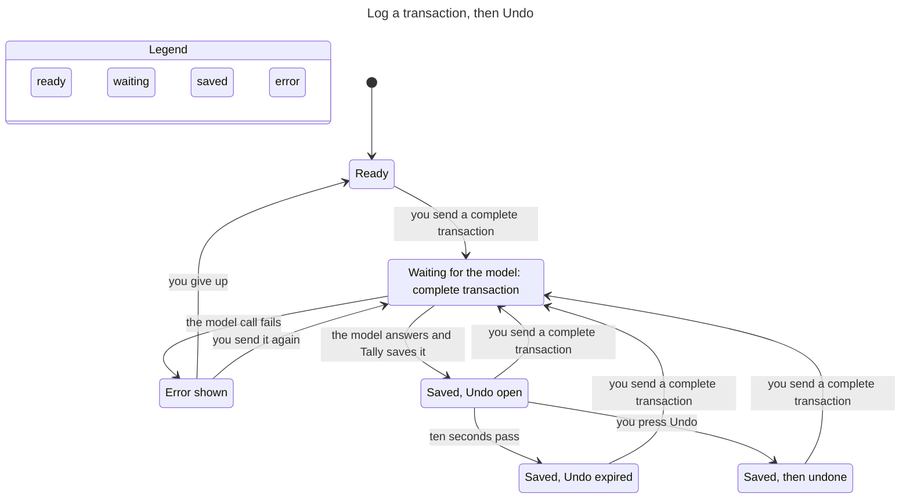
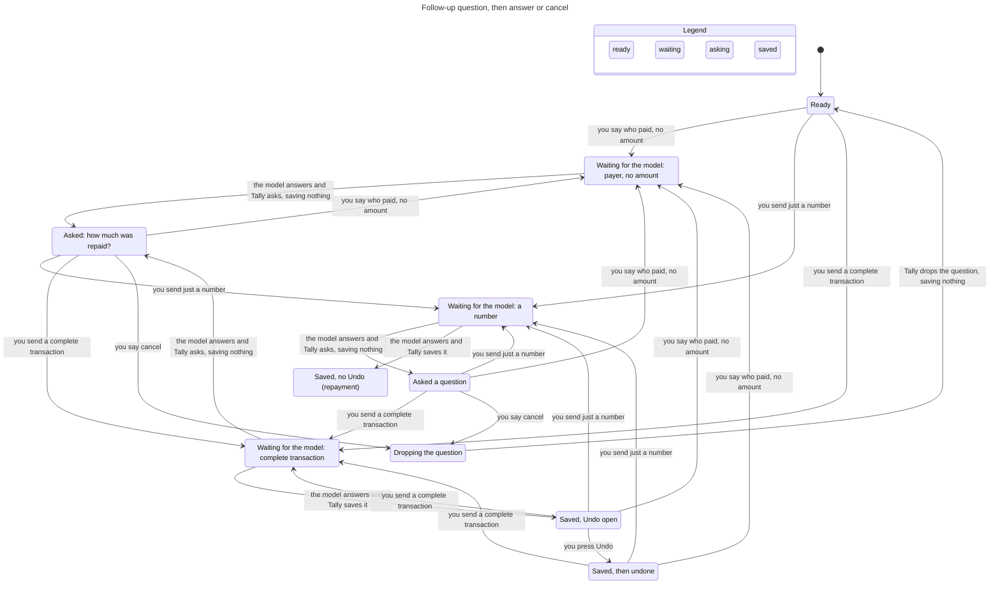
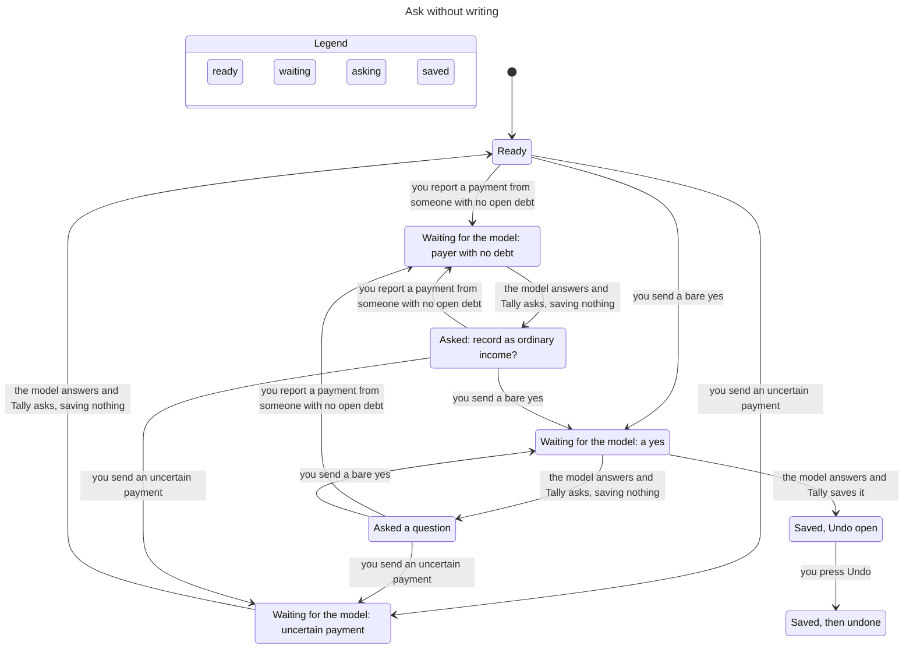

# Assistant state machines

Subsystem: Ask Tally (`src/lib/assistant.ts`, `src/lib/machines/assistant.ts`, `src/lib/provider.ts`, `src/lib/assistant-followup.ts`, assistant routes, assistant parts of `src/lib/store.ts`). Verified by `.claude/skills/verify-assistant` (sync commit `d180cb3`). Flow 2 was regenerated from a TLC dump of `model/flows/follow-up.cfg` with the views in `model/views` and rendered with Pele. Flows 1 and 3 did not change and are the earlier hand-edited charts, because the `/statechart` command is not installed here. Regenerate them with it when it is available (`model/views/*.mjs` and `model/flows/*.cfg`).

## Inventory

### 1. Access (consent), stored in `users.assistant_opt_in` and `assistant_consents.disclosure_hash`

| State | Meaning |
|---|---|
| off | `assistant_opt_in = 0` |
| on | opted in and stored hash equals `providerDisclosureHash()` |
| stale | opted in, but the provider disclosure changed since (hash differs) |

Transitions: `setAssistantConsent(hash)` off/stale to on, `setAssistantConsent(null)` to off (`store.ts`). A disclosure change makes on become stale without any write. The state comes from `getAssistantConsent`, and `canWrite` (`machines/assistant.ts`) is the only rule that lets a write happen. Access is checked once per request by both routes (`api/assistant/route.ts`, `api/shortcuts/assistant/route.ts`, the latter after credential lookup and a 30/min limiter), and again inside the turn's commit transaction before any write (`assertAssistantAccess` in `commitTurn`, fixed in `d05bb50`). Every path that stores a turn goes through `commitTurn`, including the local debt-list answer that never calls the model, so none can skip the recheck.

### 2. Request, one POST to runAssistantPrompt

| State | Meaning |
|---|---|
| idle | no request running |
| requesting | model call in flight; nothing is stored yet |
| errored | the model call threw, consent or the chat was gone at commit, the conversation moved on while the model ran (409), or the reply insert threw |

Transitions: send idle to requesting. Requesting to idle when the turn commits: the user message, the write (if any) and the reply are stored in one store transaction (`commitTurn`, `store.transaction`). Requesting to errored when the provider fails or the commit is refused, and then nothing is stored (`d05bb50`, `3f73ccd`). A reply insert that throws rolls the write back too (`c6f5d5b`). The commit is also refused when the conversation no longer ends at the message the turn read before the model call, because another request committed first (`turnMayCommit`, checked inside the commit transaction against `store.lastMessageId`). That turn stores nothing and the route answers 409 "Your conversation changed while this ran. Send that again." The check covers every stored turn, a new chat included, which must still have no message. Two requests that overlap in one conversation therefore never both commit, whatever they say. A resend reads the conversation again and runs as a new turn.

### 3. Pending follow-up, the question the last assistant message waits on

Stored on the assistant message as `followup_kind` (`store.ts`, 17 kinds in `assistant-followup.ts`). Read back only if the **last** stored message is an assistant reply with a kind (`minimalFollowUpContext` in `provider.ts`). The open run is the messages since the last reply that asked nothing. The reply that drops a question asks nothing, so a later turn ("Wallet" answering "Which account?") never reloads the dropped question. The whole run reaches the model. The local reading of it splits in two. A hint that chooses a value (the account, date, time and category, and an opt-in to Transactions) reads only the statement the write is for, which is the messages that belong to the pending question from the latest one that started a different statement (findings 18 and 19), and a guard that can only refuse or ask reads the whole run (see finding 10), so no message is ever trimmed away. Its length is bounded by policy instead, because choosing which messages to keep is a guess that kept dropping the statement or the correction a later answer depends on (see finding 8). The model has no message history, so the boundary of the run is pinned by replays and route tests, not by an invariant. It counts the turns of the open run (`runLen`, two messages each) against a small `RunMax` and checks the limit with `OpenRunBounded` and `ExpiryWritesNothing`. Modeled kinds: none, clarification, ordinary_income, repayment_amount, repayment_payer.

Four things end a pending question. **An exact cancel drops it, an answer that resolves it ends it, a completed write ends it, and a run that has grown too long ends it.** A hedged or negated reply to a repayment question is an answer of the second kind, because the uncertainty guard asks first, writes nothing and clears the question. The one exception is a refusal said in an earlier turn of the run, a quiet turn included, followed by a turn that would write (the yes to the income question, a bill, an amount): that turn asks again, writes nothing and leaves the question pending, so cancel still drops it (`refusalOutcome` returns `askAgain`, finding 11). A turn that asks a question of its own replaces the pending one with it. Nothing else changes it. A turn that only reads the ledger, which is the local debt list and a finance answer, is none of the four, so the question stays pending. A finance question at a pending ordinary income question, or at its account or date clarification, is answered like any other and leaves that question pending, so the next message that is itself a yes still records the income (`ordinaryIncomeTurn` returns `read`). So does a bill that was saved without asking anything, when the pending question is not about a bill. Their reply is stored with the same pending kind, and with the debt the question offered, so the next answer still resolves the question and a cancel still drops it. A saved bill is the answer to a pending bill question, whichever bill kind it was, so that question ends with the save and the reply stores no pending kind (`followupAfterTurn` in `machines/assistant.ts`, used by `runAssistantPrompt`). With nothing pending, a read-only turn stores no question, so a normal single turn is unchanged. The cancel rule for a new prompt is `pendingOutcome` in `machines/assistant.ts`, and it is closed. **An exact cancel is the only text that drops a pending question on purpose.** The whole prompt, trimmed, case-folded and stripped of punctuation, must equal one of `cancel`, `never mind`, `nevermind`, `skip`, `forget it`, `stop`, `ayoko na`, `wag na`, `huwag na` or `di na`. The turn then calls no model, writes nothing and stores no pending kind (the `pendingOutcome` check in `runAssistantPrompt`, before the model call). The reply comes from `cancelReply`. It is "Okay, I dropped that question. Nothing was recorded." for a question asked before anything was saved. When the dropped question is the offer to add a just-saved debt to Transactions, or a question that continues it (the account or date it asked for), the debt is already in Debts, so the reply is "Okay, I dropped that question. The debt stays in Debts, and nothing was added to Transactions." A bill saved under a question that is not about a bill leaves that question pending, so a cancel then says "Okay, I dropped that question. The bill stays in Bills, and nothing else was recorded.", and a run that saved both says "The debt stays in Debts and the bill stays in Bills." The run decides all of that (`runSaved` looks for replies that carry a debt or a bill, and the store keeps the bill on the reply that saved it), because only the offer itself has a kind of its own. A bill question never stays pending after its bill was saved, so a cancel is then an ordinary prompt. The rule holds for every pending kind, bill questions included. With nothing pending, a cancel phrase is an ordinary prompt. **Every other reply is an answer.** The pending context is kept and the handling from main runs, so a reply it cannot read asks again and writes nothing. No text decides whether the question is dropped any more. The wording guards from main still run, and they only make the turn ask or refuse.

**A run that grows too long is ended, not trimmed.** An open run holds at most 24 messages (`MAX_OPEN_RUN_MESSAGES` in `machines/assistant.ts`). A turn that finds the run already at 24 and is not an exact cancel would extend it, so it ends the question instead (`runExpired`, checked in `runAssistantPrompt` right after the cancel check and before the model call). It calls no model, writes nothing and stores a reply with no pending kind. The reply is "That question has been open too long, so I dropped it. Nothing was recorded. Please send the details again." (`expiredReply`). When the run already saved a debt or a bill it ends with the same sentence as the cancel reply, for example "That question has been open too long, so I dropped it. The debt stays in Debts, and nothing was added to Transactions." Every kind of turn extends a run, so re-asks and the read-only turns that carry the question forward count the same, and so does an answer. The next prompt starts a clean run, and an exact cancel at the limit still gets the cancel reply. The turn commits through `commitTurn`, so the consent recheck applies as for any turn.

When the code asks a question again while one is pending, the re-ask ends with one sentence that names the way out (`cancelHint` in `machines/assistant.ts`). The repayment amount question adds "Reply with the amount, or say cancel to drop this.", the payer question "Reply with the person's name, or say cancel to drop this.", and the ordinary income, account or date and bill questions "Or say cancel to drop this." A first ask has no hint. The account or date question that follows a yes to the income question names how to confirm instead, because the yes is not carried over (`incomeConfirmHint`): "Reply with yes and the account, like \"yes, Wallet\", or say cancel." The repayment and income questions lead to each other, so any of them asked right after any of them carries it. Other kinds carry it only when the same question repeats. A question the model worded itself and the offer to add a debt to Transactions never carry it, because they are not plain re-asks. That holds whatever kind the model's question is stored under. During a repayment with no amount yet it is stored as `repayment_amount`, so a later bare amount still answers it, and it is shown as the model wrote it ("Which account did Ana send it to?"), not followed by "Reply with the amount". The hint is text and is not modeled.

| Pending | New prompt | Outcome |
|---|---|---|
| any kind | the exact cancel phrase: "cancel", "Never mind.", "wag na" | drops the question. No model call, nothing written, the reply asks nothing (the same check) |
| any kind | any prompt but an exact cancel, when the open run already holds 24 messages | ends the question. No model call, nothing written, the reply asks nothing and says the question was open too long (`runExpired`). The next prompt is an ordinary one |
| any kind | the debt list, such as "List my debts" | answers it locally, writes nothing and leaves the question pending with the same kind, until the run holds 24 messages. The next answer still resolves it |
| any kind | a finance question such as "How much did I spend this month?" | answers it from the ledger, writes nothing and leaves the question pending with the same kind, until the run holds 24 messages. The refusal decision leaves a finance answer alone while a question is pending (`refusalOutcome` returns `proceed` for a read) |
| any kind but a bill kind | a bill request that saves a bill and asks nothing | saves the bill, which is its own write with its own dialog, and leaves the question pending |
| a bill kind | a bill request that saves or updates a bill and asks nothing, such as the amount a bill question asked for | saves the bill and ends the question. The reply stores no pending kind, so the next prompt is an ordinary one and a cancel is an ordinary prompt too |
| any kind | a bill request that asks its own question | the bill question takes over the pending slot and the earlier question is not asked again. This is a known limit |
| ordinary_income, or its account or date clarification | a message that itself starts with yes (yes, yeah, yep, sure, okay, ok, go ahead, record it, record that), such as "yes" or "yes, Wallet" | the only reply that records the income (`isIncomeConfirmation`, `ordinaryIncomeTurn` returns `write`). The write needs the account and date, and when they are missing the reply asks for them and says how to confirm: "Reply with yes and the account, like \"yes, Wallet\", or say cancel." The account comes from the current reply only: its own yes and account ("yes, Maya", with the date allowed after it, "yes, Maya, 2026-10-05"), or when it names none, the cue word, the provider or the default, as for any other write. When an earlier confirmation of the same income question chose an account and the current reply names none, the write asks again and echoes the choice: "You chose Maya earlier. Reply with yes and the account, like \"yes, Maya\", or say cancel." (`incomeAccountChoice`, `incomeChainAnswers`, `incomeChainAccount`) |
| ordinary_income, or its account or date clarification | exactly "no", "nope", "nah", "no thanks", "no thank you", "hindi" or "ayoko", ignoring case and punctuation (`isOrdinaryIncomeDecline`) | declines the income. It is not a cancel. Nothing is written, the reply says the money was not recorded and the question ends. A decline only ends the question and never authorizes anything |
| ordinary_income, or its account or date clarification | any other reply that is not read-only: "Wallet", "Don't record it", "I changed my mind, don't record it", "Wallet, but don't record it", "Actually, skip recording it as income", "Not as income", "Hold on, don't record that", "No, use Wallet. I still want to record it as income.", "not now" | writes nothing and asks the income question again with the cancel hint (`ordinaryIncomeTurn` returns `askAgain`). The question stays pending as ordinary_income, so "yes, Wallet" still records and cancel still drops it. A yes said earlier in the run is never carried forward as authorization (an account it named is, see finding 16) and no refusal wording is read, so a refusal worded any way writes nothing. The accepted cost is that a bare "Wallet" after the account question asks once more |
| repayment_amount | an amount the strict reading accepts, digits with an optional peso sign or word and nothing else: "500", "1,000.50", "₱500", "500 pesos" | answers it, saves the repayment (`bareAmountFromPrompt`) |
| repayment_amount | an amount with a detail, shorthand or hedge-like word: "500 cash", "5k", "P500", "500 sa GCash", "about 500", "500 last night", "it was 500" | asks for the amount again, keeps the question, writes nothing |
| repayment_amount, repayment_payer | a hedged or negated reply: "maybe 500", "I think 500", "not 500", "500?" | the uncertainty guard asks first, writes nothing and clears the question (the `uncertainRepayment` branch) |
| ordinary_income | a hedged or negated reply: "maybe", "I think so", "not sure" | `ordinaryIncomeFlow` runs before the uncertainty guard, so the guard never sees it. The question is asked again with the cancel hint, stays ordinary_income and nothing is written (the `ordinaryIncomeFlow` branch) |
| repayment_amount, repayment_payer | payment wording, uncertain or negated | answers it through the existing branches (`uncertainRepayment` and `repaymentIntent`) |
| repayment_payer | a name with an open debt | answers it (the payer is matched to the debt) |
| repayment_amount, repayment_payer, ordinary_income | an unrelated prompt, however complete: "Coffee 120", "she paid back the food money, 500", "for the food, 500", "siguro Food 500", "to Food Wallet 500" | asks the question again with the cancel hint and writes nothing. This is a deliberate limit. The user says cancel and sends the prompt again |
| none | payment with no matching open debt | asks ordinary_income (the `repaymentIntent` branch with no matching debt) |
| none | payer known, amount missing | asks repayment_amount (the `repaymentIntent` branch with no stated amount) |

The amount is read as strictly as on main. An earlier version also accepted dates, account names, `k` and `m` shorthand and filler words as an amount answer, and let a named account override the model's. It was removed because a doubtful reply was then recorded as an exact repayment. Detailed or hedged amount replies now re-ask and write nothing. That is the deliberate safe default.

Debt repayment rule from `AGENTS.md`: ask without writing when wording is negated or uncertain, no debt matches, several debt counterparties are named, the model selects a different payer, or the payment exceeds the balance. This table does not change those rules.

### 4. Undo window, per assistant transaction

| State | Meaning |
|---|---|
| open | `undo_until` set 10 s after save (`undoUntilFor`, `createTransaction`) |
| expired | now > `undo_until` (`canUndo`) |
| used | deleted through `DELETE /api/transactions/:id?undo=1` (`api/transactions/[id]/route.ts`) |
| none | debt repayment: `undo_until` null and `debt_id` set; `deleteTransaction` rejects it (`store.ts`) |

### 5. Conversation, live and then deleted (`deleteConversation`, cascades messages). A new chat is created in the same commit as the first turn that succeeds, so a failed first turn leaves no empty chat. The widget also holds UI state (`assistant-widget.tsx`: `busy`, `conversationId`, `openTransactionControl`); not modeled.

## Flow 1: log a transaction, then Undo

TLC: 24 distinct states, `UndoOnlyInWindow` holds. A model call can fail and be retried; an Undo after ten seconds is not an arrow because the store refuses it.

## Flow 2: follow-up question, answer, cancel, save

TLC: 39 distinct states. Every invariant holds. A complete unrelated prompt sent while a question is pending asks the same question again and writes nothing (the `s4 → s3 → s4` path), and only "cancel" drops it (`s4 → s7 → s0`). A read-only question leaves every state where it is, so it is not drawn (the model has it as the `readOnly` intent, checked by `core.cfg`). Repayments leave no Undo (`RepaymentNoUndo` holds). Model-call failures and consent/chat changes are left out of this chart to keep it readable.

## Flow 3: ask without writing

TLC: 26 distinct states. `UncertainNeverWrites` and `OrdinaryIncomeAsked` hold: an uncertain payment returns to Ready with nothing saved, an unmatched payment asks about ordinary income, and income is saved only after that question and a "yes". The "Saved, Undo open" arrow is the confirmed ordinary-income path.

## Findings (all fixed)

Each finding was replayed against the real code before its fix. The conformance replays in `model/conformance.test.ts` (describe block "regressions") now pin the fixed behavior, and `findings.cfg` (`Legacy = TRUE`) still fails on its four invariants, as `doubt.cfg` (`Doubt = TRUE`) does on `AnswerNotReplaced`, `race.cfg` (`Unchecked = TRUE`) does on `OneWritePerQuestion` and `CancelledNeverAnswered`, and `unbounded.cfg` (`Unbounded = TRUE`) does on `OpenRunBounded` and `ExpiryWritesNothing`, so the checks can fail. `AnswerNotReplaced` also says a read-only turn leaves a pending question pending. A scratch copy of the model where a read-only turn clears the question fails it.

1. **`NoDuplicateIntentWrite`: one request saved twice. Fixed in `c6f5d5b`.** The write and the reply committed separately. A chat deleted during the model call left a transaction with no conversation, and a resend saved a second one. The turn now commits its write and reply in one transaction, so a deleted chat saves nothing and a resend after the 404 saves once. What this guarantees is that a turn which does not commit leaves nothing behind. Two requests in flight at the same time are a separate problem (finding 5).
2. **`WriteNeedsConsent`: save after consent withdrawn. Fixed in `d05bb50`, and again for the local debt-list answer.** Access was checked only before the model call. It is now checked again at commit, before any write. The recheck first lived inside the model branch only, so a local debt-list answer ("List my debts") stored its turn even when consent was withdrawn while the request body streamed. It now sits in `commitTurn` itself, so every stored turn has it.
3. **`FollowupSurvivesError`: a failed model call forgets the question. Fixed in `3f73ccd`.** The user message used to be stored before the call, so after a failure the pending question was no longer the last message. The user message is now stored with the turn's commit, so a failed call changes nothing. It keeps the time the request was received, not the commit time (`receivedAt` in `runAssistantPrompt`), because later follow-ups read relative dates from it. Without that, "lunch today" sent at 23:59:59 and answered "250" after midnight saved on the next day (fixed after review). `addMessage` stored a clamped time at first, never earlier than the latest message of the conversation. That overwrote the received time when the clock moved back two seconds across Manila midnight, and "lunch today" then "250" saved on the next day again (S5, fixed in `497bff8`). The message now keeps its received time as `created_at`, and `getConversation` lists a chat by insertion order (rowid), which is prompt then reply because a turn commits both in one transaction. Pinned by route and store tests, not by the model, which has no dates.
4. **`PlainPromptNotTrapped`: a pending question swallows an unrelated prompt. First fixed in `25e864f` (repayment amount, ordinary income) and `64efa45` (repayment payer), replaced by an explicit cancel in `481a0ff` and `39e0033`.** "Coffee 120" after "What amount should I use for the repayment?" used to get the same question, because the repayment context joined every message since the last finished reply. The first fix let a prompt that looked like a new request replace the question. That was abandoned after four review rounds. Rounds 2 and 3 found allow-list leaks, where wording the filler, hedge, date and account lists did not know counted as a new request ("maybe 500", "500 cash", "She paid 500", "500 to Savings", "5 hundred", "mga 500"), and the round 3 redesign to a positive category-evidence rule leaked the same way. Round 4 found category words inside real answers and payment statements ("she paid back the food money, 500", "for the food, 500", "bayad sa food 500", "She paid 500 for lunch"), hedge words next to a category ("I guess Food 500", "siguro Food 500", "siguro Other income 500"), and an account named like a category ("to Food Wallet 500", where stripping the shorter account "Wallet" first left "food" as evidence). Each wrong replace dropped the pending context and the guards that read it, saved a Food expense with a ten second Undo and left Ana's debt open, and the other direction only asks again. Free text cannot be classified safely, so replacement by text is gone. The user has an explicit way out instead, which is the cancel phrase in section 3. The cost is that an unrelated prompt typed at a pending question is asked about again and must be sent after a cancel. That is a limit we accepted, not an invariant.

   The cancel is persisted. "Ana paid me" asked for an amount, "cancel" dropped the question, and a later "Coffee 120 from Missing" then "Wallet" must not reload the repayment question. The cancel's reply is stored with no pending kind, so `minimalFollowUpContext` starts the run after it. It is replayed by `PlainPromptNotTrapped (fixed)`, `PlainPromptNotTrapped (stays cancelled)` and `PlainPromptNotTrapped (payer)`, and `NoPendingNoCancel` pins that a cancel with nothing pending is an ordinary prompt. `AnswerNotReplaced (category word)`, `(hedged)` and `(detail)` pin that no other reply drops the question or writes.

   The first replacement rule (`232f564`, kept through `2594b66`) replaced on any word beyond amount filler. A hedged reply ("maybe 500", "not 500") lost the pending context, so the uncertainty guard never ran and the provider's `log_transaction` saved a 500 expense while Ana's debt stayed. An amount with a detail ("500 cash", "500 to Wallet") was replaced too, so Tally offered 500 as ordinary income. `doubt.cfg` with `Doubt = TRUE` replays the older replace-on-text rule and fails on `AnswerNotReplaced`.

5. **Two requests on one question (`OneWritePerQuestion`, `CancelledNeverAnswered`). Fixed in `e34c223`.** A turn reads the pending question before the model call and stores its user message only at commit (`3f73ccd`), and the commit never checked that the question was still the one it read. On main the user message was stored before the call, so a second request saw a user message last and had no question. Two cases were reproduced. The answer "500" sent twice while the first waited on the model (a lost response and a resend, two tabs, a Shortcut run twice) recorded two 500 repayments, settled the debt and put ₱1,000 into Wallet. And "500" in flight committed after a "cancel" that had already replied "Nothing was recorded." and wrote a repayment anyway. Now the commit compares the last stored message of the conversation with the one the turn read and refuses a turn whose conversation moved on. The first request to commit wins, the other stores nothing and gets the 409 above. The model has the other request as `Rival`, a whole turn that commits while ours waits, and `Fresh` is the check. `race.cfg` drops it and both invariants fail. Replayed by `OneWritePerQuestion (fixed)` and `CancelledNeverAnswered (fixed)`, and by the "assistant turn commit" route tests ("writes a repayment once when the same answer is sent twice…", "drops a late answer when the question was cancelled…", "refuses a first turn in an empty chat that gained a message…").

   The cost is that any two overlapping turns in one chat are refused for the one that commits second, even with nothing pending. The widget sends one prompt at a time, so a user meets the 409 only with a second tab or a repeated Shortcut run.

6. **A question lost without a cancel (`AnswerNotReplaced`, `PlainPromptNotTrapped`). Fixed in `de28309` and `4857caa`.** Review round 6 found two ways a pending question disappeared although the user never cancelled it. First, "Ana paid me" asked for an amount, and then "List my debts", a plain finance question or a bill saved without a question stored its reply with no pending kind. The following "500" reached the model with no repayment context, and a model `log_transaction` saved a 500 expense while Ana's 1,000 debt stayed open. A finance question that contained a question mark also hit the uncertainty guard, which replaced the finance answer with "I didn't record anything". Second, six "Coffee 120" replies, each asked again correctly, pushed the original payer statement out of the 12-message cap, and "500" then saved an expense in the same way. A turn that only reads, or saved a bill and asked nothing while a question that is not about a bill was pending, now stores its reply with the pending kind and the offered debt carried forward. The fix for the cap kept the run's first message and trimmed the rest. Review round 7 found that this was a guess too, and removed the trimming (finding 8). Replayed by `AnswerNotReplaced (read-only)` (two replays) and `PlainPromptNotTrapped (long run)`, and by the "assistant turn commit" route tests. The model has the read-only turn as the `readOnly` intent.

   Two limits stay. The text of a read-only question stays in the open run for the write guards, so a read-only question that itself reads as an unconfirmed payment ("How much have people paid me back?") or a negated one makes the next answer ask first and write nothing, which is the safe direction (finding 10). And a bill request that asks its own question takes over the pending slot, so the earlier question is dropped without being asked again.

7. **A saved bill left its own question pending (review round 7). Fixed in `32508d9`.** Finding 6 stored the reply of every bill action that asked nothing with the pending kind. So "I have a Netflix bill under Entertainment. It is monthly, starts today, and ends December 15." asked for an amount (`bill_amount`), "549" saved the bill and posted today's expense, and the reply was still stored as `bill_amount`. The next "I spent 200 on lunch" was forced into the bill flow, got "An active bill named Netflix already exists. Would you like to add another or update the existing bill?" and saved nothing, and "cancel" said "Okay, I dropped that question. Nothing was recorded." although the bill and its expense existed. A bill action that saves or updates a bill and asks nothing now ends a pending bill question, because that save is its answer, and leaves a question that is not about a bill pending (`followupAfterTurn`, with `isBillFollowup`). A bill action that asks its own question still replaces the pending one. Pinned by the machine table and the route tests "ends the bill question when its answer saves the bill ...", "treats cancel as an ordinary prompt once the bill answer saved the bill ..." and "keeps the pending repayment question when a bill is saved without asking anything". Bill questions are not modeled, so there is no invariant.

8. **A trimmed run lost what the question was about (review round 7). Fixed in `655593b`.** The cap at `4857caa` kept the first message of a long run and the 11 most recent, on the assumption that the first message is the statement the pending question is about. A run can hold two questions, because a turn that asks a new question replaces the pending one without starting a new run, and corrections inside the run were trimmed too. Reproduced three ways. "Coffee" asked "How much was the coffee?", "Actually, Ana paid me" asked the repayment amount, and then the sixth of six "Coffee 120" re-asks lost "Actually, Ana paid me", saved a 120 expense and dropped the repayment question without a cancel. The next "500" saved a 500 expense and Ana's debt stayed at 1,000. Five "List my debts" turns did the same. And "Ana paid me 500 into my Missing account", then "Actually Bob paid me 500", then "Bob", then six "List my debts", then "Use Wallet", lost Bob's correction and selection and repaid Ana. Choosing which messages of a long run to keep is a guessing heuristic and it kept leaking, so the trimming is gone. The whole run reaches the model, and its length is bounded by policy. A turn that would extend a run already at 24 messages, and is not an exact cancel, calls no model, writes nothing and ends the question with a reply that says it was open too long (`runExpired` and `expiredReply`). The cost is that a user who keeps a question open through 12 exchanges is asked to send the details again, which is a limit we accepted. Without the trimming, a run just under the limit with Bob's correction asks "Which person's open debt should I apply this payment to?" and writes nothing, because the run names both Ana and Bob, which is the safe direction. The model counts the turns of the open run (`runLen`) against `RunMax` and has `OpenRunBounded` and `ExpiryWritesNothing`. Replayed by `OpenRunBounded (fixed)` (two replays) and `ExpiryWritesNothing (fixed)`, and by the "assistant turn commit" route tests for both reproductions, the run two messages under the limit, an exact cancel at the limit, read-only turns, a run that had saved a debt and the consent recheck.

9. **A cancel or an expiry said nothing was recorded after a bill was saved (review round 8). Fixed in `e066d5a`.** A bill saved under a pending question that is not about a bill leaves that question pending (finding 7), and the bill may have posted its due-today expense. "Ana paid me" asked the repayment amount, a complete Netflix bill starting today saved the bill and its expense, and then "cancel", or the 24-message expiry, replied "Nothing was recorded." The reply was chosen from the saved debt alone, and the store kept no mark of a saved bill on a reply. A reply now stores the bill it saved (`bill_id` on the assistant message), the run reports what it saved (`runSaved`, a debt and a bill) and the machine picks the wording from that (`cancelReply` and `expiredReply`). The wording for a bill alone does not claim that nothing was added to Transactions, because the bill may have posted an expense. Bill questions are not modeled, so there is no invariant. Pinned by the machine tables and the route tests "says the bill stays in Bills when the question is cancelled ...", "says the bill stays in Bills when the question expires ..." and "names both when the run also saved a debt".

10. **A quiet turn moved a repayment's account and date, and then hid its own refusal (review rounds 9 and 10). Fixed in `0314611` and `a3c3c66`.** A turn that handled its own request and left the question pending, a bill saved without a question or a read-only answer, still had its user message in the open run, and the account and date hints were read over the whole run. "Ana paid me" asked for an amount, a Netflix bill using Savings that starts tomorrow was saved, and "Ana paid me 500" credited Savings on the next day although the model chose Wallet and today. A finance question that carried a date replaced the repayment date the same way. A reply is quiet when it kept a pending question and either carries the bill it saved or is marked `read_only` on the assistant message (`isQuietReply`). The first fix read every piece of user text from the messages that belong to the question (`ownUserMessages`), and that hid the refusal wording of a quiet turn from the write guards. "Ana paid me" asked for an amount, "Actually, Ana did not pay me. List my debts." was answered locally and left the question pending, and "500" then recorded the repayment with no question. The code now reads the user's words two ways, and `userMessagesFor` names them. A hint chooses a value, so it reads only the messages that belong to the question and the current prompt. That covers the account, date, time and category hints, the payment wording and the amount found in the run, the debt the user named, an opt-in to Transactions, the bill details and the check that a bill question is open. Finding 18 narrows the account, date, time, category and opt-in further, to the statement the write is for; the payment wording, the amount, the payer, the debt named and the bill details still read all of them. The yes that confirms ordinary income is not a hint: only the current message counts (finding 14). A guard can only refuse or ask, so it reads every user message of the run and the current prompt (`guardUserMessages`). That covers the unconfirmed or negated payment check (`uncertainRepayment`), the uncertain new debt check, the opt-out from Transactions and the payment wording that closes the ordinary income flow. A guard never sees less than a hint, so a refusal said anywhere in the run blocks a write nobody confirmed afterwards, and a quiet turn that says nothing against the payment ("List my debts") blocks nothing. A quiet turn that only holds a hedge word can make a later new debt ask for confirmation first, which is the safe direction. A bill saved in a message that negates a payment is its own request, so it is saved, the refusal ends the question and the reply keeps the receipt (`endQuestion`). A refusal left in a quiet read-only turn is caught by finding 11: the turn that would write asks again and writes nothing. A statement, an answer, a re-ask or a correction such as "Actually into Savings" is not quiet, so it still takes effect as a hint. The model keeps the whole run, because a hint only overrides a field the model chose, and the model sees the reply that says the bill or the answer was handled. A reply stored before the `read_only` column existed reads as not quiet, which is the earlier behavior. Pinned by the machine table in `tests/assistant-machine.test.ts`, the store test for the column and the route tests in "quiet turns inside a pending repayment run". The model has no messages, so there is no invariant.

11. **A guard replied "nothing was recorded" after the turn had written (review round 11). Fixed in `124949b`.** `a3c3c66` made the uncertain payment guard read the whole run, a quiet turn included, but `runAssistantPrompt` applied it at the end of the turn and replaced the reply, whatever the branches above had stored. "Zed paid me 500" asked about ordinary income, "Actually, Zed did not pay me. List my debts." was answered locally, and "yes" saved the 500 as income and raised the balance while the reply said "I didn't record anything". A valid due-today bill sent after the same quiet negation saved the bill and its expense under the same denial. The ordinary income branch and the bill branch never looked at `uncertainRepayment`. An income "no" that arrived after an earlier held "yes", or a bill in a message that began with "No.", also saved and then answered "Okay, I won't record the money." The rule is now one pure decision taken before any branch can write. `turnCallOf` names what the call will do after every rewrite (a bill, any other write, a read, or a call that stores nothing), and `refusalOutcome` reads it with where the refusal was said. A refusal in an earlier turn of the run plus a call that would write gives `askAgain`. Nothing is written, the reply is "You said earlier that this payment didn't happen, so I haven't recorded anything. Say cancel to drop this question.", the turn is quiet like a read, and the question stays pending with the same kind, so cancel still drops it and the yes or the bill is not kept as a hint. A refusal only in the current message gives `refuse` for a write (nothing is written, the question ends) and `endQuestion` for a bill, which is its own request in the same message, so the bill is saved, the refusal ends the question and the reply keeps the receipt and adds that the earlier question was dropped. Every other call keeps the old result: a question asked while a refusal stands ends the question with "I didn't record anything", and a finance answer under a pending question is left alone. `endedQuestionReply` is the only place that says nothing was recorded, and it says it only when the turn wrote nothing. A "no" to the income question now wins over an earlier "yes" before the call is built, so it never saves. The cost is that a bill sent while a refusal stands in the open run is asked again instead of saved, and the user has to cancel the question first. Not modeled, since the model has no messages, so there is no invariant. Pinned by the table in the "refusal decision a turn takes before it writes" tests, the route tests "asks again and records nothing when yes answers the income question after a negation said in a quiet turn" and "asks again and saves no bill or expense when a bill follows a negation said in a quiet turn", and the invariant test "a denying reply never coexists with a committed write", which compares the ledger, the bills, the debts and the balances before and after every branch it touches.

12. **A "no" prefix declined income the user had confirmed (review round 12). Fixed in `ecad4c6`, and the carry-over it left behind was removed in finding 14.** `124949b` decided the income "no" before the earlier "yes" could build a write, but `ordinaryIncomeDeclined` still matched any reply that began with "no". "Zed paid me 500" asked about ordinary income, "yes, into my Nowhere account" was held for the account, and "No, use Wallet. I still want to record it as income." answered "Okay, I won't record the money", saved nothing and dropped the question, although the user had confirmed it twice. Matching the first word of free text is the heuristic that already leaked for cancel, so the decline is now an exact normalized phrase (`INCOME_DECLINE_PHRASES`, read by `isOrdinaryIncomeDecline`, the same normalization as a cancel): "no", "nope", "nah", "no thanks", "no thank you", "hindi", "ayoko". That rule stands: a decline only ends the question and never authorizes anything, and "not now" defers instead of refusing. What did not hold was the rest of that fix, which let an earlier yes stand for a later message that was not a decline (findings 13 and 14). Not modeled, since the model has no messages, so there is no invariant. Pinned by the table "the ordinary income decline" in `tests/assistant-machine.test.ts` and the route tests "declines the ordinary income question on the exact phrase" and "does not read %s as a decline".

13. **An earlier held yes outlived a refusal that was not an exact decline (review round 13). Fixed in `28a15c8`, and replaced in finding 14.** `ecad4c6` made the decline an exact phrase, but `ordinaryIncomeAccepted` was still true whenever a "yes" had been said earlier in the run. "Zed paid me 500" asked about ordinary income, "yes, into my Nowhere account" was held for the account, and then "No, don't record this in Wallet or anywhere else.", "No, don't record it", "no, I changed my mind" or "No, never mind" saved 500 as income in Wallet against the user's own refusal. `28a15c8` vetoed the held yes when the reply led with no, nope, nah, hindi or ayoko (`vetoesHeldIncomeYes`). That was a second word list for refusals, and it leaked in both directions (finding 14). Not modeled, since the model has no messages, so there is no invariant.

14. **A held yes must not authorize a later write (review round 14). Fixed in `55ed64e`.** Two findings with one root. After "Zed paid me 500", "yes" (held for an account), a refusal that did not lead with a no word still recorded the income and answered "Saved": "Don't record it", "I changed my mind, don't record it", "Wallet, but don't record it", "Actually, skip recording it as income", "Not as income", "Hold on, don't record that". And the leading-no veto of `28a15c8` also caught an unrelated question: "No expenses this month? Show my spending totals." became an income re-ask that replaced the account clarification and lost the held confirmation, so a following "use Wallet" failed to save. Each round added words to a list in one direction and leaked in the other. **The premise is removed instead: no earlier message authorizes a write.** The ordinary income write needs the message being answered to be a yes itself (`isIncomeConfirmation`, the recognizer a plain "yes" passes: yes, yeah, yep, sure, okay, ok, go ahead, record it, record that, in leading position), decided by one pure function, `ordinaryIncomeTurn(prompt, call)`. It returns `decline` for an exact decline phrase, `write` for a confirmation, `read` when the provider's call only reads the ledger, and `askAgain` for everything else. `read` is answered by the ordinary read-only rules and leaves the pending question exactly as it was, so the finance question above is answered and a later "yes, Wallet" writes. `askAgain` writes nothing, asks the income question again with the cancel hint and stores it as ordinary_income, so all six refusals write nothing and cancel still drops the question. When a yes needs an account or date, the reply asks for it and says how to confirm in the same message (`incomeConfirmHint`): "Reply with yes and the account, like \"yes, Wallet\", or say cancel." The reply "yes, Wallet" names the account with no cue word. `55ed64e` taught `accountMention` to read it for every caller, which round 15 below corrects: `incomeConfirmationAccount` reads it only for the income write. The income flow itself stays open for the whole run once the question was asked, through any account, date or amount question, and ends with the run, a payment wording, a decline or a cancel (`ordinaryIncomeOpen`), because a flow that closed would hand the next message to the ordinary write path. `vetoesHeldIncomeYes`, `incomeConfirmed`, the held-yes carry-over (`ordinaryIncomeConfirmedInHistory`) and the `heldYesVetoed` hint flag are gone. Two costs are accepted. A bare "Wallet" after the account question asks once more. And a message that starts with a yes word and then refuses ("Okay, don't record it") is still read as a yes, because the recognizer reads the leading position only, the same as a plain yes. Not modeled, since the model has no messages: the model's `yes` and `readOnly` intents already match the new rule, and a finance question at a pending income question is its `readOnly` intent. Pinned by the table "the ordinary income turn" in `tests/assistant-machine.test.ts`, the route tests "writes nothing and keeps the question pending when %s follows an earlier yes held for an account" and "... answers the income question itself", "answers an unrelated finance question that starts with No and keeps the held clarification, so yes and the account still records", "asks again for a bare account after the clarification, and then records on yes and the account", "drops a clarification that waits for yes and the account on cancel", and the refusals in the invariant test "a denying reply never coexists with a committed write".

15. **"yes, <name>" named an account for every caller (review round 15). Fixed in `9c496dc`.** `55ed64e` made `accountMention` read a cue-free "yes, Wallet", and every caller of `accountHintFromMessages` (bills, debt-to-Transactions, repayments, income) saw it. With accounts Wallet and Maya and open debts for Ana and Maya, "Ana and Maya paid me 500 into Wallet" asks which payer, and "yes, Maya" picked the payer Maya but was also read as the Maya account, which overrode the explicit Wallet destination: 500 went into Maya and Wallet stayed unchanged. The debt-to-Transactions yes had the same leak. `accountMention` is back to cue words only. The cue-free parse is the separate `incomeConfirmationAccount(prompt, accounts)`, called only by the `log_transaction` branch when `ordinaryIncomeTurn` returned `write`. Findings 16 and 17 changed how it is used across turns. A payer pick, a bare name, and a yes after the debt-to-Transactions question leave the account to the cue words, the provider and the default. Not modeled: account inference is outside the model. Pinned by the route tests in "assistant account named by a yes reply" in `tests/assistant-route.test.ts`.

16. **An account chosen in an earlier income confirmation was forgotten (review round 16). Fixed in `1aa2514`, replaced in `7ff44c7`.** `9c496dc` read `incomeConfirmationAccount` on the current reply only. With Wallet as the default and another account Maya, "Zed paid me 500 last Monday" asks the ordinary income question, "yes, Maya" chooses Maya but asks for a date (the provider left it out), and "yes, 2026-10-05" then saved the 500 into Wallet. The same happened for an amount question. `1aa2514` answered it with `incomeFlowAccount`, a cross-turn selector over the user messages of the open income flow, which finding 17 shows was a guess that leaks and which is deleted.

17. **The carried-over account leaked in three ways (review round 17). Fixed in `7ff44c7`.** One root: `incomeFlowAccount` carried an account choice across turns by scanning the confirmations of the whole open run, and the carry-over was a guess. (1) It bypassed newer hints: after "yes, Maya" held for a date, "yes, use Wallet on 2026-10-05" wrote the 500 into Maya although the reply named Wallet and the provider selected Wallet, and "yes, into my Nowhere account on 2026-10-05" wrote into Maya instead of asking. (2) The scan started at the first income question of the whole run, so after "yes, Maya" held for a date, "Bob paid me 200 into Wallet today" opened a new income question and "yes" wrote Bob's 200 into Maya; the same with "Actually Ben paid me 200" and no account named, where the user expected the default Wallet. (3) A payer pick "yes, Maya" (Ana and Maya paid me 500 last Monday into Wallet) could be revived as an income account choice for a later income write. **The guess is removed instead.** An income write takes an account only from the current reply (its own "yes, <account>", `incomeConfirmationAccount`, with a trailing date allowed), or when it names none from the cue word, the provider or the default exactly as any other write does. A cue word or an unknown account named in the current reply is its own choice, which the ordinary account reading honors or asks about, and no earlier choice overrides or answers for it. One safety rule: if an earlier confirmation of the same income question chose an account and the current reply names none, the write asks again and echoes the earlier choice ("You chose Maya earlier. Reply with yes and the account, like \"yes, Maya\", or say cancel."), storing an account_or_date question and writing nothing, whatever account the provider selected. "The same income question" is a chain found by the pure walk `incomeChainAnswers` over the stored reply kinds of the open run, never by the words of a reply: it starts at an ordinary_income question, goes on through the account_or_date and clarification replies that answered it and the ordinary_income re-asks, and ends at any repayment_payer, repayment_amount or other kind of reply, or at a new ordinary_income question that a message with payment wording opened (the code ran the repayment path for it, not the income flow, and `hasPaymentWording` is the code's own test for that). A reply that answered another kind of question, such as the payer pick, is never in the chain. `incomeChainAccount` reads the latest confirmation of the chain that names an account, and `incomeAccountChoice` returns `account`, `ask` or `none`. The accepted tradeoff: after "yes, Maya" and a date clarification the user restates "yes, Maya, 2026-10-05" or "yes, use Maya on 2026-10-05", and the echo tells them. Not modeled: account inference is outside the model. Pinned by the tables "the account an income write may use" in `tests/assistant-machine.test.ts` and the route tests in "assistant account named by a yes reply" (the later explicit account, the later unknown account, the next payment with and without a named account, cancel and no ending the choice, the payer-pick leak, the echo, the provider's account never used when only an earlier choice exists).

18. **A hint leaked from an earlier, different payment of the same run (review round 18). Fixed in `9d825dc`, the rule for what starts a statement replaced in `705b57f` (finding 19), its errors made harmless in `1c47b27` (finding 20).** The account, date, time and category hints were read over every non-quiet user message of the open run, so a cue said about one payment applied to a later one that was not the question's answer. With Wallet as the default and another account Maya, "Zed paid me 500 into Maya on 2026-10-01" asked about ordinary income, "Actually Ben paid me 200" asked again, and "yes" wrote Ben's 200 into Maya on Oct 1. A later "Ben paid me 200" with Ben's debt open wrote a repayment into Maya on 2026-09-01, which has no Undo. The same leak went through outgoing repayments, debt advances (and an earlier debt's opt-in to Transactions), and a bill and its posted expense. A date such as "last Monday" in the earlier payment made a later write take or ask for a date. It reproduced before the later rounds (`c22c4a5`). **The rule: a hint applies only to the statement the write is for.** One pure function, `hintMessagesFor(run, current, accountNames)`, returns the user messages whose hints may apply. They run from the latest message that started a different statement to the end of the run, quiet turns left out, and the list is empty when the current message starts its own. Every write path (income, incoming and outgoing repayments, debt save and advance, bills) feeds its account, date, time, category and opt-in hints from it, and nothing keeps the whole-run scan. The payer, the amount, the bill details and every guard still read the whole run (finding 10). Which message starts a statement was first decided by a text recognizer, which round 19 replaced (finding 19): the kind of the pending question decides, and only an explicit restart starts a new statement. A correction or an answer in the same statement still applies: "Zed paid me 500", "actually into Maya", "yes" writes Maya, and "Ana paid me 500 into my Nowhere account" then "use Maya" writes Maya. Not modeled: account, date and category inference are outside the model, and the model has no messages. Pinned by the table "the user messages a hint may read" in `tests/assistant-machine.test.ts` and the route tests in "a hint applies to the statement it was said for" (income account, ISO date, last Monday, received and outgoing repayment, a payment that asked for its amount, debt advance, an earlier debt's opt-in, a bill and its expense, the time and the same-statement controls).

19. **The text recognizer for a new statement misfired both ways (review round 19). Fixed in `705b57f`.** `9d825dc` decided by text whether a reply opens a statement (a number, payment wording, a bill wording), so an answer was taken for a new statement and dropped the earlier account, date and time, and an opener was taken for an answer. Three misfires, all silent: (1) "Zed paid me 500 into Maya on 2026-10-05" asked about income, "Actually 200" and "yes" wrote 200 into Wallet on Oct 9; "use BPI 1234" or "use BPI 2" answering a repayment's or an expense's account question lost its Oct 5 or Oct 1 date; "Add it to Transactions for the 500 lunch" lost the debt's Maya and Oct 5. (2) A payment wording always opened, so a monthly Netflix bill using Maya answered with "I paid 549" saved the bill and its expense in Wallet. (3) A transaction opener under a clarification was taken for an answer, so "Log coffee into Maya on 2026-10-05", "What amount?", "Instead, log salary 5000" wrote the salary into Maya on Oct 5. **The rule: the stored kind of the pending question is the primary decider, and the text rule is narrow.** `startsNewStatement(pending, reply, statement, accountNames)` in `machines/assistant.ts`, a pure function with a table over every followup kind, says a reply starts a new statement only when (a) no question is pending, or (b) it states a complete transaction, an amount that is no date, no time and no part of an account name together with a purpose or counterparty word, and either carries restart wording (a leading instead, actually, never mind, scratch that, forget that or ignore that, an oh or a no allowed before it, or a trailing instead) or comes under a clarification, an account or date question, the ordinary income question or the repayment amount question with a purpose or counterparty the statement did not already name. A reply that starts with use, choose, select, switch, change, set, make it or put it always answers. Everything else is an answer and keeps the earlier cue, so an unknown reply keeps the hints and the ask rules and guards still stop an uncertain write. The wording is listed in the test table. The accepted costs: a restart with its amount and purpose under another kind of question (the payer or opt-in question) needs the restart wording, and a reply to a clarification or an income question that adds a new word with its amount ("120 total") is taken for a new transaction and the account or date is said again. Changed test: "asks the user to restate the account when a payment is said again in full" became "keeps the account of a restated payment under the amount question", because the same payer restated is an answer. Not modeled. Pinned by "whether a reply starts a new statement" and "the user messages a hint may read" in `tests/assistant-machine.test.ts` and "a reply to a pending question keeps its statement's hints" in `tests/assistant-route.test.ts`.

20. **A classifier error silently moved the money (review round 20). Fixed in `1c47b27`.** `startsNewStatement` (finding 19) is still a text guess, and six more replies defeated it, each writing a wrong account, date or time without a word. (1) With Wallet as the default, accounts Maya and BPI and Maya owing 1000, "Log coffee into BPI on 2026-10-05 at 8pm", the amount question and "Maya paid me 200" recorded the repayment (no Undo) into BPI on Oct 5 at 20:00, because the rule strips an account name from a reply and so saw no counterparty. (2) "Log coffee 120 into Maya on 2026-02-31 at 8pm", the date question and "Make it salary 5000 instead" saved the salary into Maya at 20:00, because the command lead returns before restart wording is read. (3) "Log coffee into Maya on 2026-10-05 at 8pm", the amount question and "Actually coffee 120" read the same transaction as a restart and lost all three cues. (4) "120 at 1130pm" left "pm" as a purpose word, because the time pattern needed a colon. (5) A monthly Internet bill via BPI answered with "Actually it is 549 monthly", "Actually 549 pesos every month", "Actually 549 for Netflix" or "Actually 12 payments" took the restart path and saved the bill and its expense in Wallet. (6) "12 noon", "3 hours ago", "10 days back", "3 in the afternoon", "5.30pm", "500 po", "500 lang" and "500 bucks" under an account or date question or a clarification were taken for a new statement and dropped the account. **The rule: a hint classification is never trusted when it would change the write.** Patching the word lists would only have moved the next misfire, so the error is made harmless at the write. `readStatementStart` returns the verdict and an `uncertain` flag for a reply shaped like a restart the rule cannot read (an amount with a purpose or counterparty word, read with account names left in place and no command exemption, that carries restart wording or, under a kind that allows a restart without wording, holds a word the statement did not name). `hintReadingsFor` returns the rule's own reading of the run and, when turning the uncertain verdicts over changes the messages, the other one. Every write path (income, received and paid repayments, a debt with its transaction, a bill with its posted expense) computes its account, date and time under both readings in `writePlaceOf`. When `ambiguousHints` says they differ, the turn writes nothing and asks "Do you mean the earlier <description> in <account> on <date>, or a new one? Reply with the account and date, or say cancel." It stores the question as `account_or_date` (`bill_account` for a bill, so the bill flow continues). The reply to it writes only when it names the account and the date on which the readings differ (`ambiguityVerdict`), and then the code's own reading was written; any other reply asks again and cancel drops it. Finding 21 replaces that answer rule: the answer chooses the reading. The kind-first rule and the narrow restart definition are unchanged, a pure answer by its kind or shape ("use BPI 2", "Coffee 120", "Actually 200", every reply under a bill or opt-in question without restart wording) is never uncertain, and a restart whose two readings agree writes. The accepted costs: a restart with a different payer or purpose asks once when the statement before it said an account, date or time, a bill answer's amount is not carried over the question, and a time followed the code's reading after the answer (finding 21: it follows the reading the answer chooses). Changed tests: the `9d825dc` cases for a later income, an income on today, last Monday, a received repayment, a repayment after an amount question, an outgoing repayment, a debt advance and a bill, and the `705b57f` cases for "Instead, log salary 5000" and "Log salary 5000" under a clarification, which asserted a restart whose hints differ and now assert the question and then the answer. Not modeled. Pinned by "when the text rule is unsure whether a reply starts a new statement" and "where a write would put the money under two readings" in `tests/assistant-machine.test.ts` and "a reply the text rule is unsure about never writes a place the reading would change" in `tests/assistant-route.test.ts`.

21. **The answer to the both-choices question wrote the wrong thing in five ways (review round 21). Fixed in `ccee790`, `32a69b4`, `6984d40`, `aa57dbc` and `1924147`.** Finding 20 added the question "Do you mean the earlier <what> in <place>, or a new one?" and left its answer and the flow around it unfinished. (a) `ccee790`: the question the debt branch asks while adding an already saved debt to Transactions was stored with no debt, so "Ana owes me 500 into Maya on 2026-10-05", "Actually add it to Transactions for the 500 food" (asked) and "use Maya on 2026-10-05" saved a second 500 debt and linked the expense to it. Every question that flow asks (its account, its date, the both-choices question) now stores the debt (`debtInFlow`), a quiet turn already carried a stored debt on, and a pending `account_or_date` or `clarification` question that carries a debt continues the flow (`debtFlowContinues`), so the answer links the one debt. That debt is only the link, never the user's opt-in to Transactions (finding 22). (b) `32a69b4`: "yes, Wallet, today" names its account with no cue word, so only the income write applied it and the verdict alone counted it: with Wallet as the default, Maya owing 1000, "Log coffee into BPI on 2026-10-05 at 8pm", "Maya paid me 200" (asked) and that answer credited BPI and reduced the debt to 800. The answer's account now reaches every write's place (`placesOf`): income, received and paid repayment, a debt with its transaction, a plain transaction, and a bill (whose account correction already read it). (c) `6984d40`: the default time was taken before the provider call and the default date after it, so a call that crossed midnight saved Oct 10 at 23:59 for a "Log coffee 120" received Oct 9 at 23:59:59. **One instant is the rule, and it is the one the request arrived at** (`requestedAt`, from `receivedAt`): the default date, the default time, a relative date, a bill's "today" and the finance default range all read it. It is the instant the user was looking at when they wrote the message, it is already the time stored on the message, and a relative word ("today") was already read from it. The write saves Oct 9 at 23:59. The store's own rule that a bill's first due date is not in the past still reads the clock when it saves, because that is a store rule about the row, not a reading of the user's words. (d) `aa57dbc`: the answer wrote the text rule's own reading, which kept the earlier statement's category and time even when the user said "new one": "Log taxi 120 into Maya on 2026-02-31 under Transport", "Make it lunch 300 instead" (asked), "new one, use Wallet on 2026-10-09" saved Transport, and an earlier "at 8pm" made a new salary 20:00. **The answer now chooses the reading, by this exact list** (`ambiguityChoice`, `EARLIER_CHOICE_WORDS`, `NEW_CHOICE_WORDS`; the reply is read as whole words, case and punctuation aside): "earlier", "earlier one", "the earlier" and "the earlier one" choose the earlier statement, which writes with its hints (account, date, time, category) and the account and date the answer names; "new one", "a new one" and "the new one" choose the restart, which writes with none of them. A reply with neither is the restart when it names the account and the date ("use Wallet on 2026-10-09"). A reply with both, or with a denial word (not, no, don't, never, neither, nor, isn't) beside either, is unclear. Anything else asks again and names both choices. An answer that names a choice still has to name the account and the date on which the two readings put the money differently, and after it the reading it chose is written, so a difference in time or category alone is settled by the choice. The question now says how to choose: `Reply "earlier" or "new one" with the account and date, or say cancel.` It names the earlier statement's place as it stood before the answer, so asking again never prints the account the user just named. (e) `1924147`: `answeringAmbiguity` tested the last stored message, which after a turn that only read the ledger ("how much did I spend this month?", the debt list) is the read-only reply, so the answer asked the same question again. The question the run waits on is now the last assistant message that is not quiet (`openQuestionOf`, by role and the `readOnly` and `billId` flags `isQuietReply` reads), checked by its stored kind (`account_or_date` or `bill_account`) and the wording the code wrote (`isAmbiguityQuestionOf`). The income, debt, bill, repayment and plain transaction paths each have a route test with a quiet turn between the question and its answer; the debt path also keeps its stored debt through the quiet turn and the bill path reads its account from the answer as before. Accepted costs: "yes, Wallet" with no date, or a date with no account, no longer chooses and asks again (the answer must name both when it says neither choice word), and a re-asked answer's account and date stay in the hints for the answer after it. Not modeled. Pinned by "finding 21a" to "finding 21e" in `tests/assistant-route.test.ts`, "the question the run is waiting on" and the `ambiguityChoice` table in `tests/assistant-machine.test.ts`.
22. **A debt id the question carried was taken for the user's opt-in, and a read was rewritten into a write (review round 22). Fixed in `2c56e67`, `afcc10d` and `4ca87af`.** `ccee790` made every question the existing-debt flow asks carry the saved debt, and OR-ed that carried debt (`debtContinues`) into `debtTransactionRequested`. (a) "Mom owes me 27" (Debts only, `debt_transaction` offered), "make it 30" (asked which debt, stored `clarification` with the debt) and "27 then" saved a 27 expense and reduced Wallet, though the user never said to add it to Transactions. (b) With "Ana owes me 500" and "Add it to Transactions ... into Nowhere account" (account question, debt carried), "How much did I spend using Wallet on 2026-10-09?" came back from the provider as `finance_question`, and the continuation rewrite turned it into `log_debt` and saved a 500 expense with no Undo. **The rule: a carried debt is context, never consent, and a call that only reads is never rewritten.** The debt a question carries is only the debt a later answer links to (`debtFlowContinues`). The consent to add it to Transactions is only what the user said in the statement being answered: its own opt-in words (`hasClearDebtTransactionOptIn`) or a yes to the stored `debt_transaction` offer, exactly as before `ccee790`. Without it the answer stays "Added to Debts only", links to the one debt and asks the Transactions offer again. The debt flow replaces the provider's call with the debt write only through `debtContinuationRewrites(call, pending, carriesDebt, answer)`: the call must write or ask (an unclear model answer), the user must have said yes or no to Transactions, and the pending question must be the offer or an account, date or generic question that carries the debt. A `finance_question`, a bill, or anything else runs as it is, and the pending question stays (a finance answer is quiet). The scan of the other continuation rewrites (the ordinary income chain, the repayment chain, the bill flow, the answer to the both-choices question) found neither fault: the income flow writes only on a message that is itself a yes, the repayment rewrites touch only write calls, and the answer to the both-choices question picks a reading and rewrites no call. The bill flow now reads the read rule from `turnCallOf` instead of naming one tool. Changed tests: none asserted an unconsented write, so none changed. Not modeled. Pinned by the `debtContinuationRewrites` table (calls x pending kinds x answer) in `tests/assistant-machine.test.ts` and "finding 22a" to "finding 22c" in `tests/assistant-route.test.ts`.
23. **A yes to the Transactions offer was forgotten by the next question (review round 23). Fixed in `4e5dc37`.** After `2c56e67` the consent to add a saved debt to Transactions was a yes counted only while the `debt_transaction` offer was the pending question (`debtQuestionYes`). The moment the debt flow asked an account or date question about that debt (stored `account_or_date`, debt carried), the earlier yes no longer counted, and a bare "yes" is not an opt-in phrase. (a) "Ana owes me 500" (Debts only, offer pending), "yes, for lunch into Nowhere account" (account question) and "use Wallet": a provider `log_transaction` saved a 500 expense unlinked from the saved debt, and a provider `ask_clarification` stored a question that dropped the debt, so a later "add it to Transactions for lunch using Wallet" saved another 500 debt and doubled the balance. (b) The same start with "yes, for food" and a provider account "Nowhere", then "BPI" with `log_debt` account BPI answered "Added it to Debts only" and asked the offer again, though the user had said yes. The same for a date question. **The rule: a yes or a no to the stored offer is a recorded answer that stays valid for the rest of that debt's flow, and it is read from the stored reply kinds of the open run, never from a reply's wording or from the carried debt id.** `debtOfferChainAnswer(run)` in the machine is the pure walk. A reply of kind `debt_transaction` that carries a debt opens the offer. The next message that is not a quiet turn answers it: a yes (`isDebtOfferYes`, the recognizer the offer answer always used) records "optIn", a no (`isDebtOfferNo`) records "optOut", anything else records nothing. The answer holds while every reply after it is an `account_or_date` or `clarification` question that carries the same debt id, and ends at any other kind, a reply with no debt or a different debt, or a new offer for another debt (a cancel or a completed write ends the run). Quiet turns (a read, a saved bill) are skipped. The offer being the last reply is the current message's own answer, which `debtQuestionYes` and `debtQuestionNo` read as before. `debtTransactionRequested` is the statement's own opt-in, a yes to the offer now, or the chain's "optIn", and `debtTransactionOptOut` takes the chain's "optOut", so `debtContinuationRewrites` rewrites a write or an unclear answer to the one saved debt's `log_debt` (a transaction linked to it, never a second debt) exactly when a yes or no is on record. `2c56e67` stays true: the carried id is still link context and never consent, and with no yes on record a carried debt writes nothing. Also fixed in the same commit: a question the model asks inside a saved debt's flow (`ask_clarification` while the offer or a debt question is pending) now keeps the debt, so the answer links to it and a later opt-in cannot save a second one. Changed tests: none. Not modeled. Pinned by the `debtOfferChainAnswer` table (yes then an account question, yes then a date question, a generic question, no then a question, an unrelated kind, a different debt, a dropped debt, quiet turns between, no offer, wording ignored) in `tests/assistant-machine.test.ts` and the round 23 describe in `tests/assistant-route.test.ts`.
24. **The debt flow's recorded yes and its link to the saved debt leaked onto turns that did not answer its question (review round 24). Fixed in `603976a`, `a3549ac` and `d180cb3`.** `4e5dc37` made the yes to the Transactions offer a recorded opt-in for the rest of that debt's flow, and `ccee790` made every question the flow asks carry the saved debt. Both were applied to whatever the next message said. (a) "Ana owes me 500", "yes, for food in Wallet on 2026-13-45" (date question), then "No, don't record it. The date was 2026-10-08." with a provider `ask_clarification` saved a 500 expense and debited Wallet: the saved yes was rewritten into the debt write and nothing read the later refusal (`603976a`). (b) "Ana owes me 500", "yes, for lunch into Nowhere account", then "Ben owes me 700 using Wallet." with a provider `log_transaction` created Ben's debt and an unauthorized 700 expense with Ana's yes, "Log groceries 500 using Wallet" became Ana's linked advance and lost Undo, and a provider `log_debt` for Ben ("Ben owes me 300") was rewritten into a lookup of Ana's saved debt that failed ("I couldn't find that open debt") and saved nothing (`a3549ac`). (c) "Ana owes me 500", "Actually log groceries 500 using Wallet" (the model asks which category) kept Ana's id on that question, so "Record an expense under Food" saved the groceries as Ana's linked advance and removed Undo, with no yes on record at all (`d180cb3`). **The rule: the debt flow's recorded consent and its link to the saved debt apply only to a turn that is an answer to that debt's own question.** `debtFlowAnswers(turn)` in the machine is the one pure rule, and `debtTransactionRequested`, `debtTransactionOptOut`, `debtContinuationRewrites`, the existing-debt branch of `log_debt` and the id a model question keeps all read it. A turn is not an answer when (a) refusal wording is in the debt flow's answers or the current message (finding 25 narrowed the wording to a small anchored set and the messages read to the flow's own answers) or the exact cancel, (b) the message, or a write the provider made, names another counterparty or direction than the saved debt, (c) the message starts a new statement or may have (`readStatementStart`: a new expense, a restart) unless the provider's write names the saved debt itself, in which case the existing ambiguity net asks "the earlier one or a new one" with the debt on the question (finding 21). Such a turn is handled as its own statement with no consent carried: Ben is added to Debts only with his own offer, groceries is an ordinary unlinked expense with Undo, and the model's question about it carries no debt. A question carries the saved debt only when the debt flow asks it about that debt (the account, date and which-debt questions of the `log_debt` write that names it, or the model's question that answers the flow). Refusal wording ("don't record it", `isDebtRecordRefusal`) in an open debt flow goes to `refusalOutcome` like every other refusal: a refusal in this message writes nothing, says "Okay, I won't record the money." and ends the question; one said earlier in the run and left pending by a quiet read asks again with `DEBT_REFUSED_AGAIN_REPLY` and writes nothing. The clear "no transaction" opt-out and a plain no to the offer keep their meaning (the debt stays in Debts only). Changed tests: `debtContinuationRewrites` now takes the `debtFlowAnswers` verdict in place of the pending kind and the carried debt, so its machine tests use `(call, answers, answer)`; no route test changed. Not modeled. Pinned by the `debtFlowAnswers` table (own question, new debt, other counterparty, other direction, new expense, refusal in the run, uncertain restart, read-only call, no flow open, a restart-shaped message whose write names the saved debt) and the `debtContinuationRewrites` and `isDebtRecordRefusal` tests in `tests/assistant-machine.test.ts`, and the round 24 describe in `tests/assistant-route.test.ts`.
25. **A legitimate answer was rejected as a new statement and then a duplicate debt was created, and the refusal wording was far too wide (review round 25). Fixed in `7d72500`, `1bdb1b0` and `4cbf8e3`.** (a) `7d72500`: "Ana owes me 500", "yes, for lunch using Wallet on 2026-13-45" (date question), then "The 500 lunch expense was on 2026-10-08 using Wallet" was read by `debtFlowAnswers` as a new statement (the word "expense" was new), so the provider's question lost the saved debt, a following "use Wallet" created a second 500 Ana debt, and a provider `log_transaction` saved an unlinked expense. (b) `1bdb1b0`: the same start with "yes, for lunch using Wallet" and a provider `log_debt` that wrongly named Ben asked "Which debt should I record?" with no debt on the question, so the answer "Ana" created another 500 Ana debt. (c) `4cbf8e3`: `isDebtRecordRefusal` matched any negation within 30 characters of record, add, log, save, put or write, so with Ana's offer pending "Don't forget to log coffee 100 using Wallet" recorded nothing and said "Okay, I won't record the money", "Don't forget to add it to Wallet", "I don't know, add it to Wallet", "I never save in cash, put it in Wallet", "Sure, don't forget to put it in Wallet" and "Spent 200 on lunch in Wallet, and don't forget to log it" were refused, and because the whole run was scanned one such phrase blocked every later answer until cancel. **The rule for (a) and (b) is structural, not another classifier tweak: a debt write never creates a second open debt that duplicates one this same open run already saved.** `duplicateOfRunDebt(savedInRun, next)` in the machine is the pure net. It compares the counterparty (normalized as the register does), the direction and the amount of the debt about to be created with the debts the run's replies carry (`runDebtIds`, the stored `debt_id`) and their amount from the debt row; a settled debt, a debt that is not in the run, and a difference in any of the three are not duplicates. `log_debt` asks it before either creating path (Debts only, and the debt with its transaction), which covers the ambiguity answer's write too. A write that would duplicate never creates. When the message states the debt again ("Ana owes me 500" a second time, `currentDebtIntent`) the turn asks once, "You already added Ana owes you ₱500.00 in this conversation. Add another, or use that one? Reply "another" or "that one", or cancel." (`duplicateDebtQuestion`, stored as a clarification that carries the saved debt); the answer is an exact list (`duplicateDebtChoice`: "another", "another one", "add another", "add another one" add the second debt on purpose and take no consent from the first one's flow; "that one", "use that one", "the same one", "same one" go on with the saved debt) and the call is built from the saved debt, whatever the model made of a bare "another". Any other turn that would duplicate goes on with the saved debt (its link or its opt-in), never a second row, and needs the statement's own opt-in words for a transaction because no yes is on record for it. On top of the net, `debtFlowAnswers` keeps a restart-shaped message an answer when it restates the saved debt (`restatesSavedDebt`): the message says the saved debt's own amount AND a purpose word its own statement (the user messages of the flow) already named, both compared with what the run recorded and no word list. "The 500 lunch expense was on 2026-10-08 using Wallet" restates a 500 lunch debt; "Log groceries 500 using Wallet" says the same amount for a purpose the statement never named and stays a new statement (the `d180cb3` case). In doubt the net decides, so a wrong "not an answer" costs a question or an unconsented-looking Debts-only reply and never a second debt. For (b), whether the USER's message answers the flow is read with the model's wrong counterparty left out (`userAnswersDebtFlow`); the recorded consent still gets nothing from a write for another counterparty, but the mismatch question carries the saved debt when the user was answering, so the corrected answer links to it. A different statement and a message that names another debt itself still carry nothing. **The rule for (c) is a small anchored set read only from the flow's own answers.** `isDebtRecordRefusal` takes exact forms on the whole message or on a clause (the text is cut at . ! ? , ; :, and a leading no, nope, nah, okay, ok, oh, actually or sorry is dropped): the bare "no", "nope", "nah", "no thanks", "no thank you", "hindi" and "ayoko" (the income decline set), "skip it", "debts only" and "leave it in debts only" only as the message or its leading clause, and don't, do not, won't, will not, never or no need to, then record, add, log or save, then it, this or that (an optional "to transactions", "yet" or "please" after), as any clause ("No, don't record it. The date was 2026-10-08.", "Wallet, but don't record it"). A negation followed by forget, know, mind, worry or need without "to record" matches nothing. The scan of earlier messages is no longer the whole run. `debtFlowUserMessages(run)` reads only the user messages that answered the debt flow's own questions, by the stored reply kinds and debt ids of the run (the reply before them is the offer or an account, date or generic question that carries a debt, a quiet read included), and never the statement itself or a message that followed any other reply; the plain no that answers the offer stays the opt-out and is not a refusal. Changed tests: the refusal table reads "no" as a refusal now (the route exempts the plain no to the offer) and drops "never put it in", which has no record verb with it, this or that; no other test changed. Not modeled. Pinned by the `duplicateOfRunDebt` table (the same debt, another spelling, a different amount, counterparty or direction, a settled debt, a debt outside the run), the `runDebtIds`, duplicate question and answer tables, the `restatesSavedDebt` table, the `isDebtRecordRefusal` tables and the `debtFlowUserMessages` table in `tests/assistant-machine.test.ts`, and the round 25 describes in `tests/assistant-route.test.ts`.

## Left out of the model

`bill_*`, `debt_transaction`, `account_or_date` and the other follow-up kinds; category, date and account inference; debt creation; finance questions, apart from their effect on a pending question (the `readOnly` intent); the widget UI; Shortcut credential auth; the shortcut route returns only `answer` and `conversationId`, so a Shortcut user never gets a transaction id to Undo with (by design, not modeled). Message counts are not modeled. The open run is counted in turns of two messages each, against a small `RunMax` that stands for the code's 12 turns, and the route tests and replays pin the 24-message boundary. The cancel hint sentence on a re-ask is text and is not modeled. A cancel is modeled only for the four question kinds, though `pendingOutcome` returns it for every pending kind, and route tests cover an account question and a bill question. The abandon path for uncertain payment wording (`uncertainRepayment` in `assistant.ts`) is not a machine outcome: its input scans the messages of the run that belong to the pending question, so it stays with the wording heuristics. Hidden steps in the charts: consent changes, chat deletion, retry after an error (flows 2 and 3 only). The flows run without `Rivals`, so overlapping requests are not drawn. A rival is one whole turn that commits while another waits, which covers every order in which two requests can commit, and the 409 wording is text.
