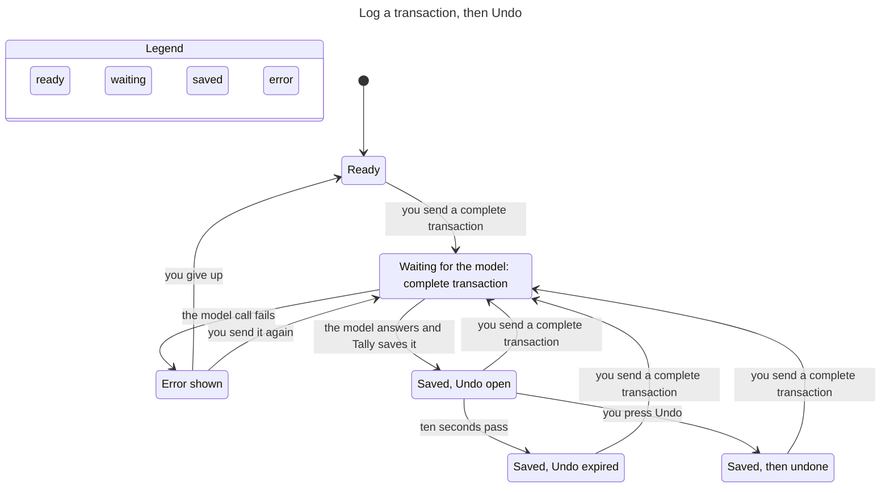
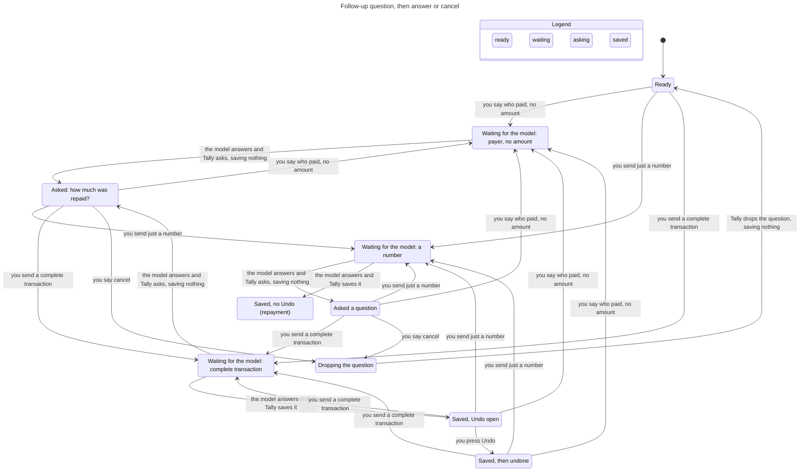
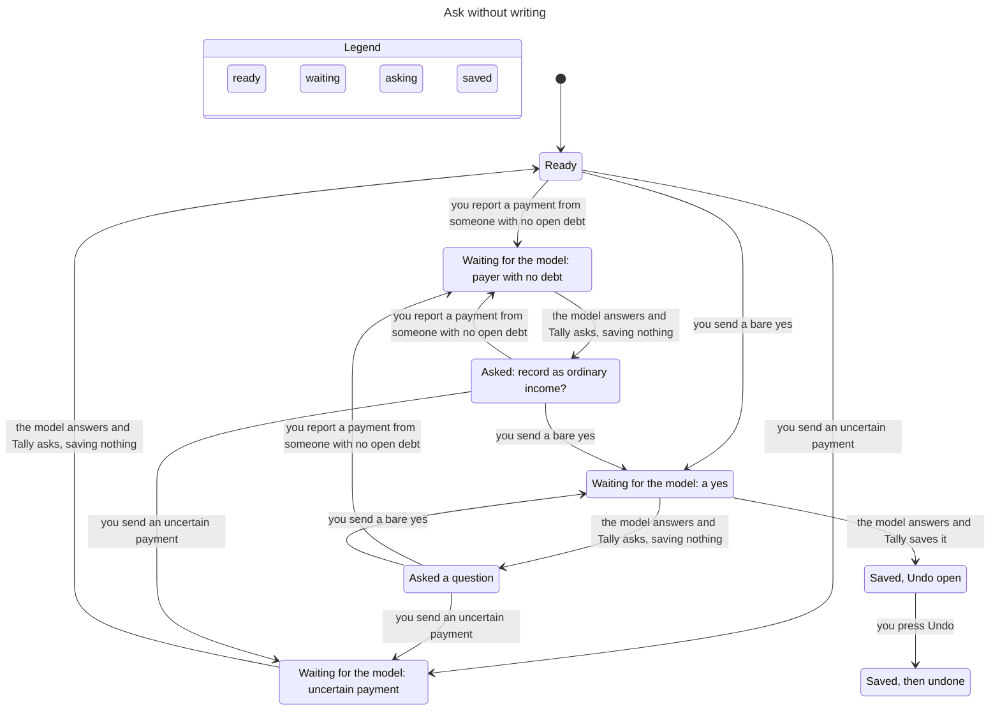

# Assistant state machines

Subsystem: Ask Tally (`src/lib/assistant.ts`, `src/lib/machines/assistant.ts`, `src/lib/provider.ts`, `src/lib/assistant-followup.ts`, assistant routes, assistant parts of `src/lib/store.ts`). Verified by `.claude/skills/verify-assistant` (sync commit `39e0033`). Flow 2 was regenerated from a TLC dump of `model/flows/follow-up.cfg` with the views in `model/views` and rendered with Pele. Flows 1 and 3 did not change and are the earlier hand-edited charts, because the `/statechart` command is not installed here. Regenerate them with it when it is available (`model/views/*.mjs` and `model/flows/*.cfg`).

## Inventory

### 1. Access (consent), stored in `users.assistant_opt_in` and `assistant_consents.disclosure_hash`

| State | Meaning |
|---|---|
| off | `assistant_opt_in = 0` |
| on | opted in and stored hash equals `providerDisclosureHash()` |
| stale | opted in, but the provider disclosure changed since (hash differs) |

Transitions: `setAssistantConsent(hash)` off/stale to on, `setAssistantConsent(null)` to off (`store.ts`). A disclosure change makes on become stale without any write. The state comes from `getAssistantConsent`, and `canWrite` (`machines/assistant.ts`) is the only rule that lets a write happen. Access is checked once per request by both routes (`api/assistant/route.ts`, `api/shortcuts/assistant/route.ts`, the latter after credential lookup and a 30/min limiter), and again inside the turn's commit transaction before any write (`assertAssistantAccess` in `commitTurn`, fixed in `d05bb50`). Every path that stores a turn goes through `commitTurn`, including the local debt-list answer that never calls the model, so none can skip the recheck.

### 2. Request, one POST to runAssistantPrompt

| State | Meaning |
|---|---|
| idle | no request running |
| requesting | model call in flight; nothing is stored yet |
| errored | the model call threw, consent or the chat was gone at commit, the conversation moved on while the model ran (409), or the reply insert threw |

Transitions: send idle to requesting. Requesting to idle when the turn commits: the user message, the write (if any) and the reply are stored in one store transaction (`commitTurn`, `store.transaction`). Requesting to errored when the provider fails or the commit is refused, and then nothing is stored (`d05bb50`, `3f73ccd`). A reply insert that throws rolls the write back too (`c6f5d5b`). The commit is also refused when the conversation no longer ends at the message the turn read before the model call, because another request committed first (`turnMayCommit`, checked inside the commit transaction against `store.lastMessageId`). That turn stores nothing and the route answers 409 "Your conversation changed while this ran. Send that again." The check covers every stored turn, a new chat included, which must still have no message. Two requests that overlap in one conversation therefore never both commit, whatever they say. A resend reads the conversation again and runs as a new turn.

### 3. Pending follow-up, the question the last assistant message waits on

Stored on the assistant message as `followup_kind` (`store.ts`, 17 kinds in `assistant-followup.ts`). Read back only if the **last** stored message is an assistant reply with a kind (`provider.ts:189`). The open run is the messages since the last reply that asked nothing, or since the latest user message flagged `context_start`, whichever is later. The message that cancels a question is stored with that flag in the turn's commit (`commitTurn`, `store.addMessage`) and its reply asks nothing, so a later turn ("Wallet" answering "Which account?") never reloads the dropped question. The model has no message history, so this boundary is pinned by a replay and a route test, not by an invariant. Modeled kinds: none, clarification, ordinary_income, repayment_amount, repayment_payer.

The rule for a new prompt is `pendingOutcome` in `machines/assistant.ts`, and it is closed. **A pending question is dropped only by an explicit cancel.** The whole prompt, trimmed, case-folded and stripped of punctuation, must equal one of `cancel`, `never mind`, `nevermind`, `skip`, `forget it`, `stop`, `ayoko na`, `wag na`, `huwag na` or `di na`. The turn then calls no model, writes nothing, answers "Okay, I dropped that question. Nothing was recorded." and stores no pending kind (`assistant.ts:690-696`). The rule holds for every pending kind, bill questions included. With nothing pending, a cancel phrase is an ordinary prompt. **Every other reply is an answer.** The pending context is kept and the handling from main runs, so a reply it cannot read asks again and writes nothing. No text decides whether the question is dropped any more. The wording guards from main still run, and they only make the turn ask or refuse.

When the code asks a question again while one is pending, the re-ask ends with one sentence that names the way out (`cancelHint` in `machines/assistant.ts`). The repayment amount question adds "Reply with the amount, or say cancel to drop this.", the payer question "Reply with the person's name, or say cancel to drop this.", and the ordinary income, account or date and bill questions "Or say cancel to drop this." A first ask has no hint. The repayment and income questions lead to each other, so any of them asked right after any of them carries it. Other kinds carry it only when the same question repeats. A model-worded clarification and the offer to add a debt to Transactions never carry it, because they are not plain re-asks. The hint is text and is not modeled.

| Pending | New prompt | Outcome |
|---|---|---|
| any kind | the exact cancel phrase: "cancel", "Never mind.", "wag na" | drops the question. No model call, nothing written, the reply asks nothing (`:690-697`) |
| ordinary_income | "yes" or "no" | answers the question (`:775-786`). "no" is not a cancel, it declines the income |
| repayment_amount | an amount the strict reading accepts, digits with an optional peso sign or word and nothing else: "500", "1,000.50", "₱500", "500 pesos" | answers it, saves the repayment (`:766`) |
| repayment_amount | an amount with a detail, shorthand or hedge-like word: "500 cash", "5k", "P500", "500 sa GCash", "about 500", "500 last night", "it was 500" | asks for the amount again, keeps the question, writes nothing |
| repayment_amount, repayment_payer, ordinary_income | a hedged or negated reply: "maybe 500", "I think 500", "not 500", "500?" | the uncertainty guard asks first, writes nothing and clears the question (`:787-788`, `:1108`) |
| repayment_amount, repayment_payer | payment wording, uncertain or negated | answers it through the existing branches (`:787-808`) |
| repayment_payer | a name with an open debt | answers it (the payer is matched to the debt) |
| repayment_amount, repayment_payer, ordinary_income | an unrelated prompt, however complete: "Coffee 120", "she paid back the food money, 500", "for the food, 500", "siguro Food 500", "to Food Wallet 500" | asks the question again with the cancel hint and writes nothing. This is a deliberate limit. The user says cancel and sends the prompt again |
| none | payment with no matching open debt | asks ordinary_income (`:797-798`) |
| none | payer known, amount missing | asks repayment_amount (`:793-794`) |

The amount is read as strictly as on main. An earlier version also accepted dates, account names, `k` and `m` shorthand and filler words as an amount answer, and let a named account override the model's. It was removed because a doubtful reply was then recorded as an exact repayment. Detailed or hedged amount replies now re-ask and write nothing. That is the deliberate safe default.

Debt repayment rule from `AGENTS.md`: ask without writing when wording is negated or uncertain, no debt matches, several debt counterparties are named, the model selects a different payer, or the payment exceeds the balance. This table does not change those rules.

### 4. Undo window, per assistant transaction

| State | Meaning |
|---|---|
| open | `undo_until` set 10 s after save (`undoUntilFor`, `createTransaction`) |
| expired | now > `undo_until` (`canUndo`) |
| used | deleted through `DELETE /api/transactions/:id?undo=1` (`api/transactions/[id]/route.ts`) |
| none | debt repayment: `undo_until` null and `debt_id` set; `deleteTransaction` rejects it (`store.ts`) |

### 5. Conversation, live and then deleted (`deleteConversation`, cascades messages). A new chat is created in the same commit as the first turn that succeeds, so a failed first turn leaves no empty chat. The widget also holds UI state (`assistant-widget.tsx`: `busy`, `conversationId`, `openTransactionControl`); not modeled.

## Flow 1: log a transaction, then Undo

TLC: 24 distinct states, `UndoOnlyInWindow` holds. A model call can fail and be retried; an Undo after ten seconds is not an arrow because the store refuses it.

## Flow 2: follow-up question, answer, cancel, save

TLC: 39 distinct states. Every invariant holds. A complete unrelated prompt sent while a question is pending asks the same question again and writes nothing (the `s4 → s3 → s4` path), and only "cancel" drops it (`s4 → s7 → s0`). Repayments leave no Undo (`RepaymentNoUndo` holds). Model-call failures and consent/chat changes are left out of this chart to keep it readable.

## Flow 3: ask without writing

TLC: 26 distinct states. `UncertainNeverWrites` and `OrdinaryIncomeAsked` hold: an uncertain payment returns to Ready with nothing saved, an unmatched payment asks about ordinary income, and income is saved only after that question and a "yes". The "Saved, Undo open" arrow is the confirmed ordinary-income path.

## Findings (all fixed)

Each finding was replayed against the real code before its fix. The conformance replays in `model/conformance.test.ts` (describe block "regressions") now pin the fixed behavior, and `findings.cfg` (`Legacy = TRUE`) still fails on its four invariants, as `doubt.cfg` (`Doubt = TRUE`) does on `AnswerNotReplaced` and `race.cfg` (`Unchecked = TRUE`) does on `OneWritePerQuestion` and `CancelledNeverAnswered`, so the checks can fail.

1. **`NoDuplicateIntentWrite`: one request saved twice. Fixed in `c6f5d5b`.** The write and the reply committed separately. A chat deleted during the model call left a transaction with no conversation, and a resend saved a second one. The turn now commits its write and reply in one transaction, so a deleted chat saves nothing and a resend after the 404 saves once. What this guarantees is that a turn which does not commit leaves nothing behind. Two requests in flight at the same time are a separate problem (finding 5).
2. **`WriteNeedsConsent`: save after consent withdrawn. Fixed in `d05bb50`, and again for the local debt-list answer.** Access was checked only before the model call. It is now checked again at commit, before any write. The recheck first lived inside the model branch only, so a local debt-list answer ("List my debts") stored its turn even when consent was withdrawn while the request body streamed. It now sits in `commitTurn` itself, so every stored turn has it.
3. **`FollowupSurvivesError`: a failed model call forgets the question. Fixed in `3f73ccd`.** The user message used to be stored before the call, so after a failure the pending question was no longer the last message. The user message is now stored with the turn's commit, so a failed call changes nothing. It keeps the time the request was received, not the commit time (`receivedAt` in `runAssistantPrompt`), because later follow-ups read relative dates from it. Without that, "lunch today" sent at 23:59:59 and answered "250" after midnight saved on the next day (fixed after review). `addMessage` stored a clamped time at first, never earlier than the latest message of the conversation. That overwrote the received time when the clock moved back two seconds across Manila midnight, and "lunch today" then "250" saved on the next day again (S5, fixed in `497bff8`). The message now keeps its received time as `created_at`, and `getConversation` lists a chat by insertion order (rowid), which is prompt then reply because a turn commits both in one transaction. Pinned by route and store tests, not by the model, which has no dates.
4. **`PlainPromptNotTrapped`: a pending question swallows an unrelated prompt. First fixed in `25e864f` (repayment amount, ordinary income) and `64efa45` (repayment payer), replaced by an explicit cancel in `481a0ff` and `39e0033`.** "Coffee 120" after "What amount should I use for the repayment?" used to get the same question, because the repayment context joined every message since the last finished reply. The first fix let a prompt that looked like a new request replace the question. That was abandoned after four review rounds. Rounds 2 and 3 found allow-list leaks, where wording the filler, hedge, date and account lists did not know counted as a new request ("maybe 500", "500 cash", "She paid 500", "500 to Savings", "5 hundred", "mga 500"), and the round 3 redesign to a positive category-evidence rule leaked the same way. Round 4 found category words inside real answers and payment statements ("she paid back the food money, 500", "for the food, 500", "bayad sa food 500", "She paid 500 for lunch"), hedge words next to a category ("I guess Food 500", "siguro Food 500", "siguro Other income 500"), and an account named like a category ("to Food Wallet 500", where stripping the shorter account "Wallet" first left "food" as evidence). Each wrong replace dropped the pending context and the guards that read it, saved a Food expense with a ten second Undo and left Ana's debt open, and the other direction only asks again. Free text cannot be classified safely, so replacement by text is gone. The user has an explicit way out instead, which is the cancel phrase in section 3. The cost is that an unrelated prompt typed at a pending question is asked about again and must be sent after a cancel. That is a limit we accepted, not an invariant.

   The cancel is persisted. "Ana paid me" asked for an amount, "cancel" dropped the question, and a later "Coffee 120 from Missing" then "Wallet" must not reload the repayment question. The cancelling user message is stored with `assistant_messages.context_start = 1` and `minimalFollowUpContext` starts the run there. It is replayed by `PlainPromptNotTrapped (fixed)`, `PlainPromptNotTrapped (stays cancelled)` and `PlainPromptNotTrapped (payer)`, and `NoPendingNoCancel` pins that a cancel with nothing pending is an ordinary prompt. `AnswerNotReplaced (category word)`, `(hedged)` and `(detail)` pin that no other reply drops the question or writes.

   The first replacement rule (`232f564`, kept through `2594b66`) replaced on any word beyond amount filler. A hedged reply ("maybe 500", "not 500") lost the pending context, so the uncertainty guard never ran and the provider's `log_transaction` saved a 500 expense while Ana's debt stayed. An amount with a detail ("500 cash", "500 to Wallet") was replaced too, so Tally offered 500 as ordinary income. `doubt.cfg` with `Doubt = TRUE` replays the older replace-on-text rule and fails on `AnswerNotReplaced`.

5. **Two requests on one question (`OneWritePerQuestion`, `CancelledNeverAnswered`). Fixed in `e34c223`.** A turn reads the pending question before the model call and stores its user message only at commit (`3f73ccd`), and the commit never checked that the question was still the one it read. On main the user message was stored before the call, so a second request saw a user message last and had no question. Two cases were reproduced. The answer "500" sent twice while the first waited on the model (a lost response and a resend, two tabs, a Shortcut run twice) recorded two 500 repayments, settled the debt and put ₱1,000 into Wallet. And "500" in flight committed after a "cancel" that had already replied "Nothing was recorded." and wrote a repayment anyway. Now the commit compares the last stored message of the conversation with the one the turn read and refuses a turn whose conversation moved on. The first request to commit wins, the other stores nothing and gets the 409 above. The model has the other request as `Rival`, a whole turn that commits while ours waits, and `Fresh` is the check. `race.cfg` drops it and both invariants fail. Replayed by `OneWritePerQuestion (fixed)` and `CancelledNeverAnswered (fixed)`, and by the "assistant turn commit" route tests ("writes a repayment once when the same answer is sent twice…", "drops a late answer when the question was cancelled…", "refuses a first turn in an empty chat that gained a message…").

   The cost is that any two overlapping turns in one chat are refused for the one that commits second, even with nothing pending. The widget sends one prompt at a time, so a user meets the 409 only with a second tab or a repeated Shortcut run.

## Left out of the model

`bill_*`, `debt_transaction`, `account_or_date` and the other follow-up kinds; category, date and account inference; debt creation; finance questions; the widget UI; Shortcut credential auth; the shortcut route returns only `answer` and `conversationId`, so a Shortcut user never gets a transaction id to Undo with (by design, not modeled). The cancel hint sentence on a re-ask is text and is not modeled. A cancel is modeled only for the four question kinds, though `pendingOutcome` returns it for every pending kind, and route tests cover an account question and a bill question. The abandon path for uncertain payment wording (`uncertainRepayment` in `assistant.ts`) is not a machine outcome: its input scans every message of the run, so it stays with the wording heuristics. Hidden steps in the charts: consent changes, chat deletion, retry after an error (flows 2 and 3 only). The flows run without `Rivals`, so overlapping requests are not drawn. A rival is one whole turn that commits while another waits, which covers every order in which two requests can commit, and the 409 wording is text.
