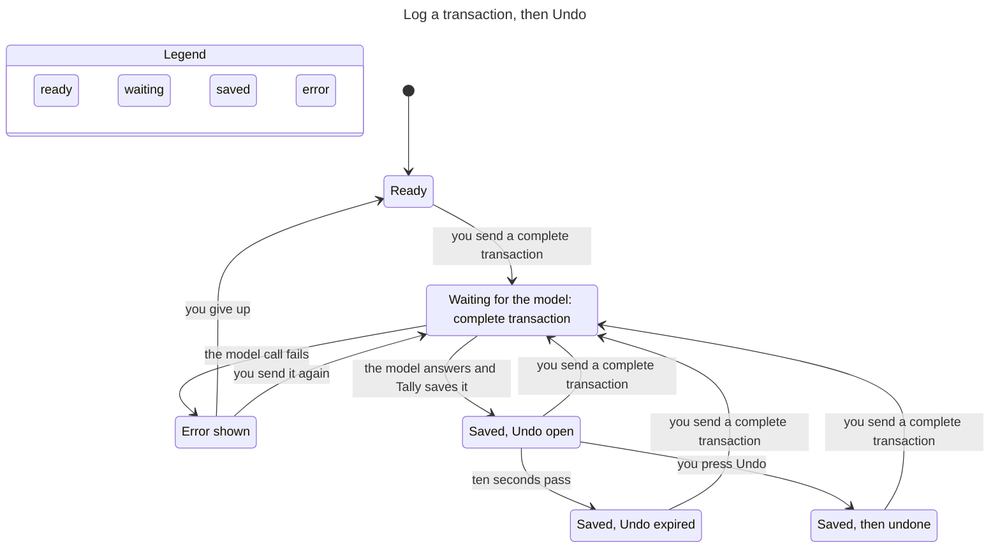
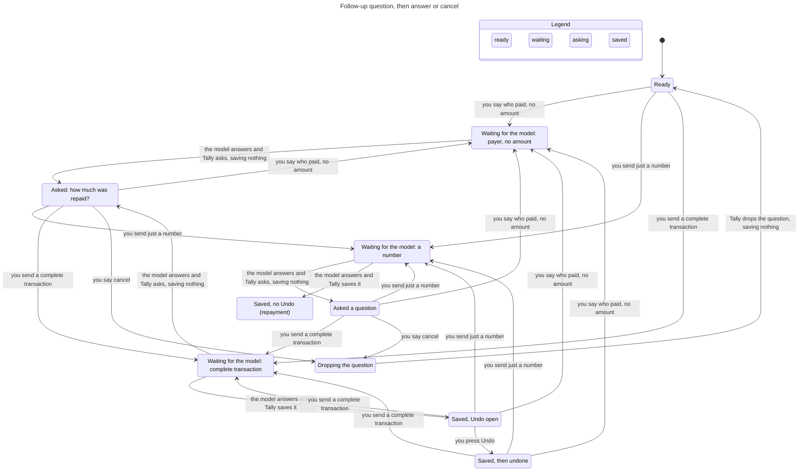
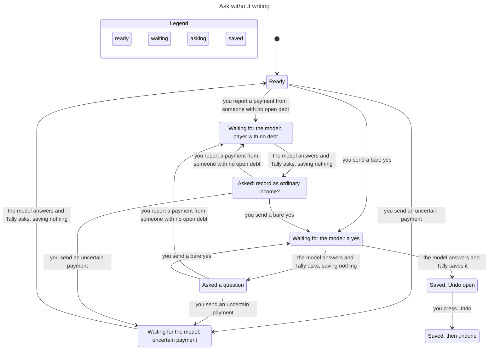

# Assistant state machines

Subsystem: Ask Tally (`src/lib/assistant.ts`, `src/lib/machines/assistant.ts`, `src/lib/provider.ts`, `src/lib/assistant-followup.ts`, assistant routes, assistant parts of `src/lib/store.ts`). Verified by `.claude/skills/verify-assistant` (sync commit `ecad4c6`). Flow 2 was regenerated from a TLC dump of `model/flows/follow-up.cfg` with the views in `model/views` and rendered with Pele. Flows 1 and 3 did not change and are the earlier hand-edited charts, because the `/statechart` command is not installed here. Regenerate them with it when it is available (`model/views/*.mjs` and `model/flows/*.cfg`).

## Inventory

### 1. Access (consent), stored in `users.assistant_opt_in` and `assistant_consents.disclosure_hash`

| State | Meaning |
|---|---|
| off | `assistant_opt_in = 0` |
| on | opted in and stored hash equals `providerDisclosureHash()` |
| stale | opted in, but the provider disclosure changed since (hash differs) |

Transitions: `setAssistantConsent(hash)` off/stale to on, `setAssistantConsent(null)` to off (`store.ts`). A disclosure change makes on become stale without any write. The state comes from `getAssistantConsent`, and `canWrite` (`machines/assistant.ts`) is the only rule that lets a write happen. Access is checked once per request by both routes (`api/assistant/route.ts`, `api/shortcuts/assistant/route.ts`, the latter after credential lookup and a 30/min limiter), and again inside the turn's commit transaction before any write (`assertAssistantAccess` in `commitTurn`, fixed in `d05bb50`). Every path that stores a turn goes through `commitTurn`, including the local debt-list answer that never calls the model, so none can skip the recheck.

### 2. Request, one POST to runAssistantPrompt

| State | Meaning |
|---|---|
| idle | no request running |
| requesting | model call in flight; nothing is stored yet |
| errored | the model call threw, consent or the chat was gone at commit, the conversation moved on while the model ran (409), or the reply insert threw |

Transitions: send idle to requesting. Requesting to idle when the turn commits: the user message, the write (if any) and the reply are stored in one store transaction (`commitTurn`, `store.transaction`). Requesting to errored when the provider fails or the commit is refused, and then nothing is stored (`d05bb50`, `3f73ccd`). A reply insert that throws rolls the write back too (`c6f5d5b`). The commit is also refused when the conversation no longer ends at the message the turn read before the model call, because another request committed first (`turnMayCommit`, checked inside the commit transaction against `store.lastMessageId`). That turn stores nothing and the route answers 409 "Your conversation changed while this ran. Send that again." The check covers every stored turn, a new chat included, which must still have no message. Two requests that overlap in one conversation therefore never both commit, whatever they say. A resend reads the conversation again and runs as a new turn.

### 3. Pending follow-up, the question the last assistant message waits on

Stored on the assistant message as `followup_kind` (`store.ts`, 17 kinds in `assistant-followup.ts`). Read back only if the **last** stored message is an assistant reply with a kind (`minimalFollowUpContext` in `provider.ts`). The open run is the messages since the last reply that asked nothing. The reply that drops a question asks nothing, so a later turn ("Wallet" answering "Which account?") never reloads the dropped question. The whole run reaches the model. The local reading of it splits in two. A hint that chooses a value reads only the messages that belong to the pending question, and a guard that can only refuse or ask reads the whole run (see finding 10), so no message is ever trimmed away. Its length is bounded by policy instead, because choosing which messages to keep is a guess that kept dropping the statement or the correction a later answer depends on (see finding 8). The model has no message history, so the boundary of the run is pinned by replays and route tests, not by an invariant. It counts the turns of the open run (`runLen`, two messages each) against a small `RunMax` and checks the limit with `OpenRunBounded` and `ExpiryWritesNothing`. Modeled kinds: none, clarification, ordinary_income, repayment_amount, repayment_payer.

Four things end a pending question. **An exact cancel drops it, an answer that resolves it ends it, a completed write ends it, and a run that has grown too long ends it.** A hedged or negated reply to a repayment question is an answer of the second kind, because the uncertainty guard asks first, writes nothing and clears the question. The one exception is a refusal said in an earlier turn of the run, a quiet turn included, followed by a turn that would write (the yes to the income question, a bill, an amount): that turn asks again, writes nothing and leaves the question pending, so cancel still drops it (`refusalOutcome` returns `askAgain`, finding 11). A turn that asks a question of its own replaces the pending one with it. Nothing else changes it. A turn that only reads the ledger, which is the local debt list and a finance answer, is none of the four, so the question stays pending. A pending ordinary income question is the one case where a finance question is not answered, because `ordinaryIncomeFlow` replaces it with the income question again, which also leaves the question pending. So does a bill that was saved without asking anything, when the pending question is not about a bill. Their reply is stored with the same pending kind, and with the debt the question offered, so the next answer still resolves the question and a cancel still drops it. A saved bill is the answer to a pending bill question, whichever bill kind it was, so that question ends with the save and the reply stores no pending kind (`followupAfterTurn` in `machines/assistant.ts`, used by `runAssistantPrompt`). With nothing pending, a read-only turn stores no question, so a normal single turn is unchanged. The cancel rule for a new prompt is `pendingOutcome` in `machines/assistant.ts`, and it is closed. **An exact cancel is the only text that drops a pending question on purpose.** The whole prompt, trimmed, case-folded and stripped of punctuation, must equal one of `cancel`, `never mind`, `nevermind`, `skip`, `forget it`, `stop`, `ayoko na`, `wag na`, `huwag na` or `di na`. The turn then calls no model, writes nothing and stores no pending kind (the `pendingOutcome` check in `runAssistantPrompt`, before the model call). The reply comes from `cancelReply`. It is "Okay, I dropped that question. Nothing was recorded." for a question asked before anything was saved. When the dropped question is the offer to add a just-saved debt to Transactions, or a question that continues it (the account or date it asked for), the debt is already in Debts, so the reply is "Okay, I dropped that question. The debt stays in Debts, and nothing was added to Transactions." A bill saved under a question that is not about a bill leaves that question pending, so a cancel then says "Okay, I dropped that question. The bill stays in Bills, and nothing else was recorded.", and a run that saved both says "The debt stays in Debts and the bill stays in Bills." The run decides all of that (`runSaved` looks for replies that carry a debt or a bill, and the store keeps the bill on the reply that saved it), because only the offer itself has a kind of its own. A bill question never stays pending after its bill was saved, so a cancel is then an ordinary prompt. The rule holds for every pending kind, bill questions included. With nothing pending, a cancel phrase is an ordinary prompt. **Every other reply is an answer.** The pending context is kept and the handling from main runs, so a reply it cannot read asks again and writes nothing. No text decides whether the question is dropped any more. The wording guards from main still run, and they only make the turn ask or refuse.

**A run that grows too long is ended, not trimmed.** An open run holds at most 24 messages (`MAX_OPEN_RUN_MESSAGES` in `machines/assistant.ts`). A turn that finds the run already at 24 and is not an exact cancel would extend it, so it ends the question instead (`runExpired`, checked in `runAssistantPrompt` right after the cancel check and before the model call). It calls no model, writes nothing and stores a reply with no pending kind. The reply is "That question has been open too long, so I dropped it. Nothing was recorded. Please send the details again." (`expiredReply`). When the run already saved a debt or a bill it ends with the same sentence as the cancel reply, for example "That question has been open too long, so I dropped it. The debt stays in Debts, and nothing was added to Transactions." Every kind of turn extends a run, so re-asks and the read-only turns that carry the question forward count the same, and so does an answer. The next prompt starts a clean run, and an exact cancel at the limit still gets the cancel reply. The turn commits through `commitTurn`, so the consent recheck applies as for any turn.

When the code asks a question again while one is pending, the re-ask ends with one sentence that names the way out (`cancelHint` in `machines/assistant.ts`). The repayment amount question adds "Reply with the amount, or say cancel to drop this.", the payer question "Reply with the person's name, or say cancel to drop this.", and the ordinary income, account or date and bill questions "Or say cancel to drop this." A first ask has no hint. The repayment and income questions lead to each other, so any of them asked right after any of them carries it. Other kinds carry it only when the same question repeats. A question the model worded itself and the offer to add a debt to Transactions never carry it, because they are not plain re-asks. That holds whatever kind the model's question is stored under. During a repayment with no amount yet it is stored as `repayment_amount`, so a later bare amount still answers it, and it is shown as the model wrote it ("Which account did Ana send it to?"), not followed by "Reply with the amount". The hint is text and is not modeled.

| Pending | New prompt | Outcome |
|---|---|---|
| any kind | the exact cancel phrase: "cancel", "Never mind.", "wag na" | drops the question. No model call, nothing written, the reply asks nothing (the same check) |
| any kind | any prompt but an exact cancel, when the open run already holds 24 messages | ends the question. No model call, nothing written, the reply asks nothing and says the question was open too long (`runExpired`). The next prompt is an ordinary one |
| any kind | the debt list, such as "List my debts" | answers it locally, writes nothing and leaves the question pending with the same kind, until the run holds 24 messages. The next answer still resolves it |
| any kind but ordinary_income | a finance question such as "How much did I spend this month?" | answers it from the ledger, writes nothing and leaves the question pending with the same kind, until the run holds 24 messages. The refusal decision leaves a finance answer alone while a question is pending (`refusalOutcome` returns `proceed` for a read) |
| ordinary_income | a finance question such as "How much did I spend this month?" | does not answer it. `ordinaryIncomeFlow` replaces it with the income question again, "Please answer yes if you want me to record this as ordinary income, or no to leave it unrecorded. Or say cancel to drop this.", the kind stays ordinary_income and nothing is written. The user says cancel first to ask it |
| any kind but a bill kind | a bill request that saves a bill and asks nothing | saves the bill, which is its own write with its own dialog, and leaves the question pending |
| a bill kind | a bill request that saves or updates a bill and asks nothing, such as the amount a bill question asked for | saves the bill and ends the question. The reply stores no pending kind, so the next prompt is an ordinary one and a cancel is an ordinary prompt too |
| any kind | a bill request that asks its own question | the bill question takes over the pending slot and the earlier question is not asked again. This is a known limit |
| ordinary_income | "yes" | answers the question (the `ordinaryIncomeFlow` branch) and records the income |
| ordinary_income | exactly "no", "nope", "nah", "no thanks", "no thank you", "hindi" or "ayoko", ignoring case and punctuation (`isOrdinaryIncomeDecline`) | declines the income. It is not a cancel. Nothing is written, the reply says the money was not recorded and the question ends, even after an earlier held "yes" |
| ordinary_income | a longer reply that leads with a negative word (no, nope, nah, hindi, ayoko), such as "No, use Wallet. I still want to record it as income." or "no problem, yes record it", or one that defers, such as "not now" | not a decline. A reply that starts with yes continues the income flow and may write. An earlier held "yes" may authorize the write only when the reply does not lead with a negative word (`vetoesHeldIncomeYes`), so after a held "yes" a leading-no reply writes nothing and asks the income question again with the cancel hint, and the question stays pending (kind ordinary_income). "not now" does not lead with a negative word, so after a held "yes" it does not veto |
| repayment_amount | an amount the strict reading accepts, digits with an optional peso sign or word and nothing else: "500", "1,000.50", "₱500", "500 pesos" | answers it, saves the repayment (`bareAmountFromPrompt`) |
| repayment_amount | an amount with a detail, shorthand or hedge-like word: "500 cash", "5k", "P500", "500 sa GCash", "about 500", "500 last night", "it was 500" | asks for the amount again, keeps the question, writes nothing |
| repayment_amount, repayment_payer | a hedged or negated reply: "maybe 500", "I think 500", "not 500", "500?" | the uncertainty guard asks first, writes nothing and clears the question (the `uncertainRepayment` branch) |
| ordinary_income | a hedged or negated reply: "maybe", "I think so", "not sure" | `ordinaryIncomeFlow` runs before the uncertainty guard, so the guard never sees it. The question is asked again with the cancel hint, stays ordinary_income and nothing is written (the `ordinaryIncomeFlow` branch) |
| repayment_amount, repayment_payer | payment wording, uncertain or negated | answers it through the existing branches (`uncertainRepayment` and `repaymentIntent`) |
| repayment_payer | a name with an open debt | answers it (the payer is matched to the debt) |
| repayment_amount, repayment_payer, ordinary_income | an unrelated prompt, however complete: "Coffee 120", "she paid back the food money, 500", "for the food, 500", "siguro Food 500", "to Food Wallet 500" | asks the question again with the cancel hint and writes nothing. This is a deliberate limit. The user says cancel and sends the prompt again |
| none | payment with no matching open debt | asks ordinary_income (the `repaymentIntent` branch with no matching debt) |
| none | payer known, amount missing | asks repayment_amount (the `repaymentIntent` branch with no stated amount) |

The amount is read as strictly as on main. An earlier version also accepted dates, account names, `k` and `m` shorthand and filler words as an amount answer, and let a named account override the model's. It was removed because a doubtful reply was then recorded as an exact repayment. Detailed or hedged amount replies now re-ask and write nothing. That is the deliberate safe default.

Debt repayment rule from `AGENTS.md`: ask without writing when wording is negated or uncertain, no debt matches, several debt counterparties are named, the model selects a different payer, or the payment exceeds the balance. This table does not change those rules.

### 4. Undo window, per assistant transaction

| State | Meaning |
|---|---|
| open | `undo_until` set 10 s after save (`undoUntilFor`, `createTransaction`) |
| expired | now > `undo_until` (`canUndo`) |
| used | deleted through `DELETE /api/transactions/:id?undo=1` (`api/transactions/[id]/route.ts`) |
| none | debt repayment: `undo_until` null and `debt_id` set; `deleteTransaction` rejects it (`store.ts`) |

### 5. Conversation, live and then deleted (`deleteConversation`, cascades messages). A new chat is created in the same commit as the first turn that succeeds, so a failed first turn leaves no empty chat. The widget also holds UI state (`assistant-widget.tsx`: `busy`, `conversationId`, `openTransactionControl`); not modeled.

## Flow 1: log a transaction, then Undo

TLC: 24 distinct states, `UndoOnlyInWindow` holds. A model call can fail and be retried; an Undo after ten seconds is not an arrow because the store refuses it.

## Flow 2: follow-up question, answer, cancel, save

TLC: 39 distinct states. Every invariant holds. A complete unrelated prompt sent while a question is pending asks the same question again and writes nothing (the `s4 → s3 → s4` path), and only "cancel" drops it (`s4 → s7 → s0`). A read-only question leaves every state where it is, so it is not drawn (the model has it as the `readOnly` intent, checked by `core.cfg`). Repayments leave no Undo (`RepaymentNoUndo` holds). Model-call failures and consent/chat changes are left out of this chart to keep it readable.

## Flow 3: ask without writing

TLC: 26 distinct states. `UncertainNeverWrites` and `OrdinaryIncomeAsked` hold: an uncertain payment returns to Ready with nothing saved, an unmatched payment asks about ordinary income, and income is saved only after that question and a "yes". The "Saved, Undo open" arrow is the confirmed ordinary-income path.

## Findings (all fixed)

Each finding was replayed against the real code before its fix. The conformance replays in `model/conformance.test.ts` (describe block "regressions") now pin the fixed behavior, and `findings.cfg` (`Legacy = TRUE`) still fails on its four invariants, as `doubt.cfg` (`Doubt = TRUE`) does on `AnswerNotReplaced`, `race.cfg` (`Unchecked = TRUE`) does on `OneWritePerQuestion` and `CancelledNeverAnswered`, and `unbounded.cfg` (`Unbounded = TRUE`) does on `OpenRunBounded` and `ExpiryWritesNothing`, so the checks can fail. `AnswerNotReplaced` also says a read-only turn leaves a pending question pending. A scratch copy of the model where a read-only turn clears the question fails it.

1. **`NoDuplicateIntentWrite`: one request saved twice. Fixed in `c6f5d5b`.** The write and the reply committed separately. A chat deleted during the model call left a transaction with no conversation, and a resend saved a second one. The turn now commits its write and reply in one transaction, so a deleted chat saves nothing and a resend after the 404 saves once. What this guarantees is that a turn which does not commit leaves nothing behind. Two requests in flight at the same time are a separate problem (finding 5).
2. **`WriteNeedsConsent`: save after consent withdrawn. Fixed in `d05bb50`, and again for the local debt-list answer.** Access was checked only before the model call. It is now checked again at commit, before any write. The recheck first lived inside the model branch only, so a local debt-list answer ("List my debts") stored its turn even when consent was withdrawn while the request body streamed. It now sits in `commitTurn` itself, so every stored turn has it.
3. **`FollowupSurvivesError`: a failed model call forgets the question. Fixed in `3f73ccd`.** The user message used to be stored before the call, so after a failure the pending question was no longer the last message. The user message is now stored with the turn's commit, so a failed call changes nothing. It keeps the time the request was received, not the commit time (`receivedAt` in `runAssistantPrompt`), because later follow-ups read relative dates from it. Without that, "lunch today" sent at 23:59:59 and answered "250" after midnight saved on the next day (fixed after review). `addMessage` stored a clamped time at first, never earlier than the latest message of the conversation. That overwrote the received time when the clock moved back two seconds across Manila midnight, and "lunch today" then "250" saved on the next day again (S5, fixed in `497bff8`). The message now keeps its received time as `created_at`, and `getConversation` lists a chat by insertion order (rowid), which is prompt then reply because a turn commits both in one transaction. Pinned by route and store tests, not by the model, which has no dates.
4. **`PlainPromptNotTrapped`: a pending question swallows an unrelated prompt. First fixed in `25e864f` (repayment amount, ordinary income) and `64efa45` (repayment payer), replaced by an explicit cancel in `481a0ff` and `39e0033`.** "Coffee 120" after "What amount should I use for the repayment?" used to get the same question, because the repayment context joined every message since the last finished reply. The first fix let a prompt that looked like a new request replace the question. That was abandoned after four review rounds. Rounds 2 and 3 found allow-list leaks, where wording the filler, hedge, date and account lists did not know counted as a new request ("maybe 500", "500 cash", "She paid 500", "500 to Savings", "5 hundred", "mga 500"), and the round 3 redesign to a positive category-evidence rule leaked the same way. Round 4 found category words inside real answers and payment statements ("she paid back the food money, 500", "for the food, 500", "bayad sa food 500", "She paid 500 for lunch"), hedge words next to a category ("I guess Food 500", "siguro Food 500", "siguro Other income 500"), and an account named like a category ("to Food Wallet 500", where stripping the shorter account "Wallet" first left "food" as evidence). Each wrong replace dropped the pending context and the guards that read it, saved a Food expense with a ten second Undo and left Ana's debt open, and the other direction only asks again. Free text cannot be classified safely, so replacement by text is gone. The user has an explicit way out instead, which is the cancel phrase in section 3. The cost is that an unrelated prompt typed at a pending question is asked about again and must be sent after a cancel. That is a limit we accepted, not an invariant.

   The cancel is persisted. "Ana paid me" asked for an amount, "cancel" dropped the question, and a later "Coffee 120 from Missing" then "Wallet" must not reload the repayment question. The cancel's reply is stored with no pending kind, so `minimalFollowUpContext` starts the run after it. It is replayed by `PlainPromptNotTrapped (fixed)`, `PlainPromptNotTrapped (stays cancelled)` and `PlainPromptNotTrapped (payer)`, and `NoPendingNoCancel` pins that a cancel with nothing pending is an ordinary prompt. `AnswerNotReplaced (category word)`, `(hedged)` and `(detail)` pin that no other reply drops the question or writes.

   The first replacement rule (`232f564`, kept through `2594b66`) replaced on any word beyond amount filler. A hedged reply ("maybe 500", "not 500") lost the pending context, so the uncertainty guard never ran and the provider's `log_transaction` saved a 500 expense while Ana's debt stayed. An amount with a detail ("500 cash", "500 to Wallet") was replaced too, so Tally offered 500 as ordinary income. `doubt.cfg` with `Doubt = TRUE` replays the older replace-on-text rule and fails on `AnswerNotReplaced`.

5. **Two requests on one question (`OneWritePerQuestion`, `CancelledNeverAnswered`). Fixed in `e34c223`.** A turn reads the pending question before the model call and stores its user message only at commit (`3f73ccd`), and the commit never checked that the question was still the one it read. On main the user message was stored before the call, so a second request saw a user message last and had no question. Two cases were reproduced. The answer "500" sent twice while the first waited on the model (a lost response and a resend, two tabs, a Shortcut run twice) recorded two 500 repayments, settled the debt and put ₱1,000 into Wallet. And "500" in flight committed after a "cancel" that had already replied "Nothing was recorded." and wrote a repayment anyway. Now the commit compares the last stored message of the conversation with the one the turn read and refuses a turn whose conversation moved on. The first request to commit wins, the other stores nothing and gets the 409 above. The model has the other request as `Rival`, a whole turn that commits while ours waits, and `Fresh` is the check. `race.cfg` drops it and both invariants fail. Replayed by `OneWritePerQuestion (fixed)` and `CancelledNeverAnswered (fixed)`, and by the "assistant turn commit" route tests ("writes a repayment once when the same answer is sent twice…", "drops a late answer when the question was cancelled…", "refuses a first turn in an empty chat that gained a message…").

   The cost is that any two overlapping turns in one chat are refused for the one that commits second, even with nothing pending. The widget sends one prompt at a time, so a user meets the 409 only with a second tab or a repeated Shortcut run.

6. **A question lost without a cancel (`AnswerNotReplaced`, `PlainPromptNotTrapped`). Fixed in `de28309` and `4857caa`.** Review round 6 found two ways a pending question disappeared although the user never cancelled it. First, "Ana paid me" asked for an amount, and then "List my debts", a plain finance question or a bill saved without a question stored its reply with no pending kind. The following "500" reached the model with no repayment context, and a model `log_transaction` saved a 500 expense while Ana's 1,000 debt stayed open. A finance question that contained a question mark also hit the uncertainty guard, which replaced the finance answer with "I didn't record anything". Second, six "Coffee 120" replies, each asked again correctly, pushed the original payer statement out of the 12-message cap, and "500" then saved an expense in the same way. A turn that only reads, or saved a bill and asked nothing while a question that is not about a bill was pending, now stores its reply with the pending kind and the offered debt carried forward. The fix for the cap kept the run's first message and trimmed the rest. Review round 7 found that this was a guess too, and removed the trimming (finding 8). Replayed by `AnswerNotReplaced (read-only)` (two replays) and `PlainPromptNotTrapped (long run)`, and by the "assistant turn commit" route tests. The model has the read-only turn as the `readOnly` intent.

   Two limits stay. The text of a read-only question stays in the open run for the write guards, so a read-only question that itself reads as an unconfirmed payment ("How much have people paid me back?") or a negated one makes the next answer ask first and write nothing, which is the safe direction (finding 10). And a bill request that asks its own question takes over the pending slot, so the earlier question is dropped without being asked again.

7. **A saved bill left its own question pending (review round 7). Fixed in `32508d9`.** Finding 6 stored the reply of every bill action that asked nothing with the pending kind. So "I have a Netflix bill under Entertainment. It is monthly, starts today, and ends December 15." asked for an amount (`bill_amount`), "549" saved the bill and posted today's expense, and the reply was still stored as `bill_amount`. The next "I spent 200 on lunch" was forced into the bill flow, got "An active bill named Netflix already exists. Would you like to add another or update the existing bill?" and saved nothing, and "cancel" said "Okay, I dropped that question. Nothing was recorded." although the bill and its expense existed. A bill action that saves or updates a bill and asks nothing now ends a pending bill question, because that save is its answer, and leaves a question that is not about a bill pending (`followupAfterTurn`, with `isBillFollowup`). A bill action that asks its own question still replaces the pending one. Pinned by the machine table and the route tests "ends the bill question when its answer saves the bill ...", "treats cancel as an ordinary prompt once the bill answer saved the bill ..." and "keeps the pending repayment question when a bill is saved without asking anything". Bill questions are not modeled, so there is no invariant.

8. **A trimmed run lost what the question was about (review round 7). Fixed in `655593b`.** The cap at `4857caa` kept the first message of a long run and the 11 most recent, on the assumption that the first message is the statement the pending question is about. A run can hold two questions, because a turn that asks a new question replaces the pending one without starting a new run, and corrections inside the run were trimmed too. Reproduced three ways. "Coffee" asked "How much was the coffee?", "Actually, Ana paid me" asked the repayment amount, and then the sixth of six "Coffee 120" re-asks lost "Actually, Ana paid me", saved a 120 expense and dropped the repayment question without a cancel. The next "500" saved a 500 expense and Ana's debt stayed at 1,000. Five "List my debts" turns did the same. And "Ana paid me 500 into my Missing account", then "Actually Bob paid me 500", then "Bob", then six "List my debts", then "Use Wallet", lost Bob's correction and selection and repaid Ana. Choosing which messages of a long run to keep is a guessing heuristic and it kept leaking, so the trimming is gone. The whole run reaches the model, and its length is bounded by policy. A turn that would extend a run already at 24 messages, and is not an exact cancel, calls no model, writes nothing and ends the question with a reply that says it was open too long (`runExpired` and `expiredReply`). The cost is that a user who keeps a question open through 12 exchanges is asked to send the details again, which is a limit we accepted. Without the trimming, a run just under the limit with Bob's correction asks "Which person's open debt should I apply this payment to?" and writes nothing, because the run names both Ana and Bob, which is the safe direction. The model counts the turns of the open run (`runLen`) against `RunMax` and has `OpenRunBounded` and `ExpiryWritesNothing`. Replayed by `OpenRunBounded (fixed)` (two replays) and `ExpiryWritesNothing (fixed)`, and by the "assistant turn commit" route tests for both reproductions, the run two messages under the limit, an exact cancel at the limit, read-only turns, a run that had saved a debt and the consent recheck.

9. **A cancel or an expiry said nothing was recorded after a bill was saved (review round 8). Fixed in `e066d5a`.** A bill saved under a pending question that is not about a bill leaves that question pending (finding 7), and the bill may have posted its due-today expense. "Ana paid me" asked the repayment amount, a complete Netflix bill starting today saved the bill and its expense, and then "cancel", or the 24-message expiry, replied "Nothing was recorded." The reply was chosen from the saved debt alone, and the store kept no mark of a saved bill on a reply. A reply now stores the bill it saved (`bill_id` on the assistant message), the run reports what it saved (`runSaved`, a debt and a bill) and the machine picks the wording from that (`cancelReply` and `expiredReply`). The wording for a bill alone does not claim that nothing was added to Transactions, because the bill may have posted an expense. Bill questions are not modeled, so there is no invariant. Pinned by the machine tables and the route tests "says the bill stays in Bills when the question is cancelled ...", "says the bill stays in Bills when the question expires ..." and "names both when the run also saved a debt".

10. **A quiet turn moved a repayment's account and date, and then hid its own refusal (review rounds 9 and 10). Fixed in `0314611` and `a3c3c66`.** A turn that handled its own request and left the question pending, a bill saved without a question or a read-only answer, still had its user message in the open run, and the account and date hints were read over the whole run. "Ana paid me" asked for an amount, a Netflix bill using Savings that starts tomorrow was saved, and "Ana paid me 500" credited Savings on the next day although the model chose Wallet and today. A finance question that carried a date replaced the repayment date the same way. A reply is quiet when it kept a pending question and either carries the bill it saved or is marked `read_only` on the assistant message (`isQuietReply`). The first fix read every piece of user text from the messages that belong to the question (`ownUserMessages`), and that hid the refusal wording of a quiet turn from the write guards. "Ana paid me" asked for an amount, "Actually, Ana did not pay me. List my debts." was answered locally and left the question pending, and "500" then recorded the repayment with no question. The code now reads the user's words two ways, and `userMessagesFor` names them. A hint chooses a value, so it reads only the messages that belong to the question and the current prompt. That covers the account, date, time and category hints, the payment wording and the amount found in the run, the debt the user named, an opt-in to Transactions, the bill details, the check that a bill question is open and the yes that confirms ordinary income. A guard can only refuse or ask, so it reads every user message of the run and the current prompt (`guardUserMessages`). That covers the unconfirmed or negated payment check (`uncertainRepayment`), the uncertain new debt check, the opt-out from Transactions and the payment wording that stops an ordinary income confirmation. A guard never sees less than a hint, so a refusal said anywhere in the run blocks a write nobody confirmed afterwards, and a quiet turn that says nothing against the payment ("List my debts") blocks nothing. A quiet turn that only holds a hedge word can make a later new debt ask for confirmation first, which is the safe direction. A bill saved in a message that negates a payment is its own request, so it is saved, the refusal ends the question and the reply keeps the receipt (`endQuestion`). A refusal left in a quiet read-only turn is caught by finding 11: the turn that would write asks again and writes nothing. A statement, an answer, a re-ask or a correction such as "Actually into Savings" is not quiet, so it still takes effect as a hint. The model keeps the whole run, because a hint only overrides a field the model chose, and the model sees the reply that says the bill or the answer was handled. A reply stored before the `read_only` column existed reads as not quiet, which is the earlier behavior. Pinned by the machine table in `tests/assistant-machine.test.ts`, the store test for the column and the route tests in "quiet turns inside a pending repayment run". The model has no messages, so there is no invariant.

11. **A guard replied "nothing was recorded" after the turn had written (review round 11). Fixed in `124949b`.** `a3c3c66` made the uncertain payment guard read the whole run, a quiet turn included, but `runAssistantPrompt` applied it at the end of the turn and replaced the reply, whatever the branches above had stored. "Zed paid me 500" asked about ordinary income, "Actually, Zed did not pay me. List my debts." was answered locally, and "yes" saved the 500 as income and raised the balance while the reply said "I didn't record anything". A valid due-today bill sent after the same quiet negation saved the bill and its expense under the same denial. The ordinary income branch and the bill branch never looked at `uncertainRepayment`. An income "no" that arrived after an earlier held "yes", or a bill in a message that began with "No.", also saved and then answered "Okay, I won't record the money." The rule is now one pure decision taken before any branch can write. `turnCallOf` names what the call will do after every rewrite (a bill, any other write, a read, or a call that stores nothing), and `refusalOutcome` reads it with where the refusal was said. A refusal in an earlier turn of the run plus a call that would write gives `askAgain`. Nothing is written, the reply is "You said earlier that this payment didn't happen, so I haven't recorded anything. Say cancel to drop this question.", the turn is quiet like a read, and the question stays pending with the same kind, so cancel still drops it and the yes or the bill is not kept as a hint. A refusal only in the current message gives `refuse` for a write (nothing is written, the question ends) and `endQuestion` for a bill, which is its own request in the same message, so the bill is saved, the refusal ends the question and the reply keeps the receipt and adds that the earlier question was dropped. Every other call keeps the old result: a question asked while a refusal stands ends the question with "I didn't record anything", and a finance answer under a pending question is left alone. `endedQuestionReply` is the only place that says nothing was recorded, and it says it only when the turn wrote nothing. A "no" to the income question now wins over an earlier "yes" before the call is built, so it never saves. The cost is that a bill sent while a refusal stands in the open run is asked again instead of saved, and the user has to cancel the question first. Not modeled, since the model has no messages, so there is no invariant. Pinned by the table in the "refusal decision a turn takes before it writes" tests, the route tests "asks again and records nothing when yes answers the income question after a negation said in a quiet turn" and "asks again and saves no bill or expense when a bill follows a negation said in a quiet turn", and the invariant test "a denying reply never coexists with a committed write", which compares the ledger, the bills, the debts and the balances before and after every branch it touches.

12. **A "no" prefix declined income the user had confirmed (review round 12). Fixed in `ecad4c6`.** `124949b` decided the income "no" before the earlier "yes" could build a write, but `ordinaryIncomeDeclined` still matched any reply that began with "no". "Zed paid me 500" asked about ordinary income, "yes, into my Nowhere account" was held for the account, and "No, use Wallet. I still want to record it as income." answered "Okay, I won't record the money", saved nothing and dropped the question, although the user had confirmed it twice. Before `124949b` the same run saved 500 to Wallet. Matching the first word of free text is the heuristic that already leaked for cancel, so the decline is now an exact normalized phrase (`INCOME_DECLINE_PHRASES`, read by `isOrdinaryIncomeDecline`, the same normalization as a cancel): "no", "nope", "nah", "no thanks", "no thank you", "hindi", "ayoko". A longer reply that only starts with "no" takes the ordinary answer path. A reply that starts with yes continues the income flow. Any other reply asks again with the cancel hint, unless an earlier turn held a yes (with no payment wording after it) and the reply does not lead with a negative word. That first version let every earlier yes stand, which review round 13 broke (finding 13). "not now" defers instead of refusing, so it asks again and the user can say cancel. The rule that a decline never coexists with a write in the same turn, and that a "no" after a held "yes" writes nothing, is unchanged, because a phrase that is exactly a decline never reaches the write branch. The claim that "No, use Wallet. I still want to record it as income." is recorded was withdrawn in finding 13. Not modeled, since the model has no messages, so there is no invariant. Pinned by the table "the ordinary income decline" in `tests/assistant-machine.test.ts` and the route tests "declines the ordinary income question on the exact phrase" and "does not read %s as a decline".

13. **An earlier held yes outlived a refusal that was not an exact decline (review round 13). Fixed in the commit that adds `vetoesHeldIncomeYes`.** `ecad4c6` made the decline an exact phrase, but `ordinaryIncomeAccepted` was still true whenever a "yes" had been said earlier in the run. "Zed paid me 500" asked about ordinary income, "yes, into my Nowhere account" was held for the account, and then "No, don't record this in Wallet or anywhere else.", "No, don't record it", "no, I changed my mind" or "No, never mind" saved 500 as income in Wallet against the user's own refusal. Before `124949b` and `ecad4c6` (at `f278714`) each of them was a decline. The fix is structural and goes in the safe direction, with no new phrase list for refusals. An earlier held yes may authorize the write only when the current message does not lead with a negative word (`vetoesHeldIncomeYes`: the first word of the normalized message is no, nope, nah, hindi or ayoko), through `incomeConfirmed`. The veto is not a decline. It never ends the question or says nothing was recorded. The turn writes nothing and asks the income question again with the cancel hint (`cancelHint` takes `heldYesVetoed`), and the question stays pending under kind ordinary_income, so a fresh yes is needed and cancel still drops it. An exact decline is still read first and ends the question. A message that itself starts with yes still answers the pending question, and a reply that does not lead with a negative word, such as "yes, use Wallet", still writes after an account clarification. The cost is accepted: "No, use Wallet. I still want to record it as income." has no leading yes, so it asks once more, where `ecad4c6` recorded it. Not modeled, since the model has no messages, so there is no invariant. Pinned by the table "the veto on an earlier held yes for ordinary income" in `tests/assistant-machine.test.ts`, the route tests "does not write on the strength of an earlier yes when the reply %s leads with no" and "records the income a user confirmed when a reply after an account clarification says yes", and the four refusals added to the invariant test "a denying reply never coexists with a committed write".

## Left out of the model

`bill_*`, `debt_transaction`, `account_or_date` and the other follow-up kinds; category, date and account inference; debt creation; finance questions, apart from their effect on a pending question (the `readOnly` intent); the widget UI; Shortcut credential auth; the shortcut route returns only `answer` and `conversationId`, so a Shortcut user never gets a transaction id to Undo with (by design, not modeled). Message counts are not modeled. The open run is counted in turns of two messages each, against a small `RunMax` that stands for the code's 12 turns, and the route tests and replays pin the 24-message boundary. The cancel hint sentence on a re-ask is text and is not modeled. A cancel is modeled only for the four question kinds, though `pendingOutcome` returns it for every pending kind, and route tests cover an account question and a bill question. The abandon path for uncertain payment wording (`uncertainRepayment` in `assistant.ts`) is not a machine outcome: its input scans the messages of the run that belong to the pending question, so it stays with the wording heuristics. Hidden steps in the charts: consent changes, chat deletion, retry after an error (flows 2 and 3 only). The flows run without `Rivals`, so overlapping requests are not drawn. A rival is one whole turn that commits while another waits, which covers every order in which two requests can commit, and the 409 wording is text.
