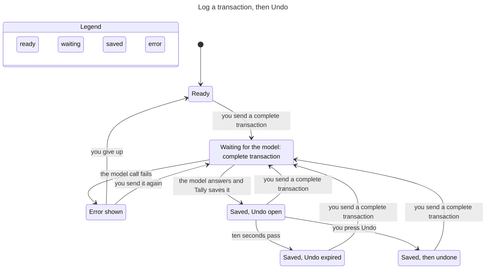
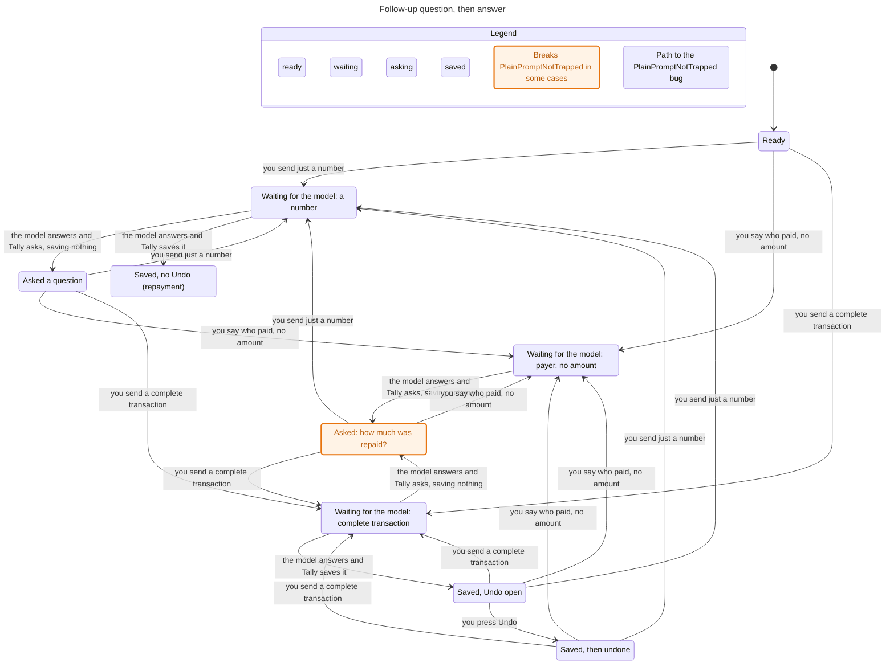
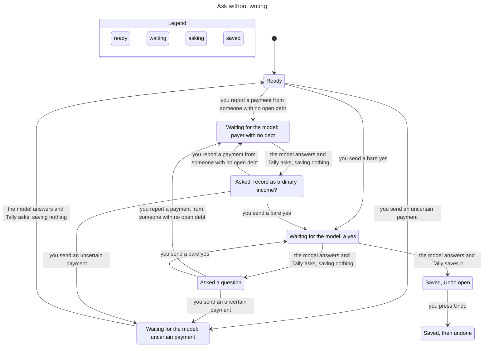

# Assistant state machines

Subsystem: Ask Tally (`src/lib/assistant.ts`, `src/lib/provider.ts`, `src/lib/assistant-followup.ts`, assistant routes, assistant parts of `src/lib/store.ts`). Verified by `.claude/skills/verify-assistant` (sync commit `c006c65`). Charts below are generated from `model/Assistant.tla`; `model/views/*.mjs` and `model/flows/*.cfg` regenerate them.

## Inventory

### 1. Access (consent) — `users.assistant_opt_in` + `assistant_consents.disclosure_hash`

| State | Meaning |
|---|---|
| off | `assistant_opt_in = 0` |
| on | opted in and stored hash equals `providerDisclosureHash()` |
| stale | opted in, but the provider disclosure changed since (hash differs) |

Transitions: `setAssistantConsent(hash)` off/stale to on, `setAssistantConsent(null)` to off (`store.ts:1004`); a disclosure change makes on become stale without any write. Guard: `getAssistantOptIn` (`store.ts:1012`) inside `assertAssistantAccess` (`assistant.ts:13`), checked once per request by both routes (`api/assistant/route.ts`, `api/shortcuts/assistant/route.ts`, the latter after credential lookup and a 30/min limiter). Not re-checked after the model call (finding 2).

### 2. Request (one POST to runAssistantPrompt)

| State | Meaning |
|---|---|
| idle | no request running |
| saved | user message stored (`assistant.ts:684`), model call in flight (`:699`) |
| errored | model call threw, or the reply insert threw |

Transitions: send idle to saved; saved to idle (reply stored, `:1086`); saved to errored on provider error (`provider.ts:289-297`) or when the chat was deleted meanwhile (`addMessage` throws "Conversation not found", `store.ts:1047`). All code after the model call is synchronous (better-sqlite3), so "write + reply" is one step.

### 3. Pending follow-up (the question the last assistant message waits on)

Stored on the assistant message as `followup_kind` (`store.ts:1047`, 17 kinds in `assistant-followup.ts`). Read back only if the **last** stored message is an assistant reply with a kind (`provider.ts:188`). Modeled kinds: none, clarification, ordinary_income, repayment_amount, repayment_payer. Resolution per new prompt (`assistant.ts:749-803` override chain):

| Pending | New prompt | Outcome |
|---|---|---|
| ordinary_income | "yes" | save income, category "Other income" (`:710`, `:752-757`), follow-up cleared |
| ordinary_income | "no" | write nothing, follow-up cleared (`:1085`) |
| repayment_amount / repayment_payer | a bare number (amount) | save the repayment (`:742-743`, `:784-785`), cleared |
| repayment_amount / repayment_payer | a complete unrelated transaction | asks the repayment question again (finding 4) |
| any | uncertain or negated payment wording | write nothing, follow-up cleared (`:725`, `:763`, `:1084`) |
| none | payment with no matching open debt | ask ordinary_income (`:773-774`) |
| none | payer known, amount missing | ask repayment_amount (`:769-770`) |

Debt repayment rule from `AGENTS.md`: ask without writing when wording is negated or uncertain, no debt matches, several debt counterparties are named, the model selects a different payer, or the amount exceeds the balance.

### 4. Undo window (per assistant transaction)

| State | Meaning |
|---|---|
| open | `undo_until` set 10 s after save (`store.ts:825`) |
| expired | now > `undo_until` |
| used | deleted through `DELETE /api/transactions/:id?undo=1` (`api/transactions/[id]/route.ts:19`) |
| none | debt repayment: `undo_until` null and `debt_id` set; `deleteTransaction` rejects it (`store.ts:926-935`) |

### 5. Conversation — live, then deleted (`deleteConversation`, `store.ts:1053`, cascades messages). The widget also holds UI state (`assistant-widget.tsx`: `busy`, `conversationId`, `openTransactionControl`); not modeled.

## Flow 1: log a transaction, then Undo

TLC: 25 states, `UndoOnlyInWindow` holds. A model call can fail and be retried; an Undo after ten seconds is not an arrow because the store refuses it.

## Flow 2: follow-up question, answer, save

TLC: 35 states. `PlainPromptNotTrapped` breaks (marked): from "Asked: how much was repaid?" a complete transaction goes back to the same question and nothing is saved. Repayments leave no Undo (`RepaymentNoUndo` holds). Model-call failures and consent/chat changes are left out of this chart to keep it readable.

## Flow 3: ask without writing

TLC: 26 states. `UncertainNeverWrites` and `OrdinaryIncomeAsked` hold: an uncertain payment returns to Ready with nothing saved, an unmatched payment asks about ordinary income, and income is saved only after that question and a "yes". The "Saved, Undo open" arrow is the confirmed ordinary-income path.

## Findings

All four are replayed against the real code in `model/conformance.test.ts` (tests labelled `FINDING`). Product code was not changed.

1. **`NoDuplicateIntentWrite`: one request saves twice.** Send "Jollibee lunch 250" in chat A. While the model call runs, delete chat A. The transaction is saved, then the reply insert fails with 404, so the user sees an error with no Undo. They send it again in a new chat: second transaction.
2. **`WriteNeedsConsent`: save after consent withdrawn.** Send a prompt; while the model call runs, turn the assistant off in Settings. The transaction is saved anyway because access is checked only before the call.
3. **`FollowupSurvivesError`: a failed model call forgets the question.** After "Ana paid me" / "What amount?", the next message "500" gets an HTTP 502 from the provider. The user message is stored but no reply, so on the next "500" the pending question and "Ana paid me" are gone from the model's context.
4. **`PlainPromptNotTrapped`: pending repayment question swallows an unrelated prompt.** After "Ana paid me" / "What amount should I use for the repayment?", sending "Coffee 120" returns the same question and saves nothing. Only a bare number or a new chat gets out.

## Left out of the model

`bill_*`, `debt_transaction`, `account_or_date` and 11 other follow-up kinds; category, date and account inference; debt creation; finance questions; the widget UI; Shortcut credential auth; the shortcut route returns only `answer` and `conversationId`, so a Shortcut user never gets a transaction id to Undo with (by design, not modeled). Hidden steps in the charts: consent changes, chat deletion, retry after an error (flows 2 and 3 only).
