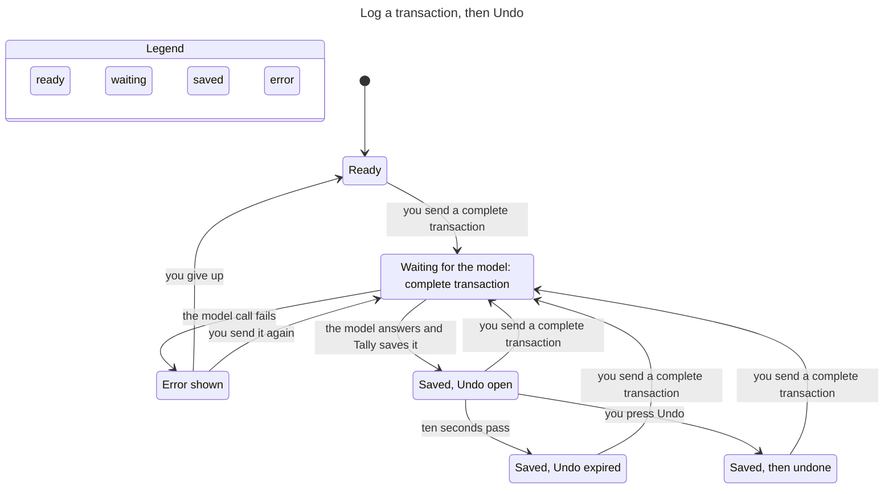
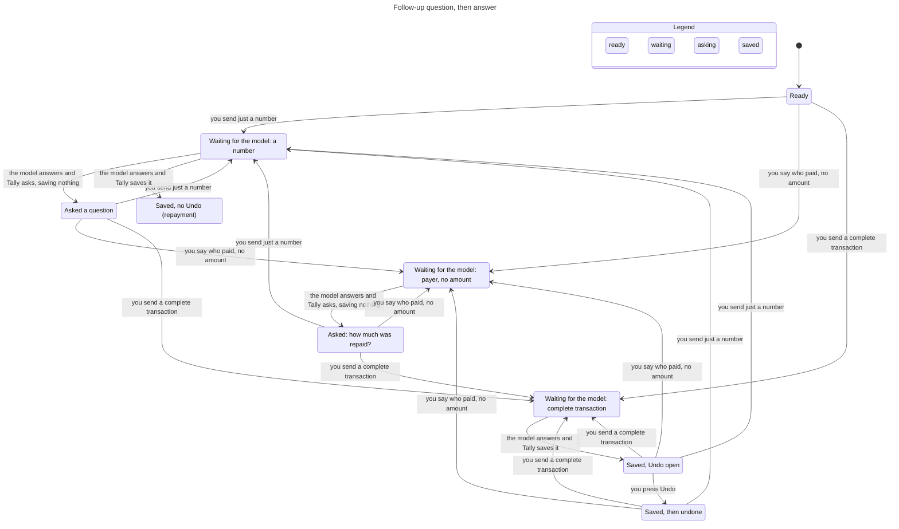
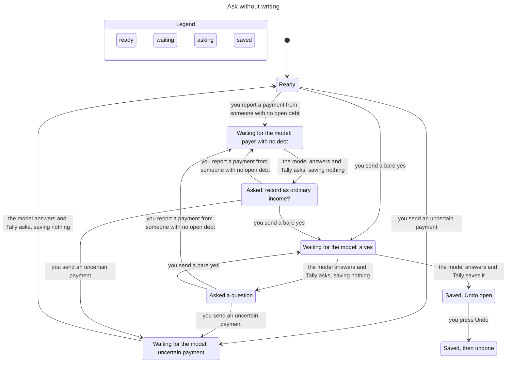

# Assistant state machines

Subsystem: Ask Tally (`src/lib/assistant.ts`, `src/lib/machines/assistant.ts`, `src/lib/provider.ts`, `src/lib/assistant-followup.ts`, assistant routes, assistant parts of `src/lib/store.ts`). Verified by `.claude/skills/verify-assistant` (sync commit `f6ee8eb`). The charts below were edited by hand to match `model/Assistant.tla` after the fixes, because the `/statechart` renderer is not installed here. Regenerate them with that renderer when it is available (`model/views/*.mjs` and `model/flows/*.cfg`).

## Inventory

### 1. Access (consent), stored in `users.assistant_opt_in` and `assistant_consents.disclosure_hash`

| State | Meaning |
|---|---|
| off | `assistant_opt_in = 0` |
| on | opted in and stored hash equals `providerDisclosureHash()` |
| stale | opted in, but the provider disclosure changed since (hash differs) |

Transitions: `setAssistantConsent(hash)` off/stale to on, `setAssistantConsent(null)` to off (`store.ts`). A disclosure change makes on become stale without any write. The state comes from `getAssistantConsent`, and `canWrite` (`machines/assistant.ts`) is the only rule that lets a write happen. Access is checked once per request by both routes (`api/assistant/route.ts`, `api/shortcuts/assistant/route.ts`, the latter after credential lookup and a 30/min limiter), and again inside the turn's commit transaction before any write (`assertAssistantAccess` in `commitTurn`, fixed in `d05bb50`). Every path that stores a turn goes through `commitTurn`, including the local debt-list answer that never calls the model, so none can skip the recheck.

### 2. Request, one POST to runAssistantPrompt

| State | Meaning |
|---|---|
| idle | no request running |
| requesting | model call in flight; nothing is stored yet |
| errored | the model call threw, consent or the chat was gone at commit, or the reply insert threw |

Transitions: send idle to requesting. Requesting to idle when the turn commits: the user message, the write (if any) and the reply are stored in one store transaction (`commitTurn`, `store.transaction`). Requesting to errored when the provider fails or the commit is refused, and then nothing is stored (`d05bb50`, `3f73ccd`). A reply insert that throws rolls the write back too (`c6f5d5b`).

### 3. Pending follow-up, the question the last assistant message waits on

Stored on the assistant message as `followup_kind` (`store.ts`, 17 kinds in `assistant-followup.ts`). Read back only if the **last** stored message is an assistant reply with a kind (`provider.ts:188`). The open run is the messages since the last reply that asked nothing, or since the latest user message flagged `context_start`, whichever is later. A prompt that replaces a question is stored with that flag in the turn's commit (`commitTurn`, `store.addMessage`), so a later turn ("Wallet" answering "Which account?") never reloads the abandoned question. The model has no message history, so this boundary is pinned by a replay and route test, not by an invariant. Modeled kinds: none, clarification, ordinary_income, repayment_amount, repayment_payer. The rule for a new prompt is `pendingOutcome` in `machines/assistant.ts`. Its facts come from the existing wording heuristics in `assistant.ts`:

| Pending | New prompt | Outcome |
|---|---|---|
| ordinary_income | "yes" or "no" | answers the question (`:710`, `:752-757`, `:1085`) |
| repayment_amount | an amount-only reply: "500", "P500", "PHP 500", "500 po", "it was 500", "1,000.50", or an amount with a detail: "500 cash", "500 to Wallet", "500 sa GCash", "500 yesterday", "5k", "500 daw", "500 bucks" | answers it, saves the repayment; a named account is the repayment's account (`:742-743`, `:784-785`) |
| repayment_amount, repayment_payer, ordinary_income | a hedged or negated reply: "maybe 500", "I think 500", "not 500", "500?" | answers it, so the uncertainty guard asks first and writes nothing |
| repayment_amount, repayment_payer | payment wording, uncertain or negated | answers it through the existing branches; uncertain wording writes nothing and clears the question (`:725`, `:763`, `:1084`) |
| repayment_payer | a name with an open debt | answers it (the payer is matched to the debt) |
| repayment_amount, repayment_payer, ordinary_income | a complete prompt that carries its own number and its own subject word ("Coffee 120"), naming no open debt and hedging nothing | **replaces** the question: the question is dropped, the prompt runs with no prior context, as in a new chat (`25e864f`, `64efa45`) |
| repayment_amount, repayment_payer, ordinary_income | no number (for example "Coffee"), or a number whose only other words are a peso marker, filler, a date, an account the user owns or a hedge ("P500", "it was 500", "500 cash") | answers it, as before |
| none | payment with no matching open debt | asks ordinary_income (`:773-774`) |
| none | payer known, amount missing | asks repayment_amount (`:769-770`) |

Debt repayment rule from `AGENTS.md`: ask without writing when wording is negated or uncertain, no debt matches, several debt counterparties are named, the model selects a different payer, or the payment exceeds the balance. This table does not change those rules.

### 4. Undo window, per assistant transaction

| State | Meaning |
|---|---|
| open | `undo_until` set 10 s after save (`undoUntilFor`, `createTransaction`) |
| expired | now > `undo_until` (`canUndo`) |
| used | deleted through `DELETE /api/transactions/:id?undo=1` (`api/transactions/[id]/route.ts`) |
| none | debt repayment: `undo_until` null and `debt_id` set; `deleteTransaction` rejects it (`store.ts`) |

### 5. Conversation, live and then deleted (`deleteConversation`, cascades messages). A new chat is created in the same commit as the first turn that succeeds, so a failed first turn leaves no empty chat. The widget also holds UI state (`assistant-widget.tsx`: `busy`, `conversationId`, `openTransactionControl`); not modeled.

## Flow 1: log a transaction, then Undo

TLC: 24 distinct states, `UndoOnlyInWindow` holds. A model call can fail and be retried; an Undo after ten seconds is not an arrow because the store refuses it.

## Flow 2: follow-up question, answer, save

TLC: 36 distinct states. Every invariant holds. A complete prompt sent while a question is pending no longer returns to the same question: from "Asked: how much was repaid?" it saves as a new request (the `s5 → s3 → s6` path). Repayments leave no Undo (`RepaymentNoUndo` holds). Model-call failures and consent/chat changes are left out of this chart to keep it readable.

## Flow 3: ask without writing

TLC: 26 distinct states. `UncertainNeverWrites` and `OrdinaryIncomeAsked` hold: an uncertain payment returns to Ready with nothing saved, an unmatched payment asks about ordinary income, and income is saved only after that question and a "yes". The "Saved, Undo open" arrow is the confirmed ordinary-income path.

## Findings (all fixed)

Each finding was replayed against the real code before its fix. The conformance replays in `model/conformance.test.ts` (describe block "regressions") now pin the fixed behavior, and `findings.cfg` (`Legacy = TRUE`) still fails on its four invariants, as `doubt.cfg` (`Doubt = TRUE`) does on `AnswerNotReplaced`, so the checks can fail.

1. **`NoDuplicateIntentWrite`: one request saved twice. Fixed in `c6f5d5b`.** The write and the reply committed separately. A chat deleted during the model call left a transaction with no conversation, and a resend saved a second one. The turn now commits its write and reply in one transaction, so a deleted chat saves nothing and the retry saves once.
2. **`WriteNeedsConsent`: save after consent withdrawn. Fixed in `d05bb50`, and again for the local debt-list answer.** Access was checked only before the model call. It is now checked again at commit, before any write. The recheck first lived inside the model branch only, so a local debt-list answer ("List my debts") stored its turn even when consent was withdrawn while the request body streamed. It now sits in `commitTurn` itself, so every stored turn has it.
3. **`FollowupSurvivesError`: a failed model call forgets the question. Fixed in `3f73ccd`.** The user message used to be stored before the call, so after a failure the pending question was no longer the last message. The user message is now stored with the turn's commit, so a failed call changes nothing. It keeps the time the request was received, not the commit time (`receivedAt` in `runAssistantPrompt`), because later follow-ups read relative dates from it. Without that, "lunch today" sent at 23:59:59 and answered "250" after midnight saved on the next day (fixed after review; pinned by route and store tests, not by the model, which has no dates).
4. **`PlainPromptNotTrapped`: a pending question swallows an unrelated prompt. Fixed in `25e864f` (repayment amount, ordinary income) and `64efa45` (repayment payer).** "Coffee 120" after "What amount should I use for the repayment?" used to get the same question, because the repayment context joined every message since the last finished reply. A complete prompt that has its own number and a subject word and names no open debt now replaces the question. An amount-only reply still resolves it, in any common peso form: `pendingOutcome` first treated only "500", "₱500", "500 php" and "500 pesos" as bare, so "P500", "PHP 500", "500 po" and "it was 500" wiped the context and could turn "Ana paid me" into an ordinary-income question (fixed after review; replayed by `PlainPromptNotTrapped (amount forms)`). A wrong "answer" only re-asks, a wrong "replace" drops the user's context, so doubtful wording resolves to "answer".

   The replacement used to last only for its own turn. "Ana paid me" asked for an amount, "Coffee 120 from Missing" replaced it and asked for an account, and then "Wallet" reloaded the abandoned messages and resurrected the repayment question instead of saving the coffee. The replacing user message is now stored with `assistant_messages.context_start = 1` and `minimalFollowUpContext` starts the run there (fixed after review; replayed by `PlainPromptNotTrapped (stays replaced)`).

   The first replacement rule replaced on any word beyond amount filler, which broke the "doubt answers" rule in two ways. A hedged or negated reply ("maybe 500", "perhaps 500", "I think 500", "probably 500", "not 500") lost the pending context, so the uncertainty guard never ran and the provider's `log_transaction` saved a 500 expense or income while Ana's debt stayed. An amount with a detail ("500 cash", "500 to Wallet", "500 sa GCash", "500 yesterday", "5k", "500 daw", "500 bucks") was replaced too, so the provider's `record_debt_payment` found no open debt and Tally offered 500 as ordinary income (fixed after review; replayed by `AnswerNotReplaced (hedged)` and `AnswerNotReplaced (detail)`, and `doubt.cfg` with `Doubt = TRUE` fails on `AnswerNotReplaced`). A prompt now replaces a question only when, once amounts, dates, the user's own account names, answer filler and hedges are removed, it still carries a subject word, and it hedges or negates nothing. A detailed amount reply to a pending repayment amount records the repayment, against the account it names when it names one.

## Left out of the model

`bill_*`, `debt_transaction`, `account_or_date` and the other follow-up kinds; category, date and account inference; debt creation; finance questions; the widget UI; Shortcut credential auth; the shortcut route returns only `answer` and `conversationId`, so a Shortcut user never gets a transaction id to Undo with (by design, not modeled). The abandon path for uncertain payment wording (`uncertainRepayment` in `assistant.ts`) is not a machine outcome: its input scans every message of the run, so it stays with the wording heuristics. Hidden steps in the charts: consent changes, chat deletion, retry after an error (flows 2 and 3 only).
