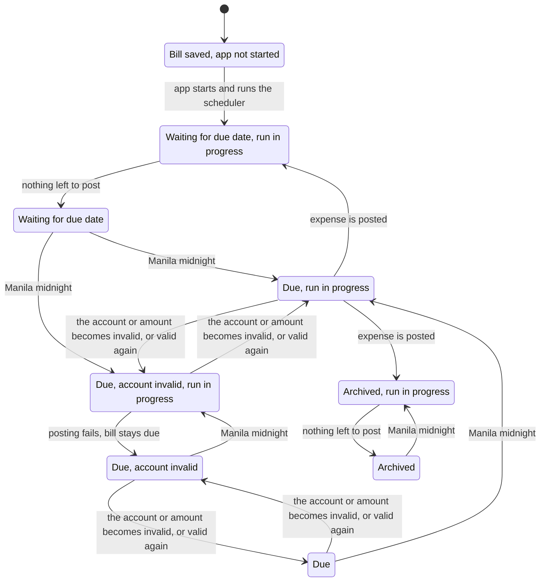

# Bills state machines

Synced to commit `c006c65`. Verification: `.claude/skills/verify-bills`.

## Inventory

### Bill schedule (`bills` row) — `src/lib/store.ts`

| State | Meaning |
|---|---|
| Waiting | `archived_at` null, `next_due_date` > today |
| Due ("Posting pending" in the UI) | `archived_at` null, `next_due_date` <= today |
| Archived | `archived_at` set; terminal, no un-archive path |

| Transition | Guard (file:line) |
|---|---|
| create → Waiting/Due | `validateBillInput` (store.ts:687); date today or later, end >= first date |
| Due → post, stays Waiting/Due | `processDueBills` 757-778: not archived, `next_due_date <= today`, not past end, transaction valid; advances by `advanceBillDate` |
| Due → Archived (post reaches end) | 773-774 `ended` |
| Due → Archived (end already passed) | 762-765 |
| Due → Due (post fails) | catch at 779-781: rollback, failure reported, loop stops for that bill |
| any → Archived (user) | `archiveBill` 744 |
| Waiting/Due → edited | `updateBill` 715; stale `expectedNextDueDate` rejected (724); archives if `next > end` (738); edits of an archived bill never reopen it |

### Scheduler (`src/lib/bill-scheduler.ts`)

`not started → running` (once, `started` guard, line 13-16; production only via `src/instrumentation.ts`) `→ waiting for midnight (timer pending) → running → waiting`. A run that throws or reports failures still re-arms the timer (lines 17-24). `nextBillRunAt` returns the next strict Manila midnight, so a timer that fires early re-arms for a tiny delay.

## Main flow (model slice `BillsFlow.tla`, no edits, no manual archive)

The chart hides 43 steps that stay in one chart state (for example a toggle of the account while waiting). "Expense is posted" from a due bill goes back to Waiting; a bill several periods late posts one expense per missed date in the same run, then stops. Reaching the end date archives the bill in the same step as its last post.

## Findings

1. **Editing the next due date back to a posted date posts it again** (`Edit.cfg`, rule `NoDoublePost`; reproduced on the real store by `conformance.test.ts`). Path: bill posted for 10-09 → you edit next due date to 10-09 → the save runs `processDueBills` → second 10-09 expense. Cause: `validateBillInput` only requires `nextDueDate >= today` (store.ts:709) and nothing remembers which dates were posted. Whether this is wanted ("re-run this date") is a product decision; today it is silent.
2. Everything else holds in the bounded model and the replay: no post for archived, not-yet-due or past-end bills; each date once under non-date edits; no date lost after a failed posting; the timer re-arms after success, failure and crash; only edits move the date backwards.
3. Persistent failures are retried once per midnight and on each save of any bill (the PATCH route runs the whole batch), never sooner; the bill shows "Posting pending" meanwhile.

Not covered: calendar arithmetic, multiple bills or users, money values, assistant bill dialog, second app instance (the app is documented as single-instance; two processes would still be guarded by the `next_due_date=?` conditional UPDATE inside a transaction, but that is not modelled).
