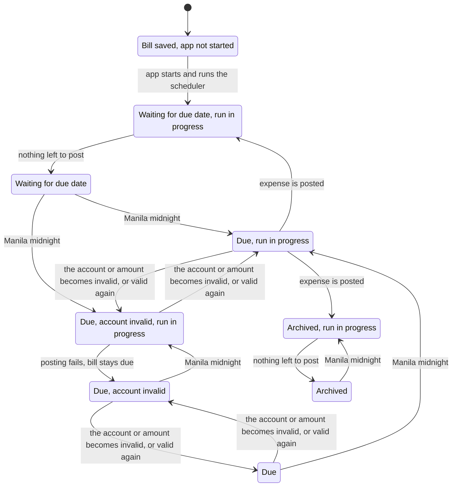

# Bills state machines

Synced to commit `39578af`. Verification: `.claude/skills/verify-bills`. Pure rules: `src/lib/machines/bill.ts`.

## Inventory

### Bill schedule (`bills` row)

The machine file names six states. Three are read off the stored row, and three are the outcome of one posting attempt.

| State | Kind | Meaning |
|---|---|---|
| not-yet-due | stored | `archived_at` null, `next_due_date` > today |
| due ("Posting pending" in the UI) | stored | `archived_at` null, `next_due_date` <= today |
| archived | stored | `archived_at` set; terminal, no un-archive path |
| posted-and-advanced | outcome | a post; `next_due_date` moves by one cadence and the bill stays active |
| ended | outcome | a post whose next date passes the end date, or a due date already past it; the bill is archived in the same step |
| failed-keeps-date | outcome | a post that throws; rolled back, the date is kept, the failure is reported |

| Transition | Guard (function) |
|---|---|
| create → not-yet-due or due | `validateBillInput` in `store.ts`: date today or later, end on or after first date |
| due → posted-and-advanced | `planPosting` returns `post` (not archived, due, next date not past end); the store inserts the expense and advances with `advanceBillDate` |
| due → ended | `planPosting` returns `post` with `ends` (next date passes end), or `end` (due date already past end, nothing posted) |
| due → failed-keeps-date | the transaction throws: rollback, failure reported, loop stops for that bill |
| any → archived (user) | `archiveBill` |
| not-yet-due or due → edited | `updateBill`: stale `expectedNextDueDate` rejected; a next due date on or before `last_posted_due_date` rejected by `canScheduleDueDate`; archives if `next > end`; edits of an archived bill never reopen it |

`last_posted_due_date` records the due date of the last successful post. It is set in the same statement that advances the schedule.

### Scheduler (`src/lib/bill-scheduler.ts`)

`not started → running` (once, `started` guard; production only via `src/instrumentation.ts`) `→ waiting for midnight (timer pending) → running → waiting`. A run that throws or reports failures still arms the next timer, in a `finally` block. `nextBillRunAt` returns the next strict Manila midnight, so a timer that fires early re-arms for a tiny delay.

## Main flow (model slice `BillsFlow.tla`, no edits, no manual archive)

The chart hides 43 steps that stay in one chart state (for example a toggle of the account while waiting). "Expense is posted" from a due bill goes back to Waiting; a bill several periods late posts one expense per missed date in the same run, then stops. Reaching the end date archives the bill in the same step as its last post.

## Findings

1. **Fixed in `39578af`.** Editing the next due date back to a posted date used to post that date again (`NoDoublePost`, `Unguarded.cfg` still shows the old behavior; `conformance.test.ts` and the store test pin the fix). The product call: the edit is refused with "was already posted", since a silent re-post and a silent skip are both wrong. Forward edits and edits to an unposted date after the last post still work.
2. Everything else holds in the bounded model and the replay: no post for archived, not-yet-due or past-end bills; each date once under non-date edits; no date lost after a failed posting; the timer re-arms after success, failure and crash; only edits move the date backwards, and never onto a posted date.
3. Persistent failures are retried once per midnight and on each save of any bill (the PATCH route runs the whole batch), never sooner; the bill shows "Posting pending" meanwhile.

Not covered: calendar arithmetic, multiple bills or users, money values, assistant bill dialog, second app instance (the app is documented as single-instance; two processes would still be guarded by the `next_due_date=?` conditional UPDATE inside a transaction, but that is not modelled). Bills posted before `last_posted_due_date` existed have no record until their next post, so an edit to a date posted before the deploy is not refused yet.
