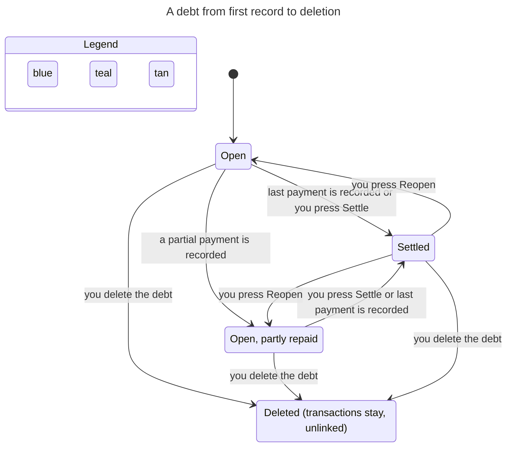

# Debt register state machines

Skill: `.claude/skills/verify-debts` (TLA+ model + replay tests). Machine: `src/lib/machines/debt.ts`. Last confirmed at commit `6793ed8`.

## Inventory

| Machine | States | Transitions (guard, code) |
|---|---|---|
| **Debt status** (`debts.status`) | `open`, `settled` | create → `open` (`createDebt`, store.ts). Payment that leaves a balance → `open`, amount reduced; payment that clears it → `settled`, amount kept (`debtAfterPayment`, machines/debt.ts; guard `acceptsPayment`: open and direction match, in `recordDebtPayment` and `recordDebtRepayment`; payment ≤ amount). Settle/Reopen button → either way, any time, amount kept (`nextDebtStatus`, machines/debt.ts, used by `updateDebtInternal`). |
| **Debt record life** | exists → deleted | `deleteDebt` store.ts. History rows cascade away; linked transactions keep their row with `debt_id` set to NULL (foreign keys, db schema); counterparty row removed when unused. |
| **Direction lock** | free → locked | A debt gets locked the moment any transaction links to it (`canChangeDirection`, machines/debt.ts, called from `updateDebtInternal`). Never unlocks, except by deleting the debt. |
| **Advance link** | none → linked | One advance transaction per debt, open debts only (`acceptsAdvance`), amount must equal the debt's current amount (`recordDebtAdvanceTransaction`). |
| **Payment history** (`debt_payments`) | append-only | `payment` rows (delta −amount) from the two payment functions. `adjustment` rows (signed delta) from `updateDebt` by `historyAdjustmentForUpdate`: an amount change on an open debt, and a reopen, bring the history to the amount. An amount edit on a settled debt and a settle write none. A history that older versions left negative can make one move to a large amount pass the exact integer range, so that move is written as two adjustments through zero, each exact. |
| **UI row** | Outstanding / Settled · last outstanding balance | `debts-view.tsx` labels by status; button toggles via PATCH `status`. |

Two facts the lifecycle hides: a settled debt's amount is a label, not a balance, and a transaction linked to a debt can't be deleted on its own (`deleteTransaction`, store.ts:926).

## Main flow: lend, get repaid, settle, reopen, delete

The chart was generated from `model/Debts.cfg`'s flow variants `Debts_FlowOwed.cfg` and `Debts_FlowOwe.cfg` (118 TLC states each). Both directions have the same shape; only the sign of the cash movement differs (receiving raises cash, repaying lowers it). Hidden: advance, amount edit and direction edit steps.

Colors: blue = open. Teal = settled. Tan = deleted. The reopened state no longer appears, because reopen agrees with history.

## Findings

1. **Reopen disagrees with payment history** (rule `OpenAmountMatchesHistory`, and `HistoryNeverNegative`). Fixed in `33ce376`. Reopen writes one adjustment to the amount, and an amount edit on a settled debt writes none. The rule is `historyAdjustmentForUpdate` in `src/lib/machines/debt.ts`. Tests: `tests/debts.test.ts` ("reopening a payment-settled debt writes an adjustment…", "reopening a settled debt with a new amount…", "editing a settled debt's amount writes no adjustment…", "reopens a payment-settled debt at its largest safe amount…", "reopens a legacy debt whose history went negative at the largest safe amount…") and `tests/debt-machine.test.ts`. The legacy test covers a history that main left negative (create 100,000, pay in full, reopen at 50,000, pay in full again, which leaves -100,000). Reopening that debt at the largest safe amount used to compute a rounded adjustment one unit too high, and every later edit of the debt then failed with "Derived debt balance exceeds the supported exact PHP minor-unit range". The model cannot reach such a history (`HistoryNeverNegative` holds), so only the store test pins it.
2. **Holds**: payments cannot exceed the balance; cash moves by exactly the linked payments and advance; settled debts accept no payment or advance; direction is frozen once a transaction links; deleting a debt leaves no transaction pointing at it.

## Not covered

SQLite atomicity (assumed from `db.transaction(...).immediate()`), the assistant's payer matching and follow-ups, counterparty rows, income/spending classification of `debt_repayment`, several debts at once, amounts beyond 1–3 units.
