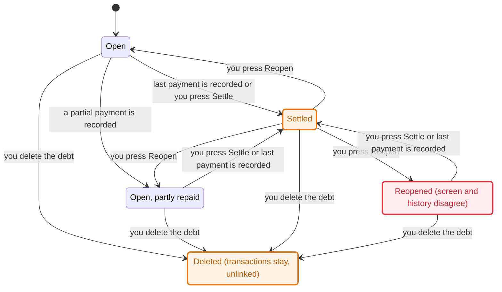

# Debt register state machines

Skill: `.claude/skills/verify-debts` (TLA+ model + replay tests). Last confirmed at commit `c006c65`.

## Inventory

| Machine | States | Transitions (guard, code) |
|---|---|---|
| **Debt status** (`debts.status`) | `open`, `settled` | create → `open` (`createDebt`, store.ts:533). Payment that leaves a balance → `open`, amount reduced; payment that clears it → `settled`, amount kept (`debtAfterPayment`, lifecycle.ts:20; guard `status === "open"` and direction match, `recordDebtPayment` store.ts:829, `recordDebtRepayment` store.ts:851; payment ≤ amount). Settle/Reopen button → either way, any time, amount kept (`updateDebtInternal` store.ts:589, status allowed values store.ts:602). |
| **Debt record life** | exists → deleted | `deleteDebt` store.ts:625. History rows cascade away; linked transactions keep their row with `debt_id` set to NULL (foreign keys, db schema); counterparty row removed when unused. |
| **Direction lock** | free → locked | A debt gets locked the moment any transaction links to it (`updateDebtInternal`, store.ts:603-605). Never unlocks, except by deleting the debt. |
| **Advance link** | none → linked | One advance transaction per debt, open debts only, amount must equal the debt's current amount (`recordDebtAdvanceTransaction` store.ts:569). |
| **Payment history** (`debt_payments`) | append-only | `payment` rows (delta −amount) from the two payment functions, `adjustment` rows (signed delta) from `updateDebt` when the amount changes (store.ts:612-617). Reopen and settle write none. |
| **UI row** | Outstanding / Settled · last outstanding balance | `debts-view.tsx:200` labels by status; button toggles via PATCH `status` (debts-view.tsx:110, :212). |

Two facts the lifecycle hides: a settled debt's amount is a label, not a balance, and a transaction linked to a debt can't be deleted on its own (`deleteTransaction`, store.ts:926).

## Main flow: lend, get repaid, settle, reopen, delete

The chart was generated from `model/Debts.cfg`'s flow variants `Debts_FlowOwed.cfg` and `Debts_FlowOwe.cfg` (82 TLC states each). Both directions have the same shape; only the sign of the cash movement differs (receiving raises cash, repaying lowers it). Hidden: advance, amount edit and direction edit steps.

Colors: blue = open and agrees with history, teal = settled, orange/red = reopened and disagreeing, tan = deleted.

## Findings

1. **Reopen disagrees with payment history** (rule `OpenAmountMatchesHistory`, and `HistoryNeverNegative`). Path: Open → last payment is recorded → Settled → you press Reopen → "Reopened (screen and history disagree)" → another payment → history is negative. The screen shows the retained amount as outstanding; the history says 0. Second route: edit a settled debt's amount down; the adjustment is computed against the retained amount, so the history goes negative. Pinned today by `tests/debts.test.ts` ("sums payment deltas exactly…"). No product code reads the history balance yet, so users don't see it. Fix shape (model variant `Debts_ReopenFix.cfg` passes every rule): reopen writes an adjustment that makes history equal the amount, and edits on a settled debt write none.
2. **Holds**: payments cannot exceed the balance; cash moves by exactly the linked payments and advance; settled debts accept no payment or advance; direction is frozen once a transaction links; deleting a debt leaves no transaction pointing at it.

## Not covered

SQLite atomicity (assumed from `db.transaction(...).immediate()`), the assistant's payer matching and follow-ups, counterparty rows, income/spending classification of `debt_repayment`, several debts at once, amounts beyond 1–3 units.
