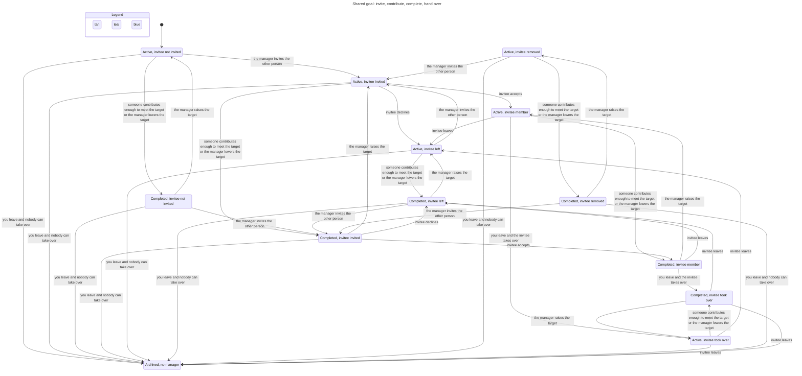

# Goals state machines

Verified by `.claude/skills/verify-goals` (TLA+ model, sync commit `c006c65`).

## Inventory

| Machine | States | Legal moves (guard) |
|---|---|---|
| Goal status | `active`, `completed`, `archived` | `nextGoalStatus` (`src/lib/lifecycle.ts:8`): archived is terminal; otherwise completed iff raised ≥ target. Recomputed on contribution add/edit/delete (`store.ts:1153, 1173, 1184`) and target change (`store.ts:1124`). Archived is set only by `succession` (`store.ts:1131`). |
| Membership | none, `invited`, `accepted`, `left`, `removed`, `former` | `MEMBERSHIP_MOVES` (`lifecycle.ts:27`): invite from none/left/removed; accept/decline from invited; leave/remove from accepted. `former` only by account deletion (`store.ts:1204`). |
| Manager | a user, or none | Set at `createGoal` (`store.ts:1063`); changed only by `succession` (`store.ts:1127`) from `changeMembership` (`:1133`) and `deleteAccountOwner` (`:1200`). |
| Contribution | exists / deleted; owner or "Former member" | Add needs an accepted member and an `active` goal (`store.ts:1145`); edit and delete need the owner to be an accepted member (`:1158`, `:1177`). |

## Main flow: invite, contribute, complete, hand over

Two people; person 1 manages. Chart from `goals-flow.cfg` (132 model states, 38 arrows; edits, disabling and account deletion left out; steps that stay in one state are not drawn).

The view hides edits, disabling and account deletion. Regenerate with `/statechart` on `goals-flow.cfg` and `goals-flow.view.mjs`. Leaving as the last accepted member archives the goal; leaving with another accepted, enabled member hands management to them.

## Rules that hold (all 7 pass, 292,512 states)

Manager matches status; completed iff target met; former members own nothing; membership moves only along the table; contributions only while active; archived is terminal.

## Findings

1. **Stale invitation accepted after archive** (rule: an archived goal has no accepted member). Path: manager invites → manager leaves (goal archived) → invitee accepts. `respondInvitation` (`store.ts:1100`) ignores goal status. Low impact.
2. **Disabled manager stays manager** (rule: a live goal's manager is enabled). Path: admin disables the manager → goal active, manager cannot sign in. `setUserEnabled` (`store.ts:334`) has no succession. Medium impact: nobody else can manage the goal.

Both replay against the real store in `.claude/skills/verify-goals/replay/goals-replay.test.ts`.
