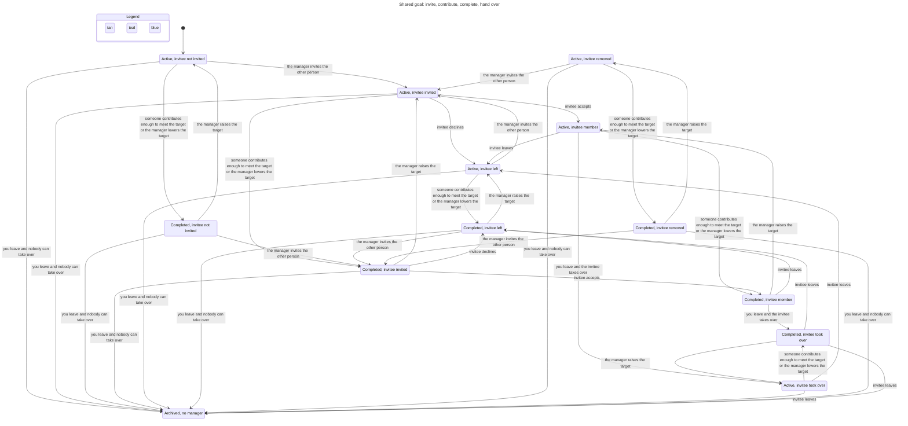

# Goals state machines

Verified by `.claude/skills/verify-goals` (TLA+ model, sync commit `1e42762`).

## Inventory

| Machine | States | Legal moves (guard) |
|---|---|---|
| Goal status | `active`, `completed`, `archived` | `nextGoalStatus` (`src/lib/machines/goal.ts:9`): archived is terminal; otherwise completed iff raised ≥ target. Recomputed on contribution add/edit/delete (`store.ts:1170, 1191, 1202`) and target change (`store.ts:1134`). Archived is set only by `succession` (`store.ts:1137`). |
| Membership | none, `invited`, `accepted`, `left`, `removed`, `former` | `MEMBERSHIP_MOVES` (`machines/goal.ts:19`): invite from none/left/removed; accept/decline from invited; leave/remove from accepted. `former` only by account deletion (`store.ts:1205`). Accept is refused on an archived goal (`answerInvitation`, `machines/goal.ts:33`). |
| Manager | a user, or none | Set at `createGoal`; changed only by `succession` (choice by `decideSuccession`, which takes a cause). A leaving, removed or deleted manager (`changeMembership`, `deleteAccountOwner`) hands the goal to the earliest enabled accepted member, or archives it when there is none. A disabled manager does the same hand-over, but with no such member nothing changes: the goal, its manager and its memberships wait for the re-enable. `handOverFromDisabledManager` runs after `setUserEnabled` in either direction and after an invitation is accepted, so the goal moves as soon as an enabled accepted member exists. Archiving closes every accepted membership. |
| Contribution | exists / deleted; owner or "Former member" | Add needs an accepted member and an `active` goal (`contributionRefusal`, `machines/goal.ts:41`, used at `store.ts:1161`); edit and delete need the owner to be an accepted member (`store.ts:1175`, `:1194`). |

## Main flow: invite, contribute, complete, hand over

Two people; person 1 manages. Chart from `goals-flow.cfg` (108 model states, 38 arrows; edits, disabling and account deletion left out; steps that stay in one state are not drawn).

The view hides edits, disabling and account deletion. Regenerate with `/statechart` on `goals-flow.cfg` and `goals-flow.view.mjs`. Leaving as the last accepted member archives the goal; leaving with another accepted, enabled member hands management to them. Disabling the last enabled accepted member archives nothing.

## Rules that hold (all 10 pass, 206,757 states)

Manager matches status; a live goal's manager is enabled unless no other enabled accepted member exists; completed iff target met; former members own nothing; membership moves only along the table; contributions only while active; an archived goal has no accepted member; archived is terminal; enabling or disabling a user never archives a goal or closes a membership.

## Findings (all fixed)

1. **Stale invitation accepted after archive** (rule: an archived goal has no accepted member). Path: manager invites → manager leaves (goal archived) → invitee accepts. Fixed: `answerInvitation` refuses accept on an archived goal. Decline still records "left". Low impact before the fix.
2. **Disabled manager stays manager** (rule: a live goal's manager is enabled, unless nobody else can take over). Path: admin disables the manager → goal active, manager cannot sign in. Fixed: `setUserEnabled` hands the goal to the earliest enabled accepted member, as leaving does. Medium impact before the fix: nobody else could manage the goal.
3. **Disabled member stays accepted after archive** (found while fixing 2; same rule as 1). Path: a disabled accepted member remains accepted when the last enabled manager leaves and the goal archives. Fixed: archiving closes every accepted membership to "left". Archived goals are hidden, so nothing a user sees changes.
4. **Disabling archived a goal nobody else could take over** (rule: enabling or disabling a user never archives a goal; found in review, a regression of the fix for 2). Path: Bob creates a goal alone and adds ₱400 → admin disables Bob → admin re-enables Bob. The goal was archived at the disable, so it and its contributions vanished from Bob's view and `addContribution` and `updateGoal` answered "Goal not found." The product decision is that disabling is reversible, so it hands the goal on when an enabled accepted member exists and otherwise leaves the goal, its manager and its memberships alone. Account deletion and a manager leaving keep their rule and archive when no one can take over. Fixed in `decideSuccession`, which takes a cause (`leave` or `disable`) and answers `keep` for a disable with no successor. Two follow-on moves keep the first rule true: enabling a member while the manager is disabled, and accepting an invitation while the manager is disabled, hand the goal to the enabled accepted member (`handOverFromDisabledManager`). Pinned by the tests "a goal only the disabled user belongs to comes back whole when they are re-enabled", "disabling the only enabled member keeps the goal, its manager and every membership, so re-enabling restores it", "enabling a member hands a goal held by a disabled manager to them", "accepting an invitation hands a goal held by a disabled manager to the new member", "deleting the account of the only enabled member still archives the goal and closes the disabled members". `goals-archive-on-disable.cfg` (the earlier rule) fails `TogglingNeverArchives`; `goals-no-handover.cfg` (no hand-over at all) fails `ManagerIsEnabledUnlessAlone`.

Replay tests: `tests/goals.test.ts`. Pure rules: `tests/goal-machine.test.ts`.
