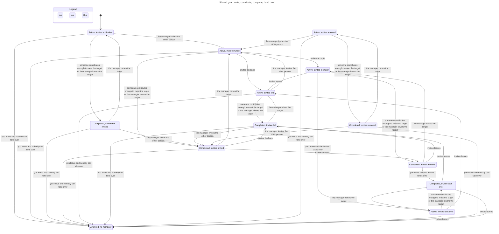

# Goals state machines

Verified by `.claude/skills/verify-goals` (TLA+ model, sync commit `1e42762`).

## Inventory

| Machine | States | Legal moves (guard) |
|---|---|---|
| Goal status | `active`, `completed`, `archived` | `nextGoalStatus` (`src/lib/machines/goal.ts:9`): archived is terminal; otherwise completed iff raised ≥ target. Recomputed on contribution add/edit/delete (`store.ts:1170, 1191, 1202`) and target change (`store.ts:1134`). Archived is set only by `succession` (`store.ts:1137`). |
| Membership | none, `invited`, `accepted`, `left`, `removed`, `former` | `MEMBERSHIP_MOVES` (`machines/goal.ts:19`): invite from none/left/removed; accept/decline from invited; leave/remove from accepted. `former` only by account deletion (`store.ts:1205`). Accept is refused on an archived goal (`answerInvitation`, `machines/goal.ts:33`). |
| Manager | a user, or none | Set at `createGoal` (`store.ts:1064`); changed only by `succession` (`store.ts:1137`, choice by `decideSuccession`, `machines/goal.ts:58`) from `changeMembership` (`store.ts:1156`), `setUserEnabled` when disabling (`store.ts:342`) and `deleteAccountOwner` (`store.ts:1219`). Archiving closes every accepted membership. |
| Contribution | exists / deleted; owner or "Former member" | Add needs an accepted member and an `active` goal (`contributionRefusal`, `machines/goal.ts:41`, used at `store.ts:1161`); edit and delete need the owner to be an accepted member (`store.ts:1175`, `:1194`). |

## Main flow: invite, contribute, complete, hand over

Two people; person 1 manages. Chart from `goals-flow.cfg` (108 model states, 38 arrows; edits, disabling and account deletion left out; steps that stay in one state are not drawn).

The view hides edits, disabling and account deletion. Regenerate with `/statechart` on `goals-flow.cfg` and `goals-flow.view.mjs`. Leaving as the last accepted member archives the goal; leaving with another accepted, enabled member hands management to them.

## Rules that hold (all 9 pass, 160,668 states)

Manager matches status and is enabled; completed iff target met; former members own nothing; membership moves only along the table; contributions only while active; an archived goal has no accepted member; archived is terminal.

## Findings (all fixed in `1e42762`)

1. **Stale invitation accepted after archive** (rule: an archived goal has no accepted member). Path: manager invites → manager leaves (goal archived) → invitee accepts. Fixed: `answerInvitation` refuses accept on an archived goal. Decline still records "left". Low impact before the fix.
2. **Disabled manager stays manager** (rule: a live goal's manager is enabled). Path: admin disables the manager → goal active, manager cannot sign in. Fixed: `setUserEnabled` runs `succession` for every goal the user manages, as leaving does. Medium impact before the fix: nobody else could manage the goal.
3. **Disabled member stays accepted after archive** (found while fixing 2; same rule as 1). Path: a disabled accepted member remains accepted when the last enabled manager leaves and the goal archives. Fixed: archiving closes every accepted membership to "left". Archived goals are hidden, so nothing a user sees changes.

Replay tests: `tests/goals.test.ts`. Pure rules: `tests/goal-machine.test.ts`.
