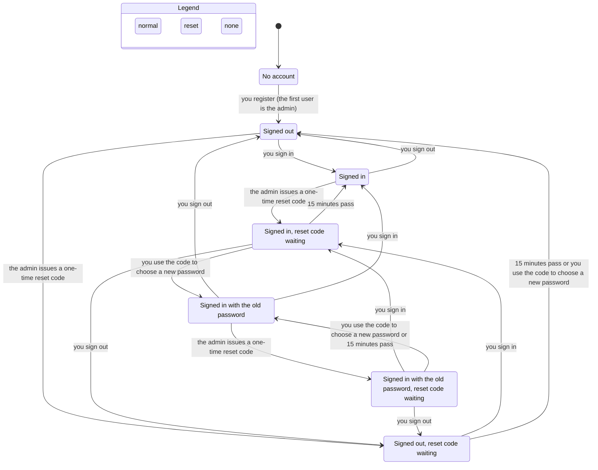
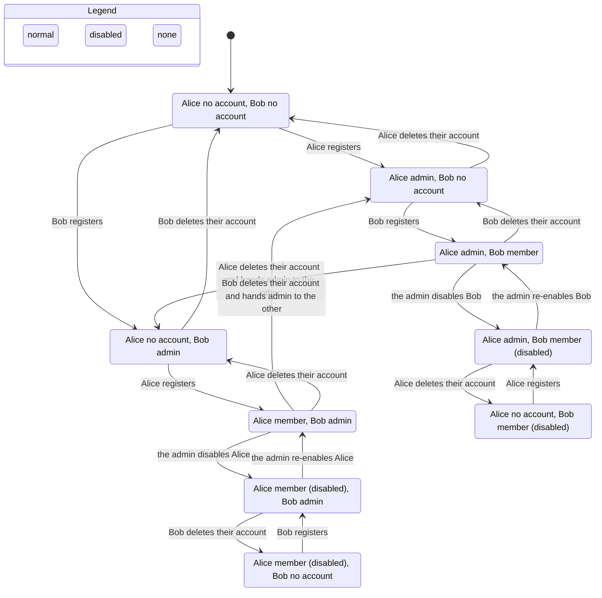

# Identity and access: state machines

Verified by `.claude/skills/verify-identity-access` (TLA+, synced at commit c006c65). Line numbers are for that commit.

## Inventory

### 1. User account (`users` row)
States: **absent**, **active** (`enabled=1`), **disabled** (`enabled=0`). Role is a second field: `admin` or `user`.

| Move | From → to | Guard | Code |
|---|---|---|---|
| register | absent → active | username 3–32 `[A-Za-z0-9_]`, unique (NOCASE); role = admin iff no admin row exists, inside one `immediate` transaction | `store.ts:303` |
| disable | active → disabled | caller is admin and not the target | `store.ts:334`, `api/admin/users/route.ts` |
| enable | disabled → active | caller is admin | same |
| delete | active → absent | correct password; an admin must name another *enabled* user when one exists, who becomes admin; with no other enabled user the admin may delete and no admin remains | `store.ts:1188`, `api/account/route.ts` |

### 2. Reset credential (`reset_token_hash`, `reset_expires_at`)
States: **none**, **live** (15 minutes), **expired**. Issue: admin, enabled user only, replaces any earlier credential (`api/admin/users/[id]/reset/route.ts`, `store.ts:339`). Consume: enabled user, matching hash, not expired; clears the credential and sets the new password hash (`store.ts:343`, `api/auth/reset/route.ts`). Disabling does not clear it.

### 3. Browser session (JWT cookie `tally_session`, 7 days)
States: **none**, **live**. Created by login and register (enabled users only for login). Every request re-reads the user row: valid only if the row exists and is enabled (`auth.ts:27-30`). Role comes from the row, not the token. Not tied to the password.

### 4. Shortcut credential (`shortcut_credential_hash`)
States: **none**, **live**. Create/rotate and revoke by the signed-in user (`api/settings/shortcut-credential/route.ts`, `store.ts:351`). Lookup only matches enabled users (`store.ts:355`). Not touched by password reset.

## Flow 1: sign up, sign in, admin reset (one person)

Hidden from the chart: requests made with a live session, Shortcut credential use and creation, and account deletion (every state has these). "15 minutes pass or you use the code" on one arrow means the two end in the same chart state; they differ in what the user's password becomes.

Reading it: the **"Signed in with the old password"** states are the finding `ResetEndsOldSessions`. After the reset the old session is still accepted.

## Flow 2: admin role, disabling, deleting with handoff (two people)

Reading it: the first person to register is admin; deleting an admin with another enabled user hands admin over; the admin can disable and re-enable others. The two bottom-right chains show the edge case: Alice (admin) deletes her account while Bob is disabled, no admin remains, and the next registrant becomes admin again.

## Findings

All three break rules in the model. The model matches the code; the code breaks them. No product code was changed.

1. **Reset does not end old sessions** (`ResetEndsOldSessions`). Path: Alice registers → signs in → admin issues a reset code → she uses it. Her old session still works for up to 7 days.
2. **Reset does not revoke the Shortcut credential** (`ResetEndsOldShortcuts`). Path: Alice registers → creates a Shortcut credential → admin issues a code → she uses it. The credential still works.
3. **Disable then enable revives an unused reset code** (`ResetNotRevivedByEnable`). Path: Alice and Bob register → admin issues Bob a code → admin disables Bob → admin re-enables Bob. The code is live again until it expires.

Rules that hold: `AtMostOneAdmin`, `AdminIsEnabled`, `AdminWhileEnabledUsers`, `AccessNeedsEnabledUser`, `ResetSingleUse`, `DeletedLeavesNothing`, no deadlock.

Observation (not a broken rule): with every other user disabled, the sole admin can delete their account without a handoff, and the next registrant is then admin.

## Not modeled

Passwords, rate limits, same-origin checks, JWT signing and expiry, goal and debt side effects of account deletion, more than two users.
