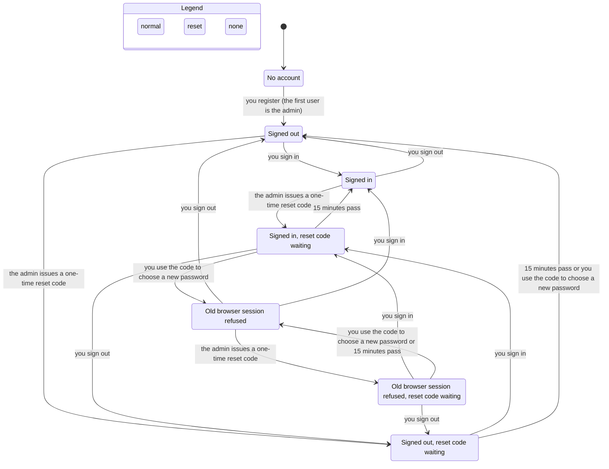
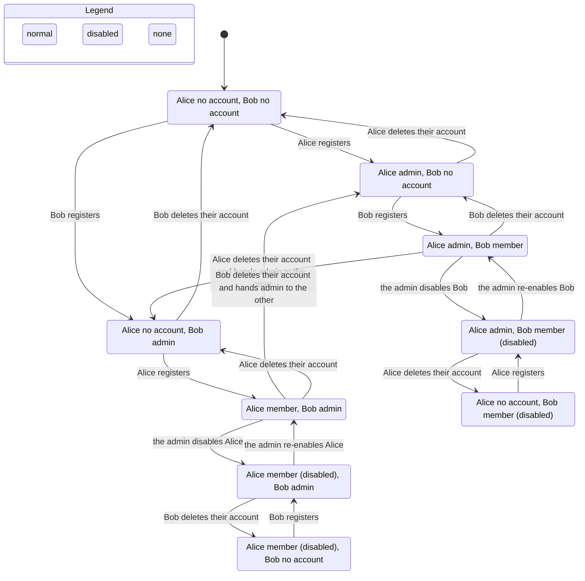

# Identity and access: state machines

Verified by `.claude/skills/verify-identity-access` (TLA+). The model matches the code at commit `ea526d7`, which moved the account rules into `src/lib/machines/identity.ts`. Line numbers are for that commit.

## Inventory

### 1. User account (`users` row)
States: **absent**, **active** (`enabled=1`), **disabled** (`enabled=0`). Role is a second field: `admin` or `user`. The transitions are decided by `nextAccountState` and `deleteRefusal` in `src/lib/machines/identity.ts`; the store persists the result.

| Move | From → to | Guard | Code |
|---|---|---|---|
| register | absent → active | username 3–32 `[A-Za-z0-9_]`, unique (NOCASE); role = admin iff no admin row exists (`roleForRegistration`), inside one `immediate` transaction | `registerUser` |
| disable | active → disabled | caller is admin and not the target; drops any outstanding reset code; a goal the user manages passes to its earliest enabled accepted member, and with none stays as it is (see [goals.md](goals.md)) | `setUserEnabled`, `api/admin/users/route.ts` |
| enable | disabled → active | caller is admin; a goal held by a disabled manager passes to the enabled user if they are an accepted member and no earlier one exists | `setUserEnabled`, `api/admin/users/route.ts` |
| delete | active → absent | correct password; an admin must name another *enabled* user when one exists, who becomes admin (`deleteRefusal`); with no other enabled user the admin may delete and no admin remains | `deleteAccountOwner`, `api/account/route.ts` |

### 2. Reset credential (`reset_token_hash`, `reset_expires_at`)
States: **none**, **live** (15 minutes), **expired**. Issue: admin, enabled user only, replaces any earlier credential (`api/admin/users/[id]/reset/route.ts`, `setResetCredential`). Consume: enabled user, matching hash, not expired. One `immediate` transaction sets the new password hash, clears the credential, bumps the account's session version and clears the Shortcut credential (`consumeResetCredential`, `api/auth/reset/route.ts`). Disabling clears the credential, so enabling again cannot revive it (`setUserEnabled`).

### 3. Browser session (JWT cookie `tally_session`, 7 days)
States: **none**, **live**, **stale**. Created by login and register (enabled users only for login). The token carries the user's `sessionVersion`, taken from the row the caller verified (the login route passes the row it compared the password against, registration passes the new row's version), never reread inside `setSession` (`auth.ts`). A reset that commits while login is awaiting the password check therefore leaves that login with the old version, and the next request refuses it. Every request re-reads the user row: valid only if the row exists, is enabled, and the token's version equals the row's (`currentUser` in `auth.ts`). A password reset bumps the row's version, so every earlier token is stale. Role comes from the row, not the token. A token with no version claim, such as one from before this change, is refused, so those users sign in once more after the deploy.

### 4. Shortcut credential (`shortcut_credential_hash`)
States: **none**, **live**. Create/rotate and revoke by the signed-in user (`api/settings/shortcut-credential/route.ts`, `setShortcutCredentialHash`). Lookup only matches enabled users (`findEnabledUserByShortcutCredentialHash`). A password reset clears it.

## Flow 1: sign up, sign in, admin reset (one person)

Hidden from the chart: requests made with a live session, Shortcut credential use and creation, and account deletion (every state has these). "15 minutes pass or you use the code" on one arrow means the two end in the same chart state; they differ in what the user's password becomes.

Reading it: the **"Old browser session refused"** state shows the fix for `ResetEndsOldSessions`. After the reset the old browser session is refused, and the user has to sign in again.

## Flow 2: admin role, disabling, deleting with handoff (two people)

Reading it: the first person to register is admin; deleting an admin with another enabled user hands admin over; the admin can disable and re-enable others. The two bottom-right chains show the edge case: Alice (admin) deletes her account while Bob is disabled, no admin remains, and the next registrant becomes admin again.

## Findings

The first three were rules the code broke. They are fixed in `ea526d7`, and the model now holds each rule.

1. **Reset ends old sessions** is fixed (`ResetEndsOldSessions`). Path: Alice registers → signs in → admin issues a reset code → she uses it. Her old session is now refused, because its version no longer matches (`currentUser`).
2. **Reset revokes the Shortcut credential** is fixed (`ResetEndsOldShortcuts`). Path: Alice registers → creates a Shortcut credential → admin issues a code → she uses it. The credential is cleared in the same transaction as the new password.
3. **Disable then enable does not revive a reset code** is fixed (`ResetNotRevivedByEnable`). Path: Alice and Bob register → admin issues Bob a code → admin disables Bob → admin re-enables Bob. Disabling now clears the code, so the old code is refused.

4. **Login that outlives a reset** is fixed. `Login` is one atomic step in the model, so the model could not show it, and a repo test replays it (`tests/login-session.test.ts`). The login route checks the password against a row it read earlier, and `setSession` used to reread the session version after that async check. A reset that committed in between gave the old-password login a token for the new version, so it survived the reset. The version now comes from the verified row.

Rules that hold: `TypeOK`, `AtMostOneAdmin`, `AdminIsEnabled`, `AdminWhileEnabledUsers`, `AccessNeedsEnabledUser`, `ResetSingleUse`, `DeletedLeavesNothing`, `ResetEndsOldSessions`, `ResetEndsOldShortcuts`, `ResetNotRevivedByEnable`, no deadlock.

Observation (not a broken rule, unchanged): with every other user disabled, the sole admin can delete their account without a handoff, and the next registrant is then admin. This is an open product call.

Observation (not a broken rule, not changed): disabling does not end a browser session or a Shortcut credential. Both stop working while the user is disabled, and they work again as soon as the user is re-enabled, because the session version and the Shortcut hash are untouched. Whether a disable should also revoke them is an open product call. The model does not cover it.

## Not modeled

Passwords, rate limits, same-origin checks, JWT signing and expiry, goal and debt side effects of account deletion, more than two users.
