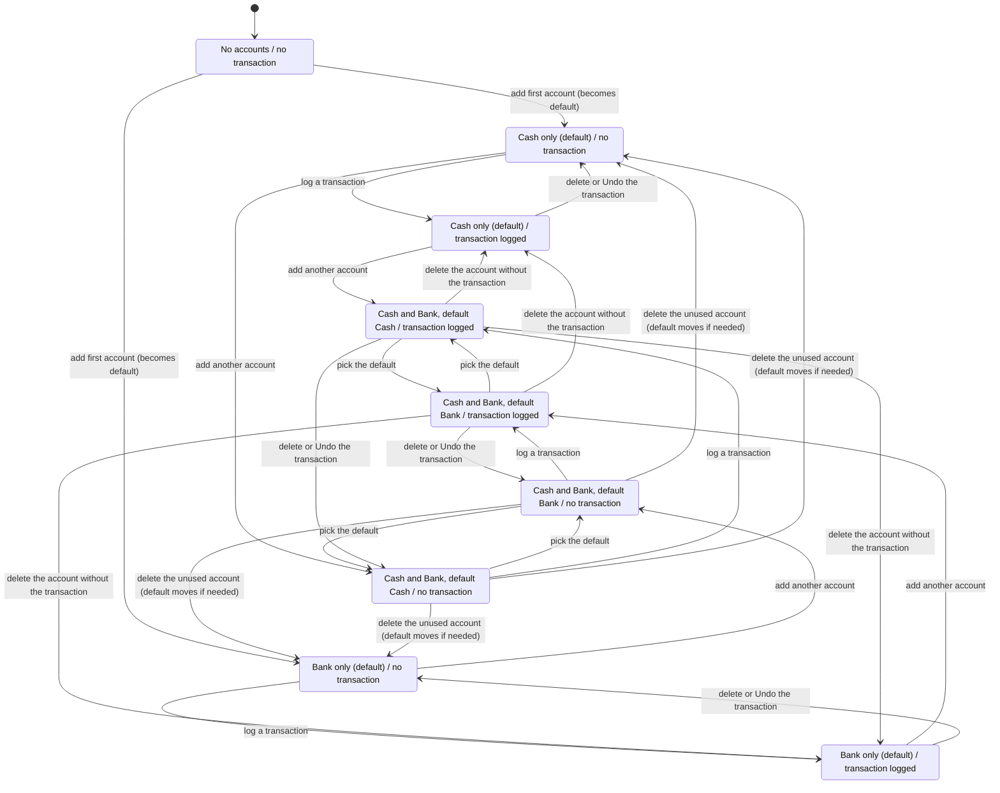

# Ledger state machines (accounts and transactions)

Source: `src/lib/store.ts` at commit `c006c65`. Verified model and replay: `.claude/skills/verify-ledger/`.
Scope: one user's financial accounts, the default account, transactions and categories. Bills, debts, goals, assistant follow-ups and auth have their own documents.

## Inventory

### Financial account set (implicit machine)

State: the user's accounts and which one is default (`financial_accounts.is_default`, mirrored in `users.default_account_id`).

| From | Action (code) | To | Guard |
| --- | --- | --- | --- |
| no accounts | `createAccount` | one account, default | name 1-80 chars, type cash/bank |
| has accounts | `createAccount` | one more account | same; first-account check `isDefault = no row exists` |
| any | `setDefaultAccount` | default moves | account owned; clears all, sets one |
| any | `updateAccount` | balance set by adjustment | owned; adjustment keeps balance = requested value |
| ≥2 accounts | `deleteAccount` | account removed, default re-picked if it was default | not used by a bill, count > 1, no transaction history |
| 1 account | `deleteAccount` | rejected | "Keep at least one financial account." |

Schema guard: partial unique index `accounts_one_default` (created in `migrate`) allows at most one default; the code makes it exactly one.

### Transaction row

State: kind (`income`, `expense`, `transfer`, `debt_repayment`), source (`manual`, `assistant`), `undo_until`, `debt_id`.

| Action | Code | Guard |
| --- | --- | --- |
| create manual or assistant row | `createTransaction` | manual kinds only; `assertTransactionInput`: owned source, transfer needs a different owned destination and no category, income/expense need an owned category of the same type |
| create debt-linked repayment | `recordDebtPayment` | open debt owed to you, amount ≤ balance; source assistant, never undoable |
| edit | `updateTransaction` | same shape checks; cannot become `debt_repayment`; a debt-linked row cannot change kind or amount |
| delete | `deleteTransaction` | not debt-linked; Undo only for assistant rows with `undo_until` in the future (10 s) |
| time passes | `undo_until` expires | Undo rejected after that |

Balances are not stored: `listAccounts` = opening + adjustment + income + debt repayments − expenses − outgoing transfers + incoming transfers. `assertLedgerTotalsSafe` rejects any write that would leave a total outside the safe integer range.

### Categories

`createCategory` and `updateCategory` only add or rename; `type` never changes and there is no delete route, so a transaction's category type cannot drift. Duplicate names are rejected by `UNIQUE(user_id,type,name)`.

## Key flow chart: accounts, default account, one transaction

Generated from `Ledger.tla` with the small bound (2 accounts, 1 transaction slot). Hidden: editing a transaction and the ten-second Undo expiry (neither changes any state shown). "Cash" and "Bank" stand for the two accounts.

Reading the chart: an account that has a transaction can never be deleted (no arrow from s7 or s8 removes the account the transaction uses); deleting the default always hands the default to the survivor; the last account is never deleted (no arrow into s0 after s0).

## Findings

No rule broken. With 2 own accounts, 1 foreign account, 2 transaction rows (128,545 states) all six rules hold, and a 300-walk replay of 25 actions on the real store agrees with the model on every accept/reject and every balance.

Observations (not bugs):
- "Exactly one default" is enforced by code only; the database index guarantees at most one. A direct SQL write could leave none.
- Debt-linked rows can still change account and date through `updateTransaction`; the model allows it and the balances follow.
- Not modeled: overflow guard, bills' side of the delete-account guard, concurrent requests.

## Rerun

Use `/verify-ledger` (`.claude/skills/verify-ledger/SKILL.md`).
