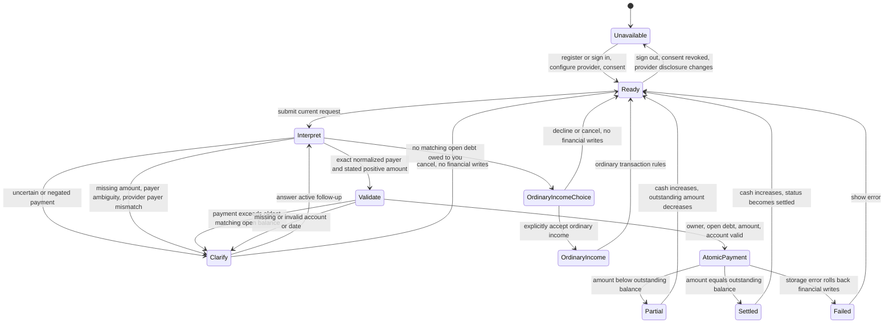

# Ask Tally received debt repayment

This chart describes the current incoming principal repayment flow. It is a reference model, not an executable model or a proof of parity with the implementation. The browser journey lives in `.agents/skills/verify-tally/`.

## State and guards

The repayment candidate contains the owner, exact normalized payer, oldest matching open `owed_to_you` debt, explicitly stated amount in integer minor units, account, and Manila date and time. Follow-up context belongs to the active request. An unrelated completed turn must not supply a payer or amount.

`src/lib/assistant.ts` owns interpretation and clarification. `src/lib/provider.ts` supplies typed tool suggestions. The server treats those suggestions as untrusted. Counterparty names and formatted balances belong in JSON-escaped untrusted context, never the provider system prompt.

`src/lib/store.ts` owns `recordDebtPayment`. Before either financial write persists, it validates debt ownership, direction, open status, positive amount, balance limit, and account ownership. One atomic operation records the category-free `debt_repayment` transaction and its linked debt payment and updates the debt. A storage failure must leave all financial records unchanged. Assistant conversation messages may still be written during clarification or failure.

## Observable outcomes

- A partial payment increases the selected account balance and reduces the open debt by the same amount.
- A full payment sets `status=settled` and retains the last positive outstanding amount. The UI labels that retained amount as the last outstanding balance. Status is authoritative.
- Repayments contribute to cash flow and repayment totals, while income and spending remain unchanged.
- Repayment cards have no generic Undo. Linked transaction deletion requires deleting the debt first.
- Negated or uncertain wording, ambiguous counterparties, provider mismatch, missing details, and excessive payments ask without changing financial records.

## Verification boundaries

The browser journey proves registration, account and debt creation, provider consent, rejection paths, amount clarification, partial payment, settlement, ledger display, and persistent SQLite changes. It stubs only the external Chat Completions provider. It does not prove a live model's language interpretation, concurrent requests, or every transition above.

Run the existing provider, assistant route, and debt storage suites for the deeper context, ownership, and rollback contracts. The chart is descriptive and can drift. Update it and the feature map when behavior changes.
